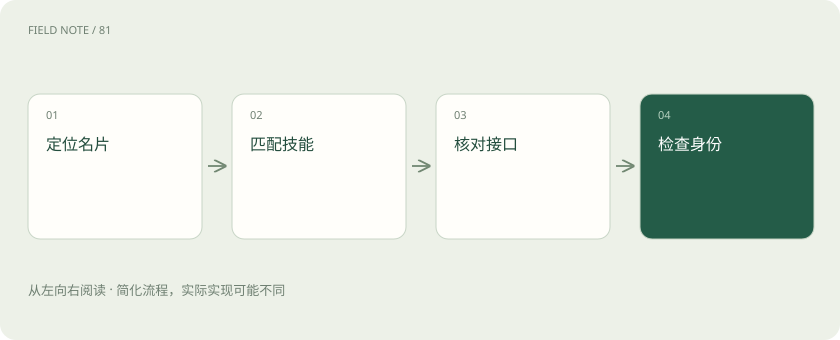
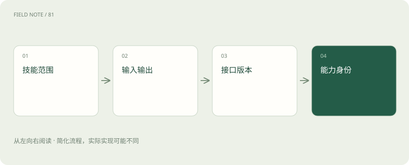
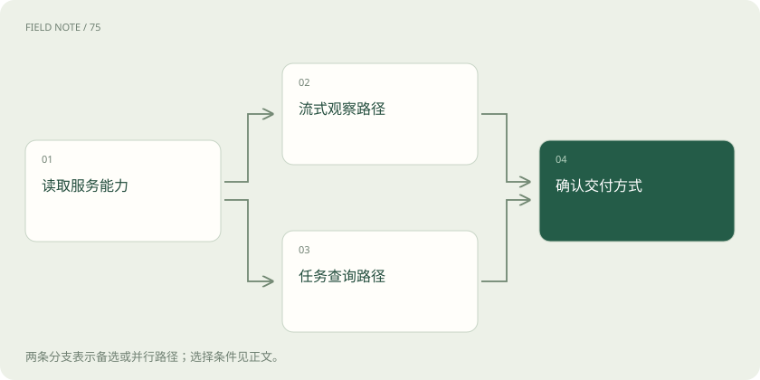

# A2A 发现：从代理名片到可协作契约

> 从 AgentCard 的技能、输入输出、接口版本和可选能力判断能否交接工作，区分能力声明与访问授权。

专题：协议与技能 · 整理于 2026-11-05

## 前置阅读

- [MCP、A2A 与 Skills：接口、委派和方法为什么要分开](stack-protocols.md)

## 先用一个类比理解

像选择跨机构承办窗口：服务目录指路，名片说明受理范围，证件与授权决定能办理什么。

类比只帮助建立直觉，不等同于完整机制。

## 一图看懂

## 先明确协作对象

A2A 面向独立代理应用之间的交流：一方提出工作，另一方依自己的内部方法执行。调用者不必获得对方的提示词、模型链或工具实现。本文于2026年11月5日核对官方 latest 页面，标示的最新已发布规范为1.0.0；接口协商使用1.0，不能把代理自身软件版本当成协议版本。采购助手把供应商材料交给风险评估助手，就是跨应用工作交接，而不是直接接管对方内部工具。

业务人员应保留原始需求与选择依据，后续更换承办方时才能判断服务范围是否仍然匹配，避免只因响应速度更快就改变任务含义。

## 与工具连接如何分工

MCP 常用于应用连接工具、资源与提示模板；A2A 描述代理之间的消息和任务协作。风险助手内部可以使用MCP查询登记信息，再通过A2A返回分析。两者可以组合，不能说接入A2A就替换全部工具接口。若真正需求只是查询一个确定字段，普通业务接口也可能足够，增加代理层会引入任务状态、身份传递与质量评价成本，应根据工作的自主性选择边界。

例如对方输出风险摘要以后，本地工具仍需查询订单状态；代理的判断与订单数据库事实应分别核实，再形成最终采购建议。

## 发现地址与发现能力

发现可以从已知位置、登记目录或预先配置开始。目录给出候选服务，AgentCard帮助理解服务宣称的能力，这两个步骤都不是全网自动搜索保证。采购部门登记一个评估服务时，应记录运营者、资料用途和维护责任。若地址来自供应商附件，即使页面能返回合法名片，也应先核对组织归属，不能把文件中的指令当成公司信任名单。

目录管理员需要规定失效地址如何下线、运营方变化如何复核。服务搬迁不应使旧域名继续成为可信资料接收方。

## 读懂AgentCard的层次

AgentCard包含服务说明、技能、输入输出模式、能力与受支持接口等信息。先问它是否覆盖供应商评估，再看接受文本还是文件，最后核对能否交付需要的结构化说明。技能名称与标签便于选择，不能视为经过认证的绩效。描述写着“专家”也不代表适合所有法域；应要求范围、时效和证据来源，使路由依据能够被业务人员审查。

输入模式是通信承诺的一部分。服务接受PDF并不意味着能够识别扫描件中的所有数字，仍需用代表性资料确认实际处理质量。

这里的 AgentSkill 是 AgentCard 内描述代理服务技能的对象，帮助调用者选择工作和理解输入输出；它不是 Agent Skills 生态的 SKILL.md 文件。后者通常是客户端按需加载的任务说明与资源。名称都含 skill，不意味着发现远程代理会下载并执行一份技能文件。

## 协议版本与接口绑定

1.0 的 supportedInterfaces 将地址、protocolBinding与protocolVersion关联。客户端要选择双方都理解的接口，不能只比较软件版本数字。官方规范要求按请求版本处理，不支持时返回版本错误。采购系统升级后若只保留旧消息解析器，即使HTTP通道正常仍可能读错内容；特别是1.0对多态对象表示有变更，应按目标版本验收，而非复制旧教程字段。

迁移评审应保存一份双方支持矩阵，包含绑定、协议版本与扩展需求。只有实际交互通过，才能宣布某一组合可用。

## 能力声明怎样影响计划

streaming与pushNotifications等能力会影响观察任务的方式。客户端只有同步等待界面时，不应因为服务端支持推送就自动创建公网回调。反过来，服务未声明流式能力时，计划应采用可支持的任务查询方式。能力协商的作用是限制双方预期，不是要求所有实现具备全部可选项；缺少能力可以降级，也可以清楚拒绝无法履行的交付要求。

若必需能力无法实现，应在发送大文件之前提示用户，减少已经泄露资料后才发现交付方式不兼容的无效操作。

## 公开卡与受保护细节

公开名片应避免泄露内部客户、系统地址或敏感技能；受保护的扩展名片可以在完成身份核验后提供更多信息。看到安全方案声明并不意味着已拿到凭据，更不意味着所有技能都对该用户开放。采购专员与审计人员可能看到不同细节，真正执行仍需检查资源和动作权限。缓存名片时也要考虑身份范围，避免把高权限结果展示给另一位用户。

扩展名片的获取过程也要留下安全审计记录，但记录应避免包含凭据。不同身份得到的能力目录不能共用无隔离缓存。

## 用失败案例验收发现

准备四种候选：名称相似但运营者错误、版本不支持、缺少输出模式、授权后技能仍不可用。合格系统应分别解释原因，而不是都显示“代理离线”。再让名片更新接口地址，观察缓存是否能安全刷新；刷新不能悄悄扩大资料接收范围。验收报告应记录选定版本、接口、必要能力和业务限制，最终路由才有可追溯依据。

验收需要同时观察用户提示和后台行为。显示版本错误之后若后台仍发送敏感资料，清楚的错误文案并不能弥补执行越界。

## 图解：从名片筛选到请求条件

这些检查共同限定可交接工作；声明能力不能替代业务授权。

## 图解：可选能力如何改变交付

从能力检查分为流式与查询路径，再汇合为交付方式选择；查询还需符合服务实际支持。

## 放在一起对比

| 检查层 | 读取什么 | 失败时怎么办 |
| --- | --- | --- |
| 业务技能 | AgentSkill范围与示例 | 排除不匹配承办方 |
| 输入输出 | 默认及技能模式 | 转换材料或拒绝交接 |
| 接口版本 | supportedInterfaces | 选择共同绑定与版本 |
| 能力与身份 | 能力声明和安全方案 | 降级或完成身份核验 |

## 真实场景

采购助手找到同名风险评估服务，但其AgentSkill只覆盖境内企业，输入只接受文本。用户提交海外供应商扫描件时，系统应在上传前判定范围与模式不匹配，并选择适合的承办方。

## 常见误区

将AgentCard中的AgentSkill误认成SKILL.md，或只凭名称路由，都会把服务声明与客户端技能加载混为一谈。

## 想一想

名片同时写着代理版本2.4.1和接口协议1.0，客户端应以哪个值判断协议兼容？

查看解释

按选定接口的protocolVersion与绑定判断兼容；代理自身version描述服务软件发布，不能替代协议协商。

## 关联阅读

- [MCP、A2A 与 Skills：接口、委派和方法为什么要分开](stack-protocols.md)
- [MCP 生命周期：从连接想象转向请求契约](mcp-session-lifecycle.md)

## 原始资料

- [A2A 1.0.0 官方规范（请求协议版本 1.0）](https://a2a-protocol.org/latest/specification/)
- [A2A 官方仓库](https://github.com/a2aproject/A2A)
- [A2A 官方任务生命周期](https://a2a-protocol.org/latest/topics/life-of-a-task/)

原创讲解；图示和类比经过简化，数字示例不代表实测。工具功能以对应版本官方资料为准。
