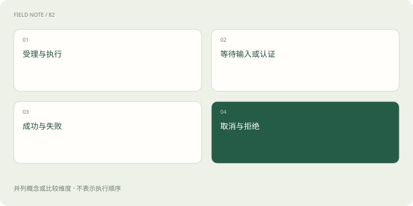
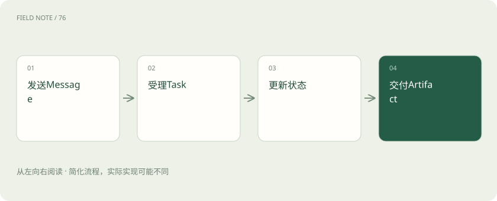
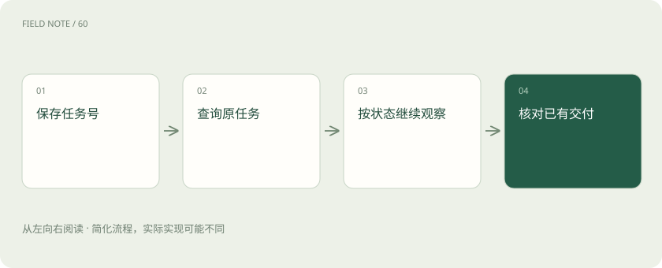

# A2A 任务：消息、状态与产物怎样交接

> 沿采购审阅理解 Message、Task、状态和 Artifact，处理等待输入、流式更新、断线恢复与取消的边界。

专题：协议与技能 · 整理于 2026-11-05

## 前置阅读

- [MCP、A2A 与 Skills：接口、委派和方法为什么要分开](stack-protocols.md)
- [A2A 发现：从代理名片到可协作契约](a2a-discovery.md)

## 先用一个类比理解

像有编号的审阅工单：往来消息补充条件，工单记录状态，附件报告承担正式交付。

类比只帮助建立直觉，不等同于完整机制。

## 一图看懂

## 消息并不总会变成任务

本文依据官方1.0.0规范，协议版本为1.0。Message是双方交流内容，Task是带标识与状态的工作单元，Artifact是交付产物。简单问题可能直接返回消息，复杂审阅才需要持续任务；客户端不能假设每次发送都产生新任务。采购助手询问支持哪些语言，与提交二百页供应商资料不是同一种工作，应分别展示即时回答与可持续跟踪的审阅。

返回即时消息的场景也要说明是否已经执行工作。确认收到材料与确认完成评估应使用不同表述，防止接收方提前推进审批。

## 关联任务与上下文

任务标识用于定位具体工作，上下文标识用于关联一组相关互动。它们不能替代业务订单号，更不是标准化长期记忆。一次采购可以有资格审查与交期评估两个任务，属于同一业务背景，却不能相互覆盖状态。日志应保留这些标识与业务关联，而不是把全部客户原文复制到每个日志点；恢复界面时也要重新核对当前用户是否能访问该任务。

业务关联表应允许一个业务对象对应多个任务，并记录每个任务的资料范围，不能用最新任务覆盖早期审查的证据链。

## 状态需要按语义理解

为方便阅读，下文使用 submitted、working、input-required 等状态语义简称，不是 1.0 JSON 的字面枚举取值；例如当前等待输入的取值是 TASK_STATE_INPUT_REQUIRED。

submitted与working描述受理和执行，input-required表示需要补充输入，auth-required表示需要身份相关处理。completed、failed、canceled、rejected表达不同结束结果；不能都压成“已完成”。供应商资料缺少营业期限时，请求补充比编造日期更合理。界面应显示谁需要行动以及缺少什么，用户没有回复时也不能持续宣称任务正在有效分析。

等待输入时应明确有效期和负责人员。过期后是终止还是重新发起属于产品政策，需要向用户说明，而不是让状态无限悬挂。

## 产物不是一段聊天气泡

Artifact承载任务交付，可以由不同Part表达文本、文件或结构化内容。消息中的进度说明不能自动视为最终报告。风险助手说“发现两处疑点”可能只是过程交流，最终产物还应说明证据、范围和待确认事项。接收方需要核对文件是否可访问、结构是否完整以及资料时点；协议能够运送文件引用，却不能保证引用永远有效或文件里的判断正确。

分块交付时还需区分追加与替换，避免把修订报告叠在旧内容后形成冲突结论。最终阅读版本应能够定位对应产物。

## 流式更新如何呈现

流式交付可以传递状态和产物更新，降低等待期间的不透明感。客户端应区分状态事件与产物事件，并按更新语义维护当前视图；收到一个片段不代表完整报告。网络断开也不能直接把任务标成失败，因为服务端可能仍在执行。采购系统应显示连接中断和最后已知状态，随后查询任务或按支持方式订阅，避免用户误以为必须重新提交材料。

用户关闭页面与取消任务是不同动作。系统应说明后台是否继续运行，并在重新打开时展示当前状态而非旧页面截图。

## 推送与查询的职责

推送适合客户端无法一直保持连接的场景，但依赖服务支持与回调配置。回调接收方要验证来源、限制内容并处理重复交付，不能让任何通知直接改变采购审批。查询适合确认权威任务状态，通知可作为刷新提示。具体传输、重试与认证策略需要按所用绑定和部署约定核对，不能把“支持推送”宣传成保证恰好一次、永久可达的业务消息系统。

回调地址变更也应经过受控配置。把用户随手提供的任意地址用作推送目标，可能把任务存在性或敏感摘要发送给第三方。

## 取消是请求而非时间倒流

取消任务要由服务判断是否还能取消，可能失败或任务已结束。已经发出的邮件、完成的外部登记和产生的成本不会因状态变为canceled自动撤销。采购审阅若只是生成报告，停止剩余分析可能足够；若已通知第三方，则需要单独业务补偿。界面应同时呈现取消处理结果与已发生动作，使用户不会把停止后续工作理解为全部影响消失。

若取消请求遇到完成竞争，用户应看到权威最终状态。不能只因为本地按钮已经点击，就隐藏其实已经交付的报告。

## 恢复要先识别未知结果

超时之后最危险的是直接重发有副作用的工作。应先利用已保存标识查询原任务，确认它究竟仍在运行、已交付还是不可访问。若记录已被清理，产品必须说明保留限制，不能承诺无限恢复。用断网、重复通知、取消与完成竞争、输入补充后再次执行四类案例验收，分别检查是否重复建任务、丢产物、误报完成或串用另一任务的材料。

恢复测试还应覆盖任务不可见的情况：未找到可能源于保留期，也可能是权限不足，界面不应泄露其他用户任务是否存在。

## 图解：消息、任务与产物交接

展示产生任务的审阅路径；简单交互也可能直接返回消息。

## 图解：断线后恢复观察

先查询原任务，再按权威状态继续观察或核对交付；图只展示仍在执行后完成的一条恢复路径。主图并列归类状态，不代表合法转换。

## 放在一起对比

| 对象或机制 | 采购审阅中的作用 | 需要核对的边界 |
| --- | --- | --- |
| Message | 提问与补充营业资料 | 未必创建新任务 |
| Task | 跟踪本次资格审阅 | 状态不等于报告质量 |
| Artifact | 交付风险报告与证据 | 区分片段与完整版本 |
| 查询与订阅 | 断线后观察原任务 | 不能假设无限保留 |

## 真实场景

二百页审阅在网络断开后仍继续执行。采购助手保存了taskId，重连后查询发现任务已完成，于是获取已有报告并核对产物完整性，避免再次提交产生第二份收费审阅。

## 常见误区

把流连接断开当作任务失败，或把点击取消当作已经撤销外部通知，都会使界面状态与真实业务后果不一致。

## 想一想

用户没有收到报告却遇到超时，为什么不能立即重新发送同一审阅？

查看解释

原任务可能仍在运行或已经完成；应先用保存的任务标识查询结果，再决定是否需要重新发起，尤其要防止重复副作用。

## 关联阅读

- [MCP、A2A 与 Skills：接口、委派和方法为什么要分开](stack-protocols.md)
- [MCP 生命周期：从连接想象转向请求契约](mcp-session-lifecycle.md)

## 原始资料

- [A2A 1.0.0 官方规范（请求协议版本 1.0）](https://a2a-protocol.org/latest/specification/)
- [A2A 官方仓库](https://github.com/a2aproject/A2A)
- [A2A 官方任务生命周期](https://a2a-protocol.org/latest/topics/life-of-a-task/)

原创讲解；图示和类比经过简化，数字示例不代表实测。工具功能以对应版本官方资料为准。
