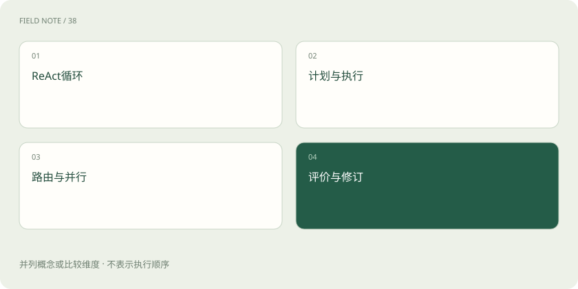
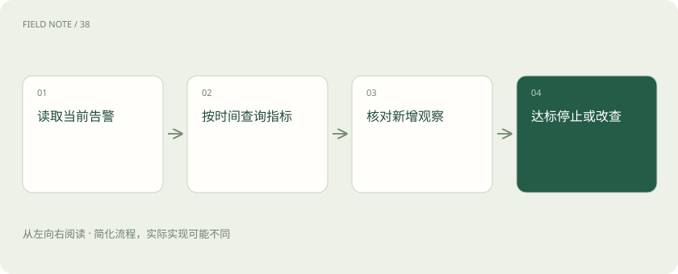

# 智能体设计模式：按任务结构选择控制方式

> 依据任务的不确定性与依赖关系，选择 ReAct、计划执行、路由并行和评估修订，并设计停止条件。

专题：智能体 · 整理于 2026-11-05

## 前置阅读

- [ReAct：让下一步行动受观察结果约束](stack-react-pattern.md)
- [Agent 和工作流：从回答问题到执行任务](agent.md)

## 先用一个类比理解

模式像不同会议组织方式：分组调查、轮流修订和统一调度分别解决不同协作问题。

类比只帮助建立直觉，不等同于完整机制。

## 一图看懂

## 模式是选择工具而非等级表

设计模式描述如何组织调用、反馈和控制权，并不存在所有团队共同认可的固定八种或十九种全集。固定流程适合步骤可预知的工作，动态 Agent 适合下一步依赖新观察的工作。应先识别不确定性在哪里，再增加相应机制；把全部模式叠在一起会引入额外延迟和难以定位的交互。

选型可以从固定规则开始：是否需要外部反馈、步骤是否可枚举、子任务是否独立。三个问题能排除许多不必要的复杂设计，也使成本增加有明确业务理由。

## ReAct 用观察修正下一步

ReAct 将任务决策与环境动作交替进行：提出需要的证据、调用工具、读取观察，再决定继续还是结束。例如设备排障先查告警，再依据时间范围读取指标，而不是一次猜出全部原因。生产轨迹可记录简短的行动目的和结果，不需要展示模型隐藏推理。每轮必须有新观察或明确状态变化。

如果连续两轮都调用相同查询且没有新增证据，应识别为停滞。此时可以改变查询范围或报告资料不足，而非把循环次数当成投入程度的证明。

## 计划执行分离适合可检查步骤

Plan-and-execute 先形成任务清单和依赖，再逐步执行。它适合资料收集、校验、汇总等结构稳定但细节不同的工作。计划只是可修订假设：某份数据缺失时，应标记依赖受阻并调整范围，而非照单生成不存在的结果。计划越细维护成本越高，验收条件比漂亮的步骤编号更重要。

执行器应报告每步的真实状态，而不是机械推进编号。只有依赖已经满足才进入后续步骤，这让计划既能提供结构，也能对环境变化作出响应。

## 路由把不同请求送往不同处理器

Routing 先判定任务类别、风险与所需能力，再选择流程或模型。常见边界是查询事实、生成草稿与修改业务对象。分类置信不足时可以澄清或进入保守流程，而非强行分配。路由器若使用含糊类别，会把权限问题误当作语言问题，因此类别需要可观察的输入条件和失败兜底。

例如售后请求中，查询保修期与批准退款需要不同权限。路由决定进入哪条流程之后，执行阶段仍需核验订单归属，不能把分类结果当作最终授权。

## 并行适合彼此独立的工作

Parallelization 可以同时检查多个独立来源或从不同标准审阅同一草稿。收益来自等待时间重叠，代价是调用成本和汇总冲突。计算总额依赖行数据清洗，就不能和清洗结果独立并行；两个分支若共享错误来源，也不能把一致意见当作独立证据。汇总需要记录各分支覆盖范围。

并行分支的输出应包括事实、来源和不确定性，方便汇总时发现分歧。只提交一句赞成或反对，会让编排者无法判断意见来自不同证据还是相同偏差。

## 编排者与工作者处理动态分工

Orchestrator-workers 让编排者根据任务决定子任务，再合并工作者产物，适合起初无法枚举所有调查方向的分析。每个工作者应有边界、输入与交付格式，避免重复研究和状态冲突。编排者负责整体约束与冲突处理，不能因为多个工作者都完成局部目标就推断整体任务已经完成。

共享数据最好通过受控状态传递，工作者不要相互覆盖同一产物。否则一个分支修订的依据可能被另一个分支旧结果覆盖，最终报告虽然完整却无法追溯。

## 评估优化需要外部标准

Evaluator-optimizer 或反思循环先生成，再依据明确标准指出问题并修订。例如检查报告是否覆盖四个必填字段，比要求“再聪明一些”更可验收。自我批评也可能重复原有盲点，因此事实与计算需要独立工具或证据校验。反思通常改变本次上下文和输出，并不自动更新权重或形成自主持续学习。

可以让检查器只审查引用是否支持对应句子，另一工具核对数字。把评估标准拆成可操作条件，比让同一模型对整体质量打一个分数更能定位可修订问题。

## 循环必须有结束条件

设定最多三次修订、同一错误连续两次无改进就升级处理，能阻止无效反复。成功应由产物标准决定，如来源齐全且数值校验通过；失败则留下缺口与最后状态。对于固定字段提取，单次结构化调用可能已经足够；只有观察确实改变下一步时，动态循环才提供值得其成本的灵活性。

选择模式后仍应与简单基线比较，例如单次检索加模板生成。如果任务成功率没有改善，却增加多轮等待，就没有理由仅因架构看起来先进而继续保留。

## 图解：设备排障中的反馈路径

ReAct 的下一步依赖新观察；无新增信息时应调整查询或停止，而非机械重复。

## 图解：智能体设计模式的关键检查

评估反馈只驱动产物修订，停止点由质量门槛和预算共同限定。

## 放在一起对比

| 责任环节 | 具体判断依据 | 对应处置 |
| --- | --- | --- |
| ReAct 用观察修正下一步 | ReAct 将任务决策与环境动作交替进行：提出需要的证据、调用工具、读取观察，再决定继续还是结束 | 例如设备排障先查告警，再依据时间范围读取指标，而不是一次猜出全部原因 |
| 并行适合彼此独立的工作 | Parallelization 可以同时检查多个独立来源或从不同标准审阅同一草稿 | 收益来自等待时间重叠，代价是调用成本和汇总冲突 |
| 评估优化需要外部标准 | Evaluator-optimizer 或反思循环先生成，再依据明确标准指出问题并修订 | 例如检查报告是否覆盖四个必填字段，比要求“再聪明一些”更可验收 |

## 真实场景

发票字段抽取采用单次结构化输出；跨系统差旅核对先路由再检索；供应商材料范围未知时由编排者拆解调查。三者根据不确定性选择不同组织方式，无需统一使用多智能体。

## 常见误区

多个评审者如果依赖同一错误资料，一致意见仍不能证明事实正确。

## 想一想

反思循环会自动改变模型权重吗？

查看解释

通常不会。循环改变本次输入和产物；权重更新需要另行设计训练与验证流程。

## 关联阅读

- [Harness：让模型持续工作的运行环境](harness-runtime.md)
- [上下文工程：在有限窗口里保住关键事实](context-engineering.md)

## 原始资料

- [Anthropic：上下文工程](https://www.anthropic.com/engineering/effective-context-engineering-for-ai-agents)
- [Anthropic：构建有效智能体](https://www.anthropic.com/engineering/building-effective-agents)
- [Anthropic：长期任务 Harness](https://www.anthropic.com/engineering/effective-harnesses-for-long-running-agents)

原创讲解；图示和类比经过简化，数字示例不代表实测。工具功能以对应版本官方资料为准。
