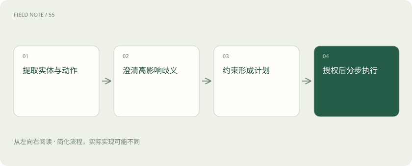
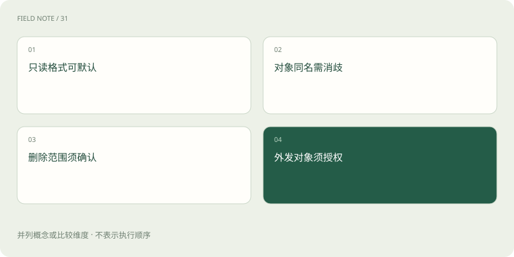
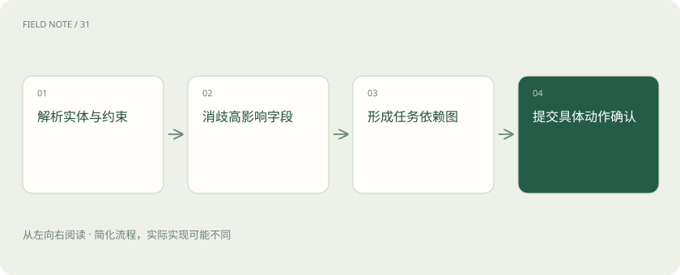

# 从模糊请求到可执行计划

> 把一句含糊的工作要求，拆成明确条件和有先后顺序的步骤。

专题：智能体 · 整理于 2026-11-05

## 先说这篇在讲什么

同事说“把上季度重点客户整理好”，听起来是一件事，实际藏着很多未说明的选择：哪些客户、哪个季度、整理成什么、交给谁。智能体要先把这些意思变成能检查的条件，再安排查询和制作报告。影响对象或实际操作的含糊处必须弄清，否则做得再快也可能交错人、改错记录。

## 先看一个具体例子

“清理异常账户”先变成异常清单，再确认是标记待复核、停用还是删除。对象和动作确定以后，才能安排对应操作。

## 遇到陌生概念，可以先读

展开前置阅读建议

- [计划与停止：智能体怎样避免一直忙下去](agent-planning.md)

## 先用一个类比理解

像接蛋糕订单：先弄清人数、日期和口味，再安排制作与配送。

类比只帮助建立直觉，不等同于完整机制。

## 一图看懂

## 听懂一句话还不够开始做

经理说“把上季度重点客户整理好，发给相关人”。人们在熟悉的团队里可能靠默契理解，助手却不能把猜测当作约定。“整理”可能是写报告，也可能是改客户系统；“相关人”可能包括同事，也可能包括外部伙伴。

意图解析就是把这句话中真正想完成的事拆清楚。至少要明确对象是谁、要做什么、覆盖什么时间、产物是什么、有哪些限制。给请求贴上“客户管理”的分类标签，只说明它属于哪类事情，还不足以确定可以调用哪个工具、修改哪条记录。

## 先认准要处理的是谁

假设名单里有两家都叫“华东商贸”的公司。助手即使准确理解要统计销售额，也可能拿错公司的数据。实体是任务里具体的人、公司、订单等对象；实体消歧就是把同名或别名对应到唯一记录。

可以先读取获准查看的客户名单，结合地址、客户编号和所属集团区分对象。编号比名称更适合提交给查询工具。若仍无法区分，就应展示候选项及差异，让用户明确选择。名字看起来合理、接口也接受参数，并不能证明选中的业务对象正确。

## 把时间和范围写成可核对条件

“上季度”可能指自然季度，也可能指公司财务季度；“重点”可能按成交额，也可能按已经批准的名单。两种解释会产生不同结果。助手可以先查已有说明，找到明确口径；找不到时要保留未知，不能悄悄选择自己熟悉的一种。

把客户范围、日期起止、统计指标、接收人和允许动作分别记录下来，就是结构化任务条件。结构化只是让每项含义有固定位置，方便检查，不要求用户写程序。若要求全公司客户但账号只允许查看华东区域，要明确说明覆盖缺口，不能把目标当作扩大访问权限的理由。

## 只问会改变结果的关键问题

报告用蓝色还是灰色标题，通常可以按现有模板决定；到底发送给内部经理还是外部合作方，会改变交付对象和数据范围，必须明确。好的澄清应说明不同答案带来的差异，让用户容易判断，而不是扔出一大串抽象字段。

等待收件人明确期间，可以继续准备已获准的销售汇总，因为这一步不依赖收件人。需要发送的步骤则保持等待。用户只补充“按自然季度算”，意味着时间条件已经确定，不能顺带解释成收件人也已确定。每个已确认条件都应保存在任务记录中，供后面步骤使用。

## 查询、写草稿、发送分开判断

查客户成交记录、生成内部报告草稿、正式把附件发出去，是三种不同动作。它们需要的数据和权限可能不同。系统应在执行前按动作及内容选择相应处理方式，这种分流叫路由；不能仅因为用户语气坚定，就跳过业务权限检查。

数据合并后也可能改变可见范围。例如单独一张公司介绍可以公开，加入报价和采购计划后就成了内部材料。因此发送前需要检查最终产物。遇到某条记录无权查看时，应标出缺失或缩小范围，而不是换一个工具尝试绕过原来的限制。

## 用先后关系排出真正的计划

报告可以这样制作：先确定名单和日期，然后读取成交记录与服务记录，再合并分析，最后生成草稿。成交与服务记录互不依赖时，可以同时查询；汇总则必须等待所需数据准备好。把步骤和这些等待关系画出来，就是依赖图。

依赖图的箭头表示“后一步需要前一步产物”，并不是装饰性的顺序。如果服务记录暂时取不到，可以先完成销售部分，同时注明服务分析缺失。恢复后只补做受影响部分，不必重新查询全部数据。这样计划既方便解释进度，也能避免某一步失败后整份报告照常生成、却偷偷缺了内容。

## 工具收下参数不代表业务正确

接口可能要求开始日期、结束日期、客户编号等固定字段。描述字段名称、类型和允许值的约定叫schema，可以理解为工具的填写说明。系统应按这份说明检查，防止把日期填成文字描述、把客户名称填进编号栏。

但格式检查只能解决部分问题。日期写得完全合规，仍可能选错财季；客户编号真实存在，仍可能属于另一家公司。因此还需要把参数与前面确认的任务条件核对，并检查调用者权限。返回空数据时，也应检查是否筛选条件不符或查询失败，不能马上宣布客户没有成交。

## 交付时说清楚实际做到哪一步

最终交付要让用户看见报告版本、覆盖期间、客户范围和已知缺口。若任务包含发送，还要明确具体收件人和附件，并按适用授权执行。已经授权的动作可继续做；产物或对象发生实质变化时，要重新判断原授权是否仍然适用。

“草稿已完成”“发送请求已被系统接收”和“收件人已经收到”是不同状态。助手只能报告有依据的那个状态，不能用一句“已处理”混在一起。用户取消后，还要停止尚未执行的动作；已经排进队列并不意味着可以忽略新的任务要求。

## 图解：高影响歧义的风险判断

并列比较不同歧义的处置：可逆格式可采用默认，业务对象与高影响副作用必须明确。

## 图解：从模糊请求到可执行计划的关键检查

只有消除会改变风险或操作对象的歧义，依赖步骤才能继续。

## 放在一起对比

| 责任环节 | 具体判断依据 | 对应处置 |
| --- | --- | --- |
| 一个企业歧义案例 | 经理说“把上季度重点客户整理好，发给相关人” | 上季度可能指自然季度或公司财季；重点可能按营收或战略名单；相关人可能包含外部伙伴 |
| 风险路由先于操作 | 同一意图可分为只读汇总、草稿生成和正式发送三个风险阶段 | 路由依据业务动作、对象敏感度及权限，而非用户语气是否坚定 |
| 工具选择需要多重验证 | 模型可依据工具说明与输入输出 schema 提出候选调用；系统还必须验证必填字段、类型、枚举、实体标识和权限 | 客户名称不能直接当作唯一 ID，应该先消歧再查询 |

## 读完先记住这一句

先弄清对象、动作和范围，计划才有可执行的依据。

## 常见误区

把系统接受参数误当作任务理解正确；工具能查到一家同名公司，也可能查错对象。

## 想一想

收件人尚未明确时，哪些工作可以先做？

查看解释

可以继续完成已授权、且不依赖收件人答案的数据查询和草稿制作；发送以及依赖发送范围的内容选择，应等待对象明确。

## 关联阅读

- [Harness：让模型持续工作的运行环境](harness-runtime.md)
- [上下文工程：在有限窗口里保住关键事实](context-engineering.md)

## 原始资料

- [Anthropic：上下文工程](https://www.anthropic.com/engineering/effective-context-engineering-for-ai-agents)
- [Anthropic：构建有效智能体](https://www.anthropic.com/engineering/building-effective-agents)
- [Anthropic：长期任务 Harness](https://www.anthropic.com/engineering/effective-harnesses-for-long-running-agents)

原创讲解；图示和类比经过简化，数字示例不代表实测。工具功能以对应版本官方资料为准。
