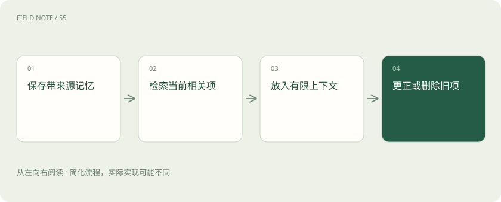

# 智能体记忆：上下文、笔记与长期存储

> 分清模型眼前能看到的内容，与系统另外保存的历史资料。

专题：智能体 · 整理于 2026-11-04

## 先说这篇在讲什么

你把朋友的地址存在手机里，下次寄快递时仍要打开通讯录，找到地址并填进订单。智能体的长期记忆也是这样：资料保存在外部，需要取回并放入本轮输入，模型才能使用。聊天保存得再多，也不表示每次回答都能看见全部历史；记错、过期或取错人的资料都会影响结果。

## 先看一个具体例子

用户只说“这次报价用欧元”，系统保存为本次报价的要求；下次做人民币月报时，不应把这个临时选择当成永久偏好。

## 遇到陌生概念，可以先读

展开前置阅读建议

- [Agent 和工作流：从回答问题到执行任务](agent.md)

## 先用一个类比理解

桌面文件可以立即阅读，档案柜里的文件要先找出并放上桌。

类比只帮助建立直觉，不等同于完整机制。

## 一图看懂

## 存在柜子里，不等于正在读

假设你以前让助手用美元做报告，今天希望它延续这个习惯。系统可能把要求存进数据库，但本轮模型未必看见那条记录。上下文指本次实际送给模型的内容，包括当前要求、选入的历史和工具结果；外部保存的资料则属于长期记忆。

模型本轮能使用的内容受输入容量限制。因此保存全部聊天记录，与把全部聊天记录放进本轮上下文，是两件不同的事。记忆系统要负责把相关材料找回来，而不是期待模型凭空知道档案柜里存了什么。

## 先挑相关笔记，再带进本轮输入

制作报告时，系统可以先查找与报告格式、币种相关的记录，再把选中的内容加入当前上下文。这个按当前需要寻找资料的过程叫检索。检索可能漏掉记录，也可能找到过期内容，所以保存成功并不能保证每次回答都采用正确偏好。

记录最好带有来源、时间和适用范围，并区分用户明确要求、已核实事实和临时猜测。为了节省空间，系统还可能把历史写成摘要；摘要会压缩内容，也可能丢失“只限本次”等条件。遇到冲突时，应能回看原话，而不是把摘要当作永远准确的结论。

## 新要求要能纠正旧记录

用户后来改口：“从这个月起，月报统一用人民币。”系统应记录这次修改的时间与范围，让新的月报偏好覆盖旧要求。不能把美元和人民币两条偏好都当成永久有效，再随机取一条。临时要求“这份海外材料用美元”也不一定改变所有月报的默认值。

这类更新需要管理外部记录，不是模型自己长出了新的知识。通常的记忆写入不会更新模型权重，也就是训练形成的内部参数。当前任务的明确要求还应与历史记录一起核对，避免旧笔记压过用户此刻已经说清楚的要求。

## 允许查看、更正与删除

若某人临时借账号查一次从上海出发的车票，不能据此把上海永久写成账号主人的居住地。可以把它记为本次行程信息，并设置适当期限。猜测若反复被取回，容易看起来像已经证实的事实，因此写入应比临时回答更谨慎。

用户需要能够查看、更正和删除相关记忆。系统还要按身份限制可见范围，不能把甲的资料用于回答乙的问题。删除和纠错也要覆盖实际保存的相关记录；只在这次回答里说“我忘记了”，并不等于外部存储已经完成处理。

## 放在一起对比

| 方式或概念 | 主要作用 | 关键边界 |
| --- | --- | --- |
| 上下文 | 本轮实际输入 | 容量有限 |
| 长期记忆 | 外部保存与检索 | 可能过时 |
| 摘要 | 压缩历史信息 | 可能丢失条件 |

## 读完先记住这一句

外部保存的信息，只有进入当前上下文后才能供本轮使用。

## 常见误区

把“已经保存”理解成“每轮都能看到”，或把一次临时情况写成稳定的个人事实。

## 想一想

系统保存了报告币种，为什么下一次仍可能用错？

查看解释

那条记录可能没有被检索进当前上下文，也可能已过期、与新要求冲突或缺少适用范围。应检查取回和更新过程，不能只检查有没有保存。

## 关联阅读

- [Token、上下文和幻觉：为什么它会忘，也会编？](tokens-context.md)
- [RAG：让模型先查资料，再组织答案](rag.md)
- [计划与停止：智能体怎样避免一直忙下去](agent-planning.md)

## 原始资料

- [memory](https://docs.langchain.com/oss/python/concepts/memory)
- [LangGraph · Memory](https://docs.langchain.com/oss/python/langgraph/memory)

原创讲解；图示和类比经过简化，数字示例不代表实测。工具功能以对应版本官方资料为准。
