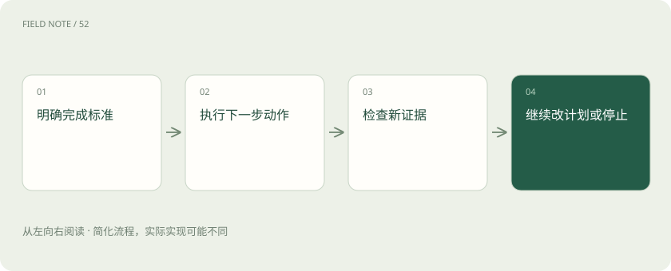

# 计划与停止：智能体怎样避免一直忙下去

> 先约定做到什么程度算完成，再把任务拆成几步；每拿到一个结果，就检查还需不需要继续。

专题：智能体 · 整理于 2026-11-04

## 先说这篇在讲什么

让助手“查一下这张工单处理完没有”，它查到系统显示已关闭，就该给你结果。如果它又不停搜索相关说明，你只会等得更久。计划解决先做什么、后做什么；停止条件解决做到哪里就够了。两者一起设计，才能让助手既不漏掉任务，也不一直忙下去。

## 先看一个具体例子

整理报销材料时，先给已有发票分类并算出合计。发现少了一张交通票，就列出缺失项和对应日期；不能猜金额补上，也不能声称已经可以提交。

## 遇到陌生概念，可以先读

展开前置阅读建议

- [Agent 和工作流：从回答问题到执行任务](agent.md)

## 先用一个类比理解

像出门买菜，清单告诉你买什么，购物完成或预算用完告诉你何时回家；清单还有空位不等于必须继续花钱。

类比只帮助建立直觉，不等同于完整机制。

## 一图看懂

## 先说清楚什么叫做完

用户说“查查工单关了没有”，完成标准就是拿到工单系统中的当前状态，并告诉用户查询结果。用户说“把工单关闭”，完成标准则需要包含真正执行关闭以及确认结果。这两个请求只差几个字，实际工作却不同。先把目标说清楚，再拆步骤，能避免助手做了一大堆事，最后交付的却不是用户需要的东西。

## 把清单当作可以修改的路线

计划可以先写成：找到工单、查询状态、整理回复。执行时若发现编号对应两张不同系统的工单，就先确认对象；若查询结果已经包含所需状态，就直接整理回复。计划是在当前信息下准备的路线，不是不可更改的命令。每走完一步，都要问新结果让目标更近了吗，还缺什么；不要只因为编号排到了下一项，就机械地调用下一个工具。

## 遇到失败，先看继续有没有用

工单接口偶尔超时，可以在允许的次数和总时限内重试；连续返回无权限，则反复请求通常不会解决问题。系统应区分“这次没查成功”和“工单不存在”：前者只是缺少证据，不能拿来支持后者。停止条件可以包括目标达成、预算用完、重复失败或需要人的选择。停止时也能交付部分结果，比如已确认工单存在，但当前账号无法查看处理状态。

## 把没完成的部分交代清楚

如果还需要用户决定，给出实际选项及影响，例如提供可访问账号，或请工单负责人补充状态。不要只写一句“无法处理”。继续执行时，原先的范围也要保留：查状态失败不意味着可以擅自修改工单，更不意味着能改查无关人员的数据。完成应当能用外部结果验证，失败也应能说明卡在哪里。这样用户才知道下一步要补什么，而不是面对一份看上去很忙却没有结论的执行记录。

## 读完先记住这一句

计划安排下一步，完成标准决定这一步是否还有必要。

## 常见误区

步骤全部打勾不代表任务完成，工具超时也不代表事情永远办不成。要分别看执行结果、完成标准和能否继续。

## 想一想

只要求查工单状态，系统已返回“已关闭”，还要继续分析关闭原因吗？

查看解释

通常不用。先报告已关闭，并注明查询来源；分析原因是另一个目标，除非用户原本也要求解释。

## 关联阅读

- [工具可靠性：接口成功为何仍可能办错事](agent-tool-reliability.md)
- [智能体记忆：上下文、笔记与长期存储](agent-memory.md)
- [多智能体协作：分工收益与协调成本](multi-agent-coordination.md)

## 原始资料

- [building effective agents](https://www.anthropic.com/engineering/building-effective-agents)

原创讲解；图示和类比经过简化，数字示例不代表实测。工具功能以对应版本官方资料为准。
