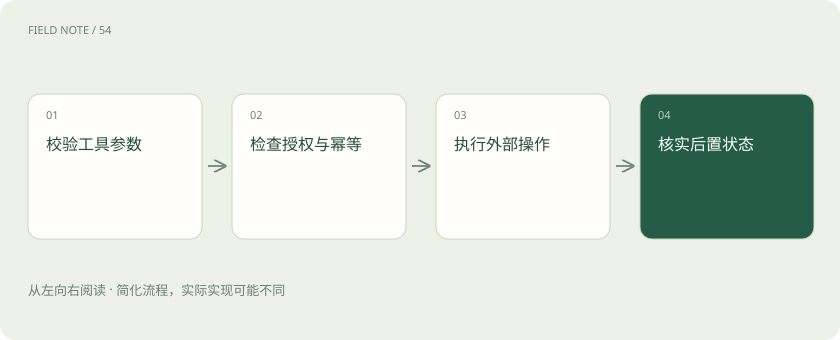

# 工具可靠性：接口成功为何仍可能办错事

> 工具调用包含参数生成、权限检查、外部执行和结果解释。

专题：智能体 · 整理于 2026-11-04

## 前置阅读

- [MCP、API、Skill：三个词，三种职责](mcp.md)

## 先用一个类比理解

像快递单显示已接单，仍需确认地址正确、包裹真正送达。

类比只帮助建立直觉，不等同于完整机制。

## 一图看懂

## 概念边界

工具调用包含参数生成、权限检查、外部执行和结果解释。接口返回成功只能说明某一步按协议完成，不能证明操作对象、时间范围或业务目标正确。模型需要检查关键字段与后置状态。

## 内部怎样运作

查询通常可以安全重试，创建或付款等动作则需要幂等标识与状态核查。超时可能意味着结果未知，而不是执行失败。错误信息应保留可诊断线索，避免模型把失败结果写成成功通知。

## 把机制放进具体场景

创建工单请求超时后，服务端可能已经创建成功。若立刻再发一次，就可能产生重复工单。使用稳定的幂等标识，或先查询操作结果，再决定是否重试，才能把“未知”逐步变成可确认状态。

## 取舍与容易忽略的限制

工具边界应同时描述输入约束和结果含义。只告诉模型“能更新订单”不够，还要明确允许变更哪些字段、何时需要额外授权，以及返回状态代表已受理还是已完成。对具有外部副作用的动作，应保留可追踪的操作标识，使后续核对不依赖模型对自然语言成功提示的猜测。

## 真实场景

查询库存成功后再下单，库存可能已经被其他订单占用。下单工具仍需在服务端重新校验，不能因为前一个查询显示有货就跳过业务检查。

## 常见误区

工具描述是能力约定，不能代替服务端权限验证和业务校验。

## 想一想

超时是否可以直接解释为操作没有发生？

查看解释

不能，超时仅表示未及时获得结果，外部副作用可能已经发生。

## 关联阅读

- [MCP、API、Skill：三个词，三种职责](mcp.md)
- [重试与熔断：故障时怎样避免越救越忙](retry-circuit.md)
- [计划与停止：智能体怎样避免一直忙下去](agent-planning.md)

## 原始资料

- [tools](https://modelcontextprotocol.io/specification/2025-06-18/server/tools)

原创讲解；图示和类比经过简化，数字示例不代表实测。工具功能以对应版本官方资料为准。
