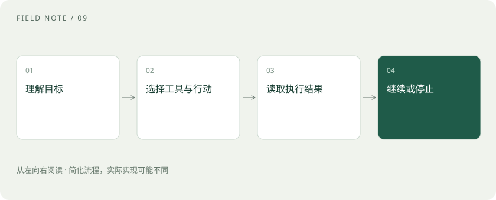

# Agent 和工作流：从回答问题到执行任务

> 工作流按事先写好的步骤执行；Agent 则让模型根据眼前结果，参与选择下一步要做什么。两者可以放在同一个应用里。

专题：智能体 · 整理于 2026-11-04

## 先说这篇在讲什么

你让聊天机器人“找出这个月花钱最多的项目”，它如果只解释怎么查，任务还得你来做。如果应用允许它查询账单、读取结果，再决定要不要补查，它就开始具备 Agent 的工作方式。这里的关键不是它说话像不像人，而是模型能否参与选择行动，以及程序能否把行动真正执行出来。

## 先看一个具体例子

分析月度费用时，程序先查询账单。若结果发现云存储费用突增，模型可提出继续查存储明细；若数据库拒绝访问，就应说明缺少数据，不能编造分析结论。

## 遇到陌生概念，可以先读

展开前置阅读建议

- [提示词：把需求说明白，比背咒语更有用](prompt.md)

## 先用一个类比理解

工作流像菜谱，先把主要步骤写好；Agent 像带着工具箱处理故障，先检查，再根据检查结果选择工具。这个比喻只说明执行方式，并不表示模型具有人类意识。

类比只帮助建立直觉，不等同于完整机制。

## 一图看懂

## 先看一个真正需要行动的问题

假设你说：“帮我分析本月费用，指出增长最多的三个项目。”普通问答可以告诉你分析方法，但拿不到账单就无法完成这件事。要继续往下做，应用需要提供查询账单的程序，并允许模型提出查询请求。收到数据后，模型还可以根据结果决定是否补查某一项明细。这种让模型参与选择行动的系统，通常称为 Agent，中文常叫智能体。这个名称描述一种应用组织方式，并不代表模型有自己的意愿。先分清目标、工具和返回结果，后面的设计就容易理解了。

## 工作流把主要路线提前写好

另一种做法是事先写好：查询账单、按项目汇总、计算环比、生成报告。每次都沿着这些步骤运行，这就是工作流。它也能使用模型，比如最后一步让模型把数字解释成自然语言，所以“用了大模型”并不能用来区分工作流和 Agent。真正的区别在于下一步由谁决定：主要由预设程序安排，还是让模型根据现场信息参与选择。对于数据格式稳定、步骤清楚的费用报表，工作流往往已经够用，运行过程也更容易检查。

## Agent 适合路线会变化的任务

如果费用突然增长，下一步查什么可能取决于异常类型。存储费用上涨要看容量和请求量，计算费用上涨则可能要查机器时长。把所有分支提前列完有时很费力，这时可以让模型根据已有结果提出下一次查询。注意，模型只是根据输入生成行动建议，实际是否允许查询，仍由应用决定。任务范围越开放，可能走的路径就越多，也越需要限制次数与费用。选择 Agent 应当是因为任务需要这种变化，而不是因为这个名字听起来更先进。

## 工具调用到底是谁在执行

工具可以理解成应用提供的一项具体能力，比如“查询指定月份账单”。模型通常输出工具名称和参数，例如月份为十月。应用检查参数格式、账号权限等条件后，再调用数据库或接口，最后把查询结果交回模型。这里至少有三个不同环节：提出请求、执行请求、收到结果。模型写出“已经查询”不等于数据库真的返回了数据。同样，模型生成转账参数也不等于资金已经转出。判断动作是否发生，要看负责执行的程序及其返回凭证。

## 每走一步，都要看刚才发生了什么

一个常见的执行过程是：给模型目标和当前资料，让它选择行动；程序执行后，把成功结果或错误信息放回输入；模型再决定继续查询、整理答案，还是停止。这里的反馈很重要。比如账单只覆盖前半个月，就不能直接当作整月数据；查询超时，也不能当作费用为零。程序应把这些差别准确传回来。模型下一轮能看到什么，取决于应用怎样组织输入，并不意味着它天然掌握全部历史。保留关键数据与错误原因，才能让后续选择有依据。

## 不用在固定和自主之间二选一

实际应用常把两种方式混在一起。比如先由程序按固定规则检查发票日期、金额和重复编号，发现异常后，再让模型解释异常原因，并提出需要补充的资料。清楚且必须一致的步骤交给规则，难以穷举的判断再考虑模型。自主性因此更像一个范围：模型可以只选择查询条件，也可以参与拆分多个任务。无论开放多少选择，都应该说清楚哪些步骤允许变化。这样既能应对不同情况，也方便发现错误究竟出在哪一个环节。

## 重试之前，先想会不会做两遍

网络超时后，重新查询账单通常问题不大，但重新下单可能造成两笔订单。为避免这种情况，系统需要考虑幂等性：同一个业务请求重试多次，仍只产生一次应有的结果。常见做法是为请求设置唯一编号，并在执行前检查是否已经处理。次数限制和费用预算也要由程序落实，不能只在提示词里写“别查太多次”。遇到会产生重要影响的动作，可以安排人工审核。审核的对象应是明确的动作和参数，让人能看懂接下来具体会发生什么。

## 怎样判断这个 Agent 值不值得用

先选一个具体任务比较效果：原来需要人工补查几次，现在是否减少；报告中的数字能否追溯到账单；失败后是否能说清楚原因。不要只看它生成了多少计划，或者调用了多少次模型。多 Agent 只是把工作分给多个角色的一种组织办法，还会增加信息传递、状态同步和错误传播的成本。如果一个模型配几个工具就能完成任务，未必需要增加角色。最终应当看任务是否完成、结果是否可靠、耗费是否合适，再决定保留多少自动选择的空间。

## 读完先记住这一句

Agent 的关键是让模型参与选择下一步，再用真实执行结果决定是否继续。

## 常见误区

把模型放进循环，并不保证任务做得更好。没有可用工具、真实反馈和停止条件，循环可能只是在重复生成计划。

## 想一想

费用查询工具返回超时，模型却写出“本月支出下降了”，这份结果能用吗？

查看解释

不能。超时没有提供本月账单，下降的结论没有数据支持。系统应先判断是否可以安全重试；若仍拿不到数据，就明确说明查询失败和缺少哪些信息。

## 关联阅读

- [智能体记忆：上下文、笔记与长期存储](agent-memory.md)
- [计划与停止：智能体怎样避免一直忙下去](agent-planning.md)
- [工具可靠性：接口成功为何仍可能办错事](agent-tool-reliability.md)
- [多智能体协作：分工收益与协调成本](multi-agent-coordination.md)

## 原始资料

- [Anthropic · Building effective agents](https://www.anthropic.com/engineering/building-effective-agents)

原创讲解；图示和类比经过简化，数字示例不代表实测。工具功能以对应版本官方资料为准。
