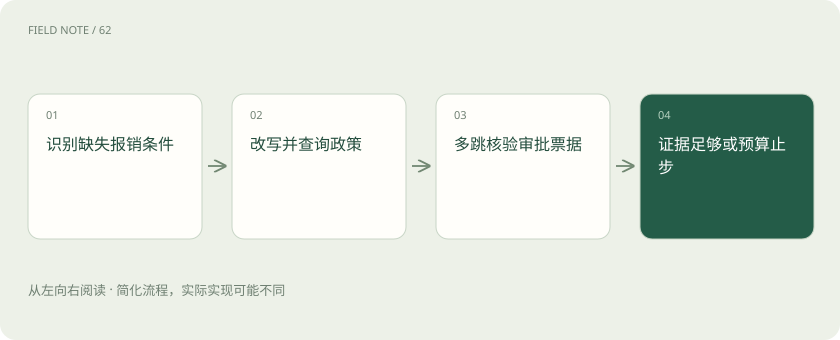
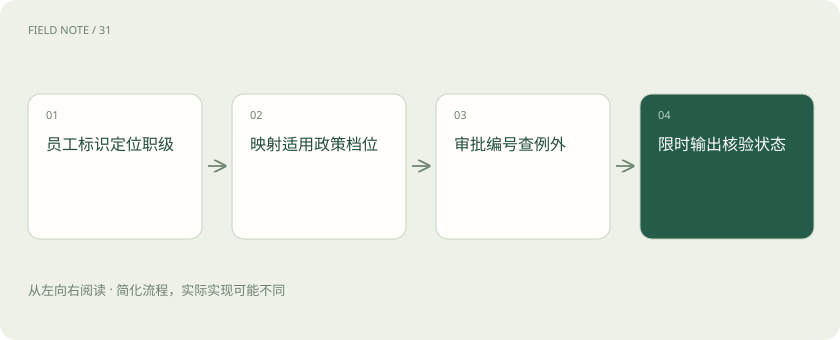

# Agentic RAG：让检索决策可停止

> 先列报销缺项，再选择查询，并在证据充分或预算到期时停下。

专题：AI 应用 · 整理于 2026-11-05

## 先说这篇在讲什么

用户问一句话，系统不一定马上知道该去哪里找答案。本篇用酒店报销说明：先找出缺少的条件，再决定问人、查政策或核对票据。每次查询都要带回有用的新信息；查够了就回答，查不齐也要及时停下，把还不知道的部分说清楚。

## 先看一个具体例子

深圳九月住宿：先补职级，查当期政策，再核对例外审批；三轮后仍缺审批就说明未核实。

## 遇到陌生概念，可以先读

展开前置阅读建议

- [RAG：让模型先查资料，再组织答案](rag.md)
- [Agent 和工作流：从回答问题到执行任务](agent.md)
- [Recall、MRR 与 nDCG：检索到底好在哪](retrieval-metrics.md)
- [让每个结论都有边界：RAG 的证据责任](deep-rag-evidence.md)

## 先用一个类比理解

像经办人按缺失凭证逐项核对，每拿一份材料都要有用途。

类比只帮助建立直觉，不等同于完整机制。

## 一图看懂

## 先从简单的住宿问题开始

员工问“深圳住宿每天最多能报多少”，系统可以先查公司政策，再依据查到的文字回答。这叫检索增强生成，简称RAG：先找资料，再组织答案。这样的固定两步容易检查，也容易预估等待时间。只有问题变成“这张发票到底能不能报”，需要结合职级、日期与审批，才值得让系统自己决定下一步动作。能自行选择查询路线的做法称为Agentic RAG。工具调用多并不代表能力强；简单问题仍应保留两步流程，作为以后比较效果的参照。

## 把不知道的条件列出来

拿到一张酒店发票，先别急着判断。逐项检查：住在哪个城市、哪天入住、员工是什么职级、有没有特殊审批。把条件写成清单，标出已经知道与尚未知道的部分。发票日期可以从票面读取，职级可以在得到授权后查员工系统，私人旅行目的则可能必须问本人。系统选择下一步的过程叫路由。好的路由会写明“查询九月深圳住宿政策”，而不是只说“继续研究”。相似案例不能代替这个员工的真实条件。

## 换个搜索说法也不能换问题

如果搜“酒店钱”没有结果，可以换成“住宿报销标准”。这种调整叫查询改写。改写时必须保留深圳、九月和具体年份；把九月改成“最新”就可能查到不适用的制度。操作时保存原问题、改写后的问题和返回资料，比较是否真的更接近答案。若结果全是旧政策，先检查日期筛选，而不是不停更换同义词。更稳妥的工具可以单独接收城市与生效日期，让这些硬条件不容易在改写中丢失。

## 连续查几处资料要能接得上

先查职级，再查该职级的住宿标准，最后查例外审批，这叫多跳查询。每一跳都必须有明确的连接依据，例如员工编号、政策版本和审批编号。不能因为名字相近就把另一个人的审批接过来。假如员工系统写P6，政策表却按M级分类，必须找到正式对应规则，不能直接认为P6就是第六档。每步保存输入事实和出处，后面的结论才有办法追溯；第一步接错人，后面即使查得再认真，也会沿着错误继续走。

## 工具返回了结果，还要检查含义

识别票据的工具返回金额800，并不等于已经确认能报800元。先看币种、小数点、日期单位以及调用是否成功。文字政策和票面识别结果也承担不同作用：前者说明规则，后者提供待核对的事实。工具说“没有匹配”，可能只是照片模糊，不能解释为票据造假，更不能解释为不准报销。模型提出调用请求后，需要由实际运行程序执行并检查返回状态；超时、无权限和空结果应分别记录，不能在最后的自然语言回答里混成一个否定结论。

## 第二次搜索必须有新的任务

查到普通标准后，仍不知道展会期间是否有例外，这时第二次查询有明确价值。若只是再搜一次“住宿上限”，返回同样的政策，就没有取得进展。可以在工作记录里保存已解决条件、已查版本、仍缺证据的事项，再检查新搜索是否补足其中一项。新增网页数量不等于新增独立证据，系统自称“更有信心”也不能代替进展。再次请求相同资料时，应说明这次要解决什么新问题。这是一种可以自己实现的管理规则，并非所有代理框架自带。

## 提前约定什么时候停下来

例如给一次咨询最多三轮检索、一次票据核验和一个总等待时间。这些数字只是练习设置，需要按业务调整。必要条件都已核实，就停止并给出有依据的答案；时间或次数用完仍缺职级，就说明目前只能判断政策范围，不能确认这张票能否报销。没有权限通常不能靠重复调用解决，临时超时可以有限重试，但仍受总截止时间约束。预算耗尽是系统没查完，不是政策不支持；已经超过用户等待窗口，也不应再偷偷启动昂贵的新查询。

## 用相同问题比较是否值得

准备一批相同问题，让固定两步流程与自主选路流程各跑一次。记录答案是否正确、等待多久、花了多少调用，以及额外动作是否真的解决了例外条件。再加入政策不存在、职级缺失、审批已经撤回的题目，观察系统能否正确追问或说明未核实。检查完整路线里的错误工具、无效改写和过早停止，不能只看最后的文字是否流畅。如果简单问题更贵却没更准，就让它继续走固定路径，把跨系统核验留给确实需要多步决策的问题。

## 图解：可中止的检索反馈

节点展示反馈决策的单次展开；仅有新缺口且预算允许才进入下一轮，否则直接交付，不形成无出口循环。

## 图解：多跳连接的约束

连接键失配会把正确工具结果拼成错误结论。

## 放在一起对比

| 对象或路线 | 处理依据 | 适用边界或检查点 |
| --- | --- | --- |
| 两步RAG | 固定先检索后回答 | 简单政策题 |
| 改写 | 保留城市日期职级 | 术语不匹配 |
| 多跳工具 | 明确连接键 | 政策与审批联合核验 |
| 停止 | 充分证据或预算到限 | 未决项必须披露 |

## 读完先记住这一句

每次查询都应填补一个明确缺口，并受时间与次数约束。

## 常见误区

把反复搜索当成认真，或把工具超时说成不能报销。

## 想一想

连续两次查询返回相同政策，还该继续吗？

查看解释

先说明仍缺什么。如果没有新目标就停止；若确实缺特殊审批，可在剩余预算内查对应编号。

## 关联阅读

- [把政策文件变成可追责的知识库](deep-rag-corpus.md)
- [从候选召回到证据上下文：检索是一场逐级筛选](deep-rag-retrieval.md)

## 原始资料

- [LangChain 检索概念](https://docs.langchain.com/oss/python/deepagents/retrieval)
- [LangGraph 记忆概念](https://docs.langchain.com/oss/python/concepts/memory)

原创讲解；图示和类比经过简化，数字示例不代表实测。工具功能以对应版本官方资料为准。
