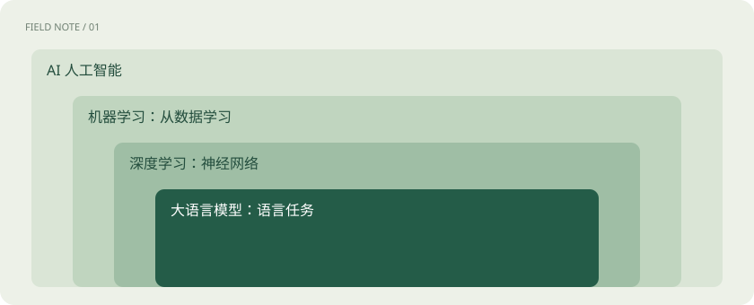

# AI、机器学习、大模型，到底是什么关系？

> AI 是一个大领域，聊天模型只是其中一种工具；聊天软件还要把许多工具组合起来。

专题：AI 基础 · 整理于 2026-11-04

## 先说这篇在讲什么

你用聊天软件写总结，用手机识别照片里的花，都可能用到了 AI。但它们未必用同一种方法。这篇先把几个常听到的名字摆清楚，再分清“模型”和“产品”，以后遇到新名词就更容易找到位置。

## 先看一个具体例子

一个客服助手：大模型组织语言，检索系统找订单，业务接口查询状态，页面展示结果。答得好是多个环节共同作用。

## 先用一个类比理解

把 AI 想成一个大工具市场：不同模型是不同工具，产品则把工具、界面和服务组合成你能使用的东西。

类比只帮助建立直觉，不等同于完整机制。

## 一图看懂

## 先从你见过的事情开始

手机认出照片里的猫，商店预测明天卖多少苹果，聊天软件帮你改一封信，这些都可以是人工智能的用途。“人工智能”，简称 AI，是这个大领域的名字，并不是某一款聊天软件的名字。

## 机器怎样从例子里学习

过去可以由人写规则，比如“温度超过某个值就报警”。机器学习则是另一条路：给机器许多过去的记录，让训练过程调整内部数值，找出能帮助判断新情况的规律。深度学习属于机器学习，使用多层神经网络处理信息；这个名字先认识即可，后面再讲它怎样计算。

## 大语言模型在这张地图的哪里

大语言模型是深度学习的一类应用，擅长处理和生成语言。它学习过大量材料，因而可以回答问题、写作和处理代码。但预测机器故障、识别图像，也可以用其他类型的模型完成，不必都交给聊天模型。

## 为什么同一个模型，在不同软件里体验不同

模型可以理解为一套已经训练好的计算系统。聊天软件还要提供输入框、历史记录、搜索、文件上传和账号管理。例如，你问订单到哪了，模型可能负责理解问题，订单接口负责查真实状态，页面负责显示。软件能查订单，不等于模型原来的参数里存着你的订单。

## 读完先记住这一句

先问系统要做什么，再区分其中的模型、工具和产品。

## 常见误区

“用了 AI”不代表它在每次使用时都持续训练；“模型更大”也不保证每一种任务都更好。

## 想一想

聊天网页和大语言模型是同一个东西吗？

查看解释

不是。网页是产品入口，大模型只是其背后的组成部分之一。

## 关联阅读

- [训练、微调与推理：学习和使用是两回事](training-inference.md)
- [Token、上下文和幻觉：为什么它会忘，也会编？](tokens-context.md)
- [AI 技术栈全景：市场上这些工具分别卖什么？](industry-stack.md)

## 原始资料

- [Hugging Face · LLM 入门课程](https://huggingface.co/learn/llm-course/chapter1/1)

原创讲解；图示和类比经过简化，数字示例不代表实测。工具功能以对应版本官方资料为准。
