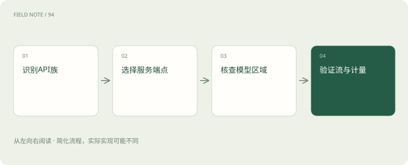
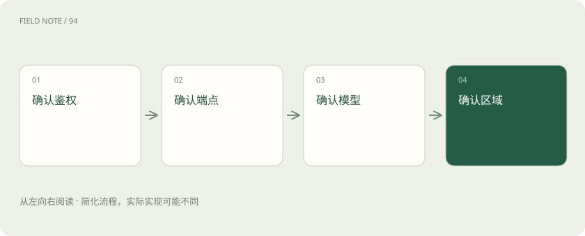
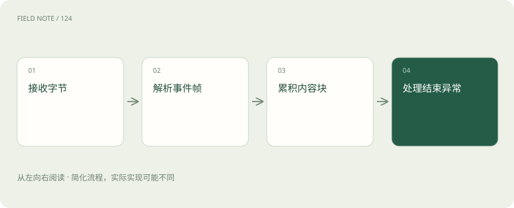

# Bedrock API族：从统一会话到端点能力矩阵

> 接入Bedrock，要同时选对接口、服务地址、模型和区域。

专题：接入平台 · 整理于 2026-11-05

## 先说这篇在讲什么

假设你要做一个客服机器人：用户输入订单号，机器人查订单再解释物流。接入Bedrock时，第一步不是把密钥填进代码，而是决定消息发给哪个服务地址、用哪种请求格式，以及谁来查订单。下面沿着这一条消息的去向，解释几个容易混淆的名称。

## 先看一个具体例子

客服后台选定区域和模型后，用Converse提交问题；收到查单请求，自己查询订单并回传结果，再展示模型解释。

## 遇到陌生概念，可以先读

展开前置阅读建议

- [模型 API 地图：先分接口、模型、平台与客户端](api-protocol-map.md)
- [推理网关：为什么企业不直接调用模型？](gateway.md)

## 先用一个类比理解

Bedrock像一个有多个窗口的服务大厅。窗口可以受理不同业务，即使都在同一栋楼，也不能拿同一张表直接办理所有事情。

类比只帮助建立直觉，不等同于完整机制。

## 一图看懂

## 先看消息要送到哪里

客服网页不会直接把汉字交给模型。后台先整理问题，再向Bedrock发送请求，Bedrock把请求交给选中的模型，最后把回答送回来。这里Bedrock是提供模型服务的平台；API是后台与平台约定的办事方式，包含发到哪里、提交哪些字段、怎样读取结果。

同个平台可以有多种API。官方当前列出的接口族包括Invoke、Converse、OpenAI兼容接口和Messages。OpenAI兼容接口又包含Chat Completions和Responses。因此，配置里只写“使用Bedrock”还不足以让程序知道该怎么发消息。

## 聊天记录怎样装进Converse

如果客服先问“订单号是多少”，用户再答“123”，后台必须让模型知道123指的是订单号。Converse提供共同的消息结构，把谁说了什么、有哪些内容块、生成设置放在相应位置。ConverseStream则按事件逐步返回结果，让页面能够陆续显示文字。

共同格式不等于功能完全相同。某个模型支持图片，另一个模型可能只接受文字；工具和缓存也要分别检查。后台还需要管理聊天历史，决定本轮带上哪些旧消息，不能指望选择Converse以后平台就自动永久保存全部对话。

## Invoke为什么要看模型说明

如果要使用模型特有的输入格式，可以走InvokeModel。请求外层用modelId指出要找哪个模型，body装真正的推理输入。body可以理解为寄件箱里的表单，它的栏目由具体模型规定，而不是所有模型共用一张表。

例如原来的表单把问题写在prompt里，新模型可能要求messages数组。只替换modelId，旧表单仍可能无法受理。图像生成、向量生成等任务也未必适合聊天接口。迁移时要一起检查内容类型、模型版本以及返回结果的读取方法。

## runtime和mantle是不同服务入口

服务地址决定请求进入哪个入口。bedrock-runtime与bedrock-mantle都属于Bedrock，但支持细节不能互相照搬。当前官方建议新应用考虑runtime；它提供Converse、Invoke及相应兼容入口。mantle也提供Responses、Chat Completions和Messages。

如果客服需要Responses里的服务端工具，区别就很实际：runtime的Responses同步执行且没有服务端工具，mantle面向包含服务端工具和异步推理等需求。Messages在runtime通过InvokeModel使用原生格式，在mantle有Anthropic原生入口。接口名字一样，不能据此推断地址与行为一样。

## 凭据证明身份，权限决定能做什么

后台需要凭据才能访问服务。SigV4是对请求进行AWS签名的方式；Bedrock API key则可以通过Bearer方式携带密钥。runtime和mantle都支持这两类鉴权，不能把其中一个叫作签名专用入口、另一个叫作密钥专用入口。

通过身份检查以后，还要有操作权限。runtime相关推理检查bedrock:InvokeModel，流式另涉及bedrock:InvokeModelWithResponseStream；mantle使用bedrock-mantle:CreateInference。API key有短期、长期类型及具体操作限制，双向流等能力应单独查阅。密钥有效仍可能没有目标资源权限。

## 逐步返回也需要先拆开包装

用户看到文字一点点出现，不代表网络每次送来一个汉字。ConverseStream和InvokeModelWithResponseStream使用AWS EventStream包装事件。后台先还原完整事件，再分辨它是文字、工具参数还是异常；SDK有时已经完成前一步。

不能把收到的二进制直接当作SSE的data文本行。假设查询参数分两次到达，后台要按调用归属拼好，等参数完成才执行查单。Bedrock的兼容接口还应按各自格式解析，不能因为平台相同就共用一个不加区分的解析器。

## 看到回答之前和之后都可能失败

请求可能因为权限不足、区域不支持模型、参数错误或额度限制而失败。即使HTTP已经成功建立连接，后面也可能出现流内错误。客服页面若只看开头的状态码，就可能把半句话显示成完成的回答。

费用统计也要认准来源。Converse普通响应有usage，流式可能在metadata事件里提供统计，原生Invoke和兼容接口则遵循各自说明。usage表示使用量，但缺少某项不能直接当成零。缓存量、输入量和输出量要保留各自含义，避免重复相加。

## 把选择变成可以检查的清单

做订单客服时，先写下四项要求：接受文字、允许应用执行查单工具、部署在指定区域、能够记录用量。再逐一核对接口、服务入口和模型是否同时满足。应用自己查订单时可考虑Converse；需要Responses服务端工具时再核查mantle对应支持。

最后保存模型标识、区域、入口、接口名称和检查日期。本文依据2026年11月5日已核验页面解释这些区别，并不是实际性能测试。以后模型目录变化，只需重新检查这些具体项目，就能知道旧方案是否仍然可用。

## 图解：接入四项交集

四项共同成立才形成候选调用路径。

## 图解：流适配次序

AWS原生流需要先解帧，再解释内容与计量。

## 放在一起对比

| 边界 | 承诺 | 核验对象 |
| --- | --- | --- |
| Converse | 统一消息结构 | 模型特性与消息类型 |
| InvokeModel | 提供商原生body | 具体模型输入输出 |
| runtime Responses | 同步且无服务端工具 | 目标区域与模型 |
| mantle Responses | 包含服务端工具等能力 | 工具与异步支持范围 |

## 读完先记住这一句

接入时把接口、入口、模型、区域和权限一起核对。

## 常见误区

在runtime收到普通文字，就认定mantle的服务端工具也已验收。文字成功只能证明这次文字调用。

## 想一想

两个入口都支持Responses，为什么还要比较？

查看解释

因为同名接口在不同入口的工具、同步异步等能力可能不同，还要同时核对模型与区域。

## 关联阅读

- [模型 API 地图：先分接口、模型、平台与客户端](api-protocol-map.md)
- [流式适配：从字节、事件到完整工具循环](api-stream-translation.md)
- [推理网关：为什么企业不直接调用模型？](gateway.md)

## 原始资料

- [AWS API兼容矩阵](https://docs.aws.amazon.com/bedrock/latest/userguide/models-api-compatibility.html)
- [AWS API与端点](https://docs.aws.amazon.com/bedrock/latest/userguide/apis.html)
- [AWS Converse](https://docs.aws.amazon.com/bedrock/latest/userguide/conversation-inference.html)
- [AWS API keys](https://docs.aws.amazon.com/bedrock/latest/userguide/api-keys.html)
- [AWS API keys限制](https://docs.aws.amazon.com/bedrock/latest/userguide/api-keys-reference.html)
- [AWS推理端点与鉴权授权比较](https://docs.aws.amazon.com/bedrock/latest/userguide/endpoints.html)

原创讲解；图示和类比经过简化，数字示例不代表实测。工具功能以对应版本官方资料为准。
