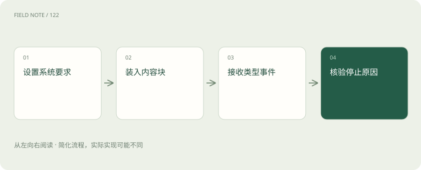
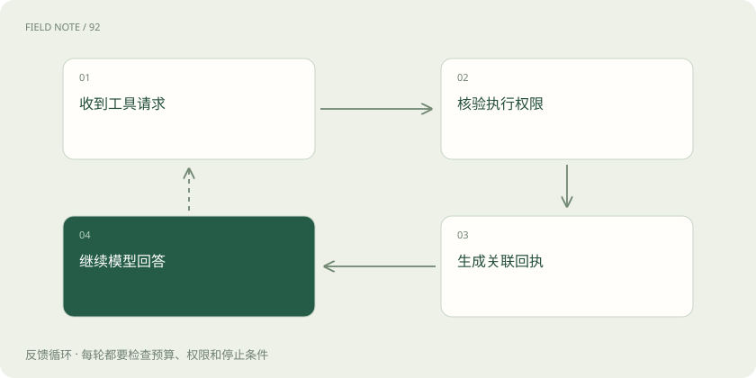
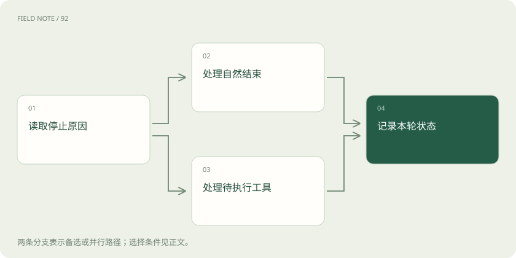

# Claude Messages：从内容块读懂工具与流式状态

> 掌握顶层 system、内容块、工具回执与 SSE 结束语义，识别文字已经出现却流程尚未完成的情况。

专题：接入平台 · 整理于 2026-11-05

## 前置阅读

- [模型 API 地图：先分接口、模型、平台与客户端](api-protocol-map.md)
- [上下文装配：决定模型这一轮看见什么](context-assembly.md)

## 先用一个类比理解

像一份带编号附件的交接单：正文、执行请求与回执各有位置，不能只抄第一段。

类比只帮助建立直觉，不等同于完整机制。

## 一图看懂

## Messages 是有类型的交接单

Claude Messages 的名字容易令人误以为，只要把另一个平台的 messages 数组原样发送就能接入。实际上，Messages 是一套完整的请求、内容块、停止原因和工具回执协议。顶层 system 承载系统要求，messages 主要使用 user 与 assistant 角色；不能照搬 OpenAI 风格的 system 消息。鉴权、版本头和模型参数也属于请求契约，平台界面里的聊天行为不能作为接口字段说明。

阅读一份调用记录时，先区分请求配置与对话材料，再查看各条消息中的 content。纯文本可以使用简写，但多模态输入、工具往返和思考相关内容需要按对应类型理解。验收重点不是页面有没有出现汉字，而是结构中的目标、限制、证据和执行结果有没有落在正确的位置。

## content 不是唯一一段回答

返回消息的 content 是内容块序列，可能同时含有文字、tool_use 或特定能力产生的其他块。只读取第一个 text 块，会漏掉后续说明或工具请求；把全部块转换成一段字符串，又会丢失类型与关联信息。界面可以只展示用户需要的文字，但供下一轮继续使用的记录应保留协议所需结构。

例如一次查询先给出“我需要核对库存”，再产生查询工具块。第一段文字只是解释，不能据此标记查询完成。审阅者需要看到块类型、排列顺序以及每个块属于哪次消息。遇到不认识的新类型，应按明确策略保留或报告不支持，而不是默默删除之后宣称兼容。

## 工具调用通过标识闭合

客户端工具由应用执行。Claude 在 assistant 的 content 中给出 tool_use，包含 id、名称和输入；应用检查权限与参数后执行，并在紧接着的 user 消息中返回 tool_result，通过 tool_use_id 指向原调用。它不是额外增加一个通用 tool 角色，也不能只回一句“执行成功”来代替关联。

同一轮可能请求多个工具，应完整收集并按规则回传对应结果，避免在工具请求与回执之间插入无关消息。失败应明确表达为失败回执，不能伪装成业务查询的空结果。调用标识解决的是结果对应关系，并不自动提供外部写入的幂等性；付款、发信等动作仍需独立防重与授权核对。

## stop_reason 决定下一步

收到返回对象后，还要检查 stop_reason。end_turn 表示本轮自然结束，tool_use 表示等待工具往返，max_tokens 表示达到输出限制；这些含义不能统一映射成“回答成功”。其他能力可能引入不同停止原因，应依据所用版本和功能文档解释，不能凭最后一句文字推断流程状态。

假设回答在一段看起来完整的句号后达到限制，也可能遗漏后续重要内容；反过来，模型请求工具时尚未提供最终答案，并不意味着接口失败。产品需要把正常结束、等待外部结果、截断与异常区分开，再决定是否展示继续按钮、执行工具或提示结果不完整。停止原因是控制信息，不是装饰性的日志字段。

## 流式接收依赖事件层级

Messages 流通常从 message_start 开始，随后按索引出现 content_block_start、content_block_delta 和 content_block_stop，再由 message_delta 更新消息级信息，最终以 message_stop 结束。期间可能出现 ping 或错误事件。文字片段、工具输入片段和思考相关片段有不同类型，不应全部追加到用户可见文本中。

一个工具输入可能分成多段 JSON 字符串到达，单段无法解析并不说明调用损坏。应按块索引积累，在具备完整结构且满足执行条件后处理；内容块停止也不等于整条消息停止。网络断开更不能充当 message_stop：此时应记录未完成状态，保留已收到内容并依据恢复策略处理，避免把半条指令当作可靠动作。

## usage 必须按字段语义记账

流中 usage 的位置和含义需要分别阅读。message_start 可以提供初始输入统计，后续 message_delta 的输出统计通常是累计值，不能把每次看到的 output_tokens 相加，否则一条消息会被重复计费式地放大。缓存相关计数字段也应按文档分类保留，而不是混成一个自定义总数。

排错时可以保留最终可确认的统计及其来源，并将中断流与正常完成流分开。若 SDK 提供最终消息聚合结果，可以使用其正式统计对象，同时核对异常路径是否真的形成了最终消息。界面字符数、收到的数据包数和模型令牌数不是同一种单位，不能互相替代；本文也不把任何字段推导成固定价格。

## 思考块与签名需要结构保留

启用相应思考能力时，返回中可能包含 thinking、签名或经过遮蔽的内容。签名用于协议完整性和后续处理，并不是要求应用解密内部推理。需要在后续请求中保留的思考相关块，应遵循当前功能文档整体原样回传；不能修改文本、拼接伪造签名，或把遮蔽内容替换成自己编写的解释。

用户界面展示的可公开摘要与协议记录承担不同责任。为了界面简洁隐藏某个块，不等于可以在工具循环历史中删除它；为了压缩上下文重新整理消息，也必须先核对该模式允许的转换。不能要求服务返回隐藏思维链来修复兼容问题。若中间代理只能保留文字，应承认对应功能存在结构缺失。

## 用纸面轨迹验收接入

不调用真实模型也能检查协议理解：准备一份用户问题、一条带文字与两个工具请求的 assistant 消息、两个对应回执，以及最后的正常结束消息，再分别标注角色、块类型、调用标识与停止原因。流式版本另外标出块开始、片段和消息结束位置，观察界面显示与流程状态是否一致。

验收应覆盖断线、输出截断、工具失败和未知块，确认不会把它们都展示成成功。官方 SDK 可以减少事件聚合工作，却不能替应用决定权限与业务完成标准。本文讨论的是原生 Messages；托管平台可能采用不同鉴权与版本安排，迁移时还要核对入口合同。所有示例都是教学轨迹，没有发起模型调用或读取任何凭据。

## 图解：工具回执闭环

继续回答可以提出下一批工具请求，形成可追溯的往返。

## 图解：结束状态分流

正常结束与等待工具两条路径都要更新状态，不能统一记为已完成。

## 放在一起对比

| 观察对象 | 原生表示 | 验收重点 |
| --- | --- | --- |
| 系统要求 | 顶层 system | 与对话消息分开 |
| 工具结果 | user 内 tool_result | 关联 tool_use_id |
| 流式完成 | message_stop | 断线不替代完成事件 |

## 真实场景

库存查询返回两个 tool_use 后，应用分别核验并回传带 tool_use_id 的 user 内容块，再等待最终回答结束。

## 常见误区

把文本出现当作整个消息完成，或把累计 usage 逐事件相加。

## 想一想

为什么 tool_result 不能只是一句未带标识的成功说明？

查看解释

模型需要通过 tool_use_id 将结果对应到具体工具请求；文字成功既缺关联，也不能说明实际执行范围。

## 关联阅读

- [OpenAI Chat Completions：消息、候选与工具往返](api-openai-chat.md)
- [OpenAI Responses：内容项、事件与会话状态](api-openai-responses.md)
- [流式适配：从字节、事件到完整工具循环](api-stream-translation.md)

## 原始资料

- [Claude Messages](https://platform.claude.com/docs/en/api/messages)
- [流式消息](https://platform.claude.com/docs/en/build-with-claude/streaming)
- [工具回执](https://platform.claude.com/docs/en/agents-and-tools/tool-use/handle-tool-calls)
- [扩展思考](https://platform.claude.com/docs/en/build-with-claude/extended-thinking)

原创讲解；图示和类比经过简化，数字示例不代表实测。工具功能以对应版本官方资料为准。
