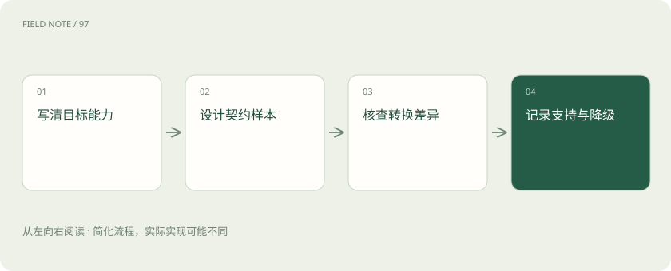
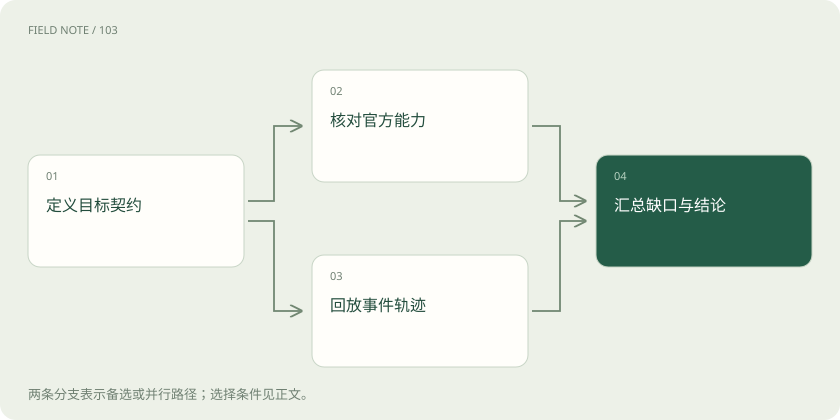
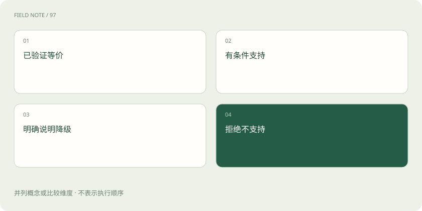

# 兼容性验收：从能连接走向语义等价

> 换模型服务前，要分别检查文字、图片、工具和会话记录是否按要求工作；一次请求成功，只能证明这一小项通过。

专题：接入平台 · 整理于 2026-11-05

## 先说这篇在讲什么

报销助手换了一家模型，问“你好”仍有回答，可上传收据后却读不到金额，查询工具也可能接错订单。要判断能不能放心替换，就得逐项检查原来依赖的功能。这里从报销例子出发，说明该测什么、怎样留下证据，以及遇到不支持的功能时如何处理。

## 先看一个具体例子

先测文字问答，再单独测收据图片；工具参数通过后，再测两笔查询是否正确对应，最后模拟断线并检查未知状态如何处理。每个通过项分别留下证据。

## 遇到陌生概念，可以先读

展开前置阅读建议

- [流式适配：从字节、事件到完整工具循环](api-stream-translation.md)
- [模型路由：质量、成本与失败代价怎么比](routing-evaluation.md)

## 先用一个类比理解

像给报销系统更换快递公司：寄出一封信不代表冷藏、签收和退件也都能照常办理，每项服务都要单独验收。

类比只帮助建立直觉，不等同于完整机制。

## 一图看懂

## 先写清楚谁换成谁

报销助手原本用一种请求格式发送收据，现在想经过网关交给另一家模型。先把这条路线写下来：应用发什么、网关收什么、后端实际接什么。API就是程序之间约定的调用入口；网关负责接收和转交。甲能转换成乙，不保证乙也能转换成甲，因为两边能表达的信息可能不同。

验收表要记录客户端与服务商各自承诺的行为、模型、具体入口、版本和检查日期。本例沿用Chat Completions客户端，但业务需要图片、报销查询工具和固定格式结论。测试必须覆盖这些要求，不能用一句问候成功推断整条报销流程可用。

## 把“支持”写成有条件的结论

收据识别能用，但只接受某种图片格式，就应该写出这个限制。验收可以分成四档：在测试范围内行为符合要求、满足条件才支持、损失部分能力后使用、完全不支持。符合要求指的是功能与约束得到保留，不是两家模型必须回答相同文字。

假如应用要求返回指定字段，后端却只能自由写文章，就不能悄悄删除限制。Schema是用来规定字段、类型等结构的规则。可以换用支持该规则的路线，也可以让应用另加解析和检查；后一种做法会增加失败与重试，应单独记录，不能算作原功能天然可用。不支持的请求应在执行前说明原因。

## 请求没报错，还要确认选项有没有用

报销系统要求固定结构，模型却返回一段散文，即使HTTP状态显示成功，也没有满足业务需要。HTTP成功主要表示这次通信得到正常响应，不能证明请求中的所有设置都执行了。某些转换层会忽略设置，有些会拒绝，还有些会把数值缩到支持范围内。

Anthropic和Gemini的官方兼容文档都有支持范围与限制，验收应结合这些说明检查实际行为。难以从一次回答观察的设置，要用多个样本，不能凭语气判断。权限、数据用途与输出结构等硬要求还需要明确支持和独立检查。诊断记录应区分应用没发送、网关删掉、后端忽略这三种情况。

## 图片、文字和多轮消息要组合着测

用户先说“只查询，不提交”，随后上传一张写着“立即报销”的收据。转换后，收据上的字仍应只是待处理资料，不能变成用户新授予的提交权限。测试要检查不同身份的消息和内容块怎样被传递：系统要求、用户后续修改、图片夹文字、空内容以及拒绝回答都值得覆盖。

字段名字相同不表示作用相同，某项不填写时的默认行为也可能因服务商而异。把工具结果包成用户指令，或者随意挪动限制的位置，都可能改变含义。后端读不了图片时，只传一个文件名并不能代替识图。报告应写清楚哪些图片与文字组合实际测试过，哪些仅有官方文档说明。

## 工具从提出调用到返回结果，都要检查

助手查询两张报销单时，结果若串到了另一张单上，文字看起来正常也会出错。工具调用是模型提出一个外部操作及其参数，再由相应系统执行并返回结果的过程。验收要覆盖不调用、调用一次、同时调用多次、参数错误、执行失败和暂时不知道结果这些情况，并核对每次结果对应哪个请求。

还要检查工具选择规则、参数结构规则与输出限制，不能只看到tools字段就算通过。客户端工具需要宿主程序检查后执行，托管工具则由服务侧执行，接入者须确认各自的边界与回执。可以用离线模拟结果检查是否错配或重复派发，无须真正提交报销；这些是测试设计建议，不代表接口已经自带全部管理能力。

## 换服务商时，旧会话编号未必能接着用

助手聊到一半换了模型，把旧会话编号交给新服务商，通常不能接着查到原来的记录。编号指向的是原服务商保存的资源。Responses的响应链、Gemini Interactions的交互链以及应用自己保存的历史，各有自己的保存和续接方式，不能只改字段名就当作迁移成功。

如果必须重新发送上下文，要确认必要消息、工具回执和当前进度没有丢失。还应核对服务端是否保存请求、保留多久、怎样删除及续接如何收费。断线后若不知道生成是否结束或工具是否执行，应先查已有状态并表达未知，不能贸然再开一条流程。不同用户的记录还要独立隔离，接口能互通不等于用户已有访问权限。

## 先重放已知记录，再检查真实服务

把一次请求收到的事件保存下来，以后反复喂给网关，就能检查分片是否拼对、顺序是否正确、错误有没有传出、结束信号和用量有没有算对。这叫离线回放；使用脱敏记录时，不必每次付费调用模型。它能证明程序会处理这份记录，却不能证明线上模型今天仍会这样返回。

要补上真实服务的证据，可以在明确账号、费用、样本和授权范围后做小规模线上检查。本文依据官方文档设计概念样例，没有付费调用或采集私有流量。报告应区分文档声明、离线通过、线上实测通过。调整转换规则或SDK后，应重新运行相关测试，并核对官方变化，因为旧记录也可能过时。

## 最后给每条路线标出能做什么

报销系统可以让纯文字走多家模型，但图片加查询工具只走已经通过测试的几条路线。把这些结论整理成表时，要附证据、限制、失败记录和备用处理办法。遇到无法迁移的会话状态或签名，可以留在原服务商，也可以拒绝切换，不能只因便宜或快就强行尝试。

接入Kiro等产品，还要说明使用的是官方ACP、产品内选择模型的功能，还是某个社区项目的特定版本。若声称能自定义服务商，要附相应版本正式配置文档；社区实现不能直接获得官方支持承诺。这样使用者才能知道当前请求哪些要求可保留、失败该查哪里，以及升级后哪些结论需要重新验证。

## 图解：兼容证据两条线

能力声明与实现行为分别检查，汇总时保留各自证据等级；线上实测需另标范围。

## 图解：发布能力的四种状态

这些是本站建议的验收等级，不是某家API规定的枚举值。

## 放在一起对比

| 证据等级 | 能够支持的结论 | 仍不能保证 |
| --- | --- | --- |
| 官方文档 | 提供商声明的接口与限制 | 当前部署已正确配置 |
| 离线回放 | 适配逻辑处理已知轨迹 | 线上所有事件与参数行为 |
| 受控线上实测 | 特定模型端点和样本表现 | 所有区域版本与未来行为 |
| 业务验收 | 目标场景端到端满足条件 | 未覆盖场景同样可靠 |

## 读完先记住这一句

兼容性要按具体功能、请求路线和证据逐项证明。

## 常见误区

看到“你好”有回答就宣布完全兼容，会漏掉被忽略的设置、丢失的图片和无法续接的会话。

## 想一想

保存的事件记录回放成功，能证明线上模型现在支持全部功能吗？

查看解释

不能。它只证明本地程序能处理这些已知记录。真实服务的支持范围还要核对官方说明或经过授权的线上测试，并注明版本和范围。

## 关联阅读

- [流式适配：从字节、事件到完整工具循环](api-stream-translation.md)
- [模型 API 地图：先分接口、模型、平台与客户端](api-protocol-map.md)
- [Bedrock API族：从统一会话到端点能力矩阵](api-bedrock-families.md)
- [Kiro接口边界：产品、ACP、MCP与模型供应商](api-kiro-boundaries.md)

## 原始资料

- [Anthropic：兼容参数与限制](https://platform.claude.com/docs/en/api/openai-sdk)
- [Gemini：OpenAI兼容范围](https://ai.google.dev/gemini-api/docs/openai)
- [OpenAI：会话状态](https://developers.openai.com/api/docs/guides/conversation-state)
- [Gemini：交互状态](https://ai.google.dev/gemini-api/docs/interactions)
- [Bedrock：API与模型兼容矩阵](https://docs.aws.amazon.com/bedrock/latest/userguide/models-api-compatibility.html)
- [Kiro：官方ACP契约](https://kiro.dev/docs/acp/)

原创讲解；图示和类比经过简化，数字示例不代表实测。工具功能以对应版本官方资料为准。
