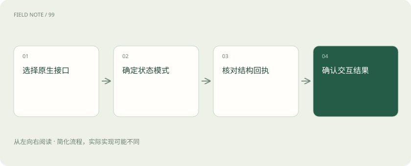
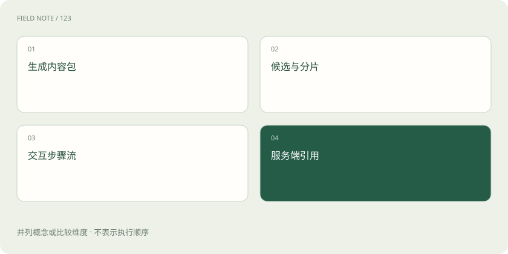
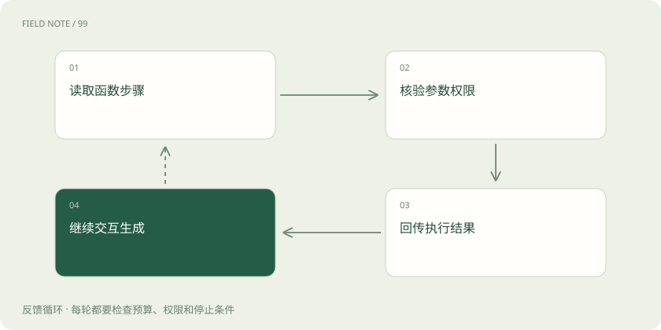

# Gemini 原生接口：区分生成内容与交互状态

> 读懂 Gemini 当前两条原生接口路径，分清材料、候选、交互步骤和历史保存方式。

专题：接入平台 · 整理于 2026-11-05

## 先说这篇在讲什么

给 Gemini 发问题时，你可能看到两套不同的字段：有的叫 contents，有的叫 input。这并不是随便改名，而是两种不同的办事方式：一种每次交齐材料，另一种可以引用此前保存的交互。本篇用查库存的例子说明如何选入口、读材料、返回工具结果，并避免在搬运历史时丢掉模型需要的签名数据。

## 先看一个具体例子

同样查询商品库存，Generate Content 记录函数 part 和 functionResponse，Interactions 记录函数步骤与结果步骤；迁移时逐件核对这些事项是否对应。

## 遇到陌生概念，可以先读

展开前置阅读建议

- [模型 API 地图：先分接口、模型、平台与客户端](api-protocol-map.md)
- [上下文装配：决定模型这一轮看见什么](context-assembly.md)

## 先用一个类比理解

像两种办事台账：一份随申请交齐附件，一份凭已保存的办理编号接续，但每份回执都得对应原事项。

类比只帮助建立直觉，不等同于完整机制。

## 一图看懂

## 两种入口都要认识

API 是程序交换请求与结果的约定。Gemini 当前原生接口有 Generate Content 和 Interactions 两条路径：官方推荐新项目考虑 Interactions，同时 Generate Content 继续受到支持。因此旧应用不必仅因出现新入口就认定已经失效，新项目也不应只靠过去印象选接口。

Generate Content 用 contents、parts、candidates 组织材料和结果；Interactions 用 input 和步骤组织过程，还能通过 previous_interaction_id 连接此前保存的交互。字段背后有不同的状态管理方式，不能换个名字就互通。动手前先记录自己使用的入口、版本、模型与保存模式，并核对目标地区和托管平台是否支持所需能力。

## contents 是对话包，parts 是包内附件

在 Generate Content 中，contents 放一轮轮对话。每轮的 role 说明来源，parts 放这一轮的具体材料。模型侧通常写 model，不能直接抄其他接口的 assistant。systemInstruction 则放系统要求，例如“仅依据授权仓库回答”，不应随便把 system 角色消息塞进 contents。不同编程语言的 SDK 字段写法可能略有不同，要对照原始协议。

一个问题可以同时带文字、图片或文件引用，也可能带函数内容，允许的组合受具体模型和模式限制。把多个 parts 拼成一句话会抹掉附件边界。历史里保存了文件地址，也不代表文件一直有效；仍需确认它没过期，当前身份有访问权，才能把它作为这次回答的依据。

## candidates 是可能的回答集合

Generate Content 返回的 candidates 可以理解为候选回答集合，每个候选有自己的 content.parts 和 finishReason。选其中一个作为页面回答是一项明确选择，不能把几个候选的片段混在一起，也不能默认第一个候选的第一段 text 就是全部结果。后续 part 可能还包含文字或函数请求。

finishReason 说明生成为什么停下，需结合安全反馈及实际内容判断。自然停止、长度达到限制、内容被阻断是不同情况；没有可见文字也可能是在请求函数。HTTP 成功只说明这次网络请求得到成功响应，不能证明用户的库存查询已完成。先看候选是否存在、材料是否完整，再决定显示、执行工具还是提示无法生成。

## functionCall 是待办，functionResponse 是回执

函数声明列出模型可以申请使用的工具，例如查仓库库存。模型在 functionCall 中给出函数名称和参数，但真正读取数据库的是你的程序。执行之前应检查用户是否有权限、商品和仓库编号是否合理。执行以后用 functionResponse 返回结构化结果，并保留对应的模型调用内容；当前模式要求调用标识时也要一并保留。

同轮可能有多个函数 parts。查两个仓库可以在确认独立后分别办理，支付和撤单却会影响同一订单，不能因它们一起出现就同时执行。SDK 的自动函数调用只是帮助程序运行这个循环，不表示远端模型已经拥有本地函数，更不代表省去了授权。失败也要准确回报，不能用自然语言“好了”掩盖实际没有查到的数据。

## Interactions 把过程分成步骤

在 Interactions 中，input 承载用户材料和允许的结构化步骤，steps 用于描述交互过程。user_input 是用户输入，model_output 是模型输出，function_call 是函数请求，function_result 是执行结果。这些类型帮助程序知道每一步发生了什么，不能只把 function_result 改名为另一接口的 functionResponse 就当迁移完成。

还要检查调用与结果的对应关系，以及引用的历史交互。特别注意 create 与 get：interactions.create 的返回只包含模型生成的步骤；interactions.get 读取已保存资源时，才能看到包括 user_input 在内的完整步骤。因此看到两份结果字段不同，应先问它们是创建返回还是读取返回，而不是直接补造缺少的用户步骤。

## 引用历史与自己携带历史是两件事

previous_interaction_id 像此前办理记录的编号，让新交互接续服务端保存的内容。使用它前，要确认旧交互确实保存、仍能引用，并按当前要求提交新材料和工具回执。即使服务端记住上次查询，也不会自动知道企业仓库刚刚发生的变化，最新库存仍要重新核对。无状态模式则需要自行提交完整必要步骤，不能假设服务会补齐。

Generate Content 的 SDK 聊天对象常会在本地收集历史，后续调用再发送。它方便使用，却不是服务端永久记忆：进程重启或裁剪历史会改变实际提交内容。页面保留旧聊天气泡也证明不了模型收到过它。两种方式都要管理上下文容量、保存期限与版本，并记录可审查的业务进度。

## thought signatures 原样带回，别自行解释

thought signatures 即思考签名，是模型生成的协议数据，像不能自行涂改的校验附件。它是不透明的，应用不应尝试从中解码内部推理，也不能写一段解释代替它。Generate Content 的签名可作为 part 的元数据出现，也就是附在材料上的信息；手动维护历史时，要按对应模型和模式的规则保留关联 part、签名及顺序。

不要随意合并带签名和不带签名的 parts，也不能从别轮复制签名。Interactions 用独立步骤表示思考，有状态模式可由服务端管理，无状态模式则需保留该模式要求的步骤和签名。SDK 自动处理只适用于相应调用路径，经过自定义代理仍要核验结构是否完整。这里需要保存协议材料，不需要公开隐藏思维链。

## 分批生成与实时通话有不同规则

streamGenerateContent 是 Generate Content 分批返回结果的方法。流式是边生成边接收的意思，程序仍需区分候选、parts 和结束信息，不能把每段都当普通文字。某次片段没有 text，可能是在交付函数或统计，而不是调用失败。统计字段也要先确认是累计值还是本段增加值，不能见一次就加一次。

Gemini Live 面向实时双向交互，有自己的会话、消息和媒体限制。它和分批返回文字不是同一套协议，结束与重连也不能照搬。测试时分别制造正常结束、用户取消、网络中断和安全终止，保存已经确认的结果及仍不确定的状态。连接关闭本身无法证明库存查询或后续业务动作都已经完成。

## 接入环境也决定该填哪些信息

Gemini Developer API 常见的是 API 密钥入口；Vertex AI 则通常结合 Google Cloud 项目、位置以及 IAM，也就是云平台的身份权限管理。具体能用哪种鉴权，应按所选入口当前文档确认。模型标识、区域、配额和功能推出时间也可能不同，另一个环境调用成功并不能替你证明当前环境可用。

OpenAI compatibility 是给已有客户端迁移使用的兼容入口，外形可能使用 messages、choices 等字段。它能返回文字，不代表全部原生工具、多模态和签名能力都能无损传递。需要逐项核对实际使用功能的映射和限制。先选定接入环境，再检查身份、模型与功能，排错才不会把环境问题误认为模型不理解问题。

## 拿同一张库存单检查两条路径

准备一个商品号、两个仓库和一份失败回执。在 Generate Content 记录用户 contents、模型函数 part、对应 functionResponse 与最终候选；在 Interactions 记录输入、函数步骤、结果步骤和可用的交互引用。比较每个业务事项是否连续，别只看字段名字长得像不像。每份执行结果都应追溯到正确调用。

然后加入一张图片、带签名的历史和一次断线，检查迁移后还能否说明材料来自哪里、工具是否完成、哪些结果不能确认。阅读当前官方说明时，继续分清受到支持的 Generate Content 与推荐考虑的 Interactions，也要分清 create 与 get 的观察范围。这样即使将来字段继续演进，检查思路仍然可用。

## 图解：两种原生组织法

上排两项描述 Generate Content，下排两项描述 Interactions；并列观察不表示字段可以直接互换。

## 图解：函数处理循环

继续生成可再次请求函数，循环中的每次执行都必须有独立关联。

## 放在一起对比

| 观察对象 | 原生表示 | 验收重点 |
| --- | --- | --- |
| Generate Content | contents / parts / candidates | 保留多分片与结束原因 |
| Interactions | input / steps / previous_interaction_id | 核对状态模式与步骤关联 |
| 兼容入口 | messages / choices | 逐项验证功能映射 |

## 读完先记住这一句

先认清接口和状态保存方式，再逐项保留材料、工具关联及签名。

## 常见误区

网页还显示旧聊天，不代表服务端记住了它；两条接口里的签名位置也不能直接互换。

## 想一想

为什么 Interactions 创建返回中没看到用户输入，不能马上判断记录丢了？

查看解释

create 的返回只含模型生成步骤；读取已保存交互的 get 返回才包含 user_input 等完整步骤，应先确认自己读的是哪一种结果。

## 关联阅读

- [OpenAI Chat Completions：消息、候选与工具往返](api-openai-chat.md)
- [OpenAI Responses：内容项、事件与会话状态](api-openai-responses.md)
- [流式适配：从字节、事件到完整工具循环](api-stream-translation.md)

## 原始资料

- [Generate Content 参考](https://ai.google.dev/api/generate-content)
- [函数调用](https://aistudio.google.com/docs/function-calling?generate-content=true)
- [生成内容中的思考](https://ai.google.dev/gemini-api/docs/generate-content/thinking)
- [Interactions 概览](https://aistudio.google.com/docs/interactions-overview)
- [当前思考说明](https://aistudio.google.com/docs/thinking)
- [OpenAI 兼容](https://ai.google.dev/gemini-api/docs/openai)

原创讲解；图示和类比经过简化，数字示例不代表实测。工具功能以对应版本官方资料为准。
