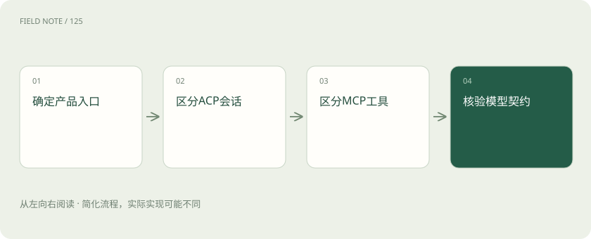
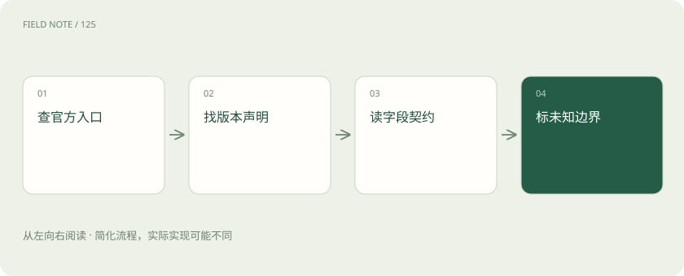
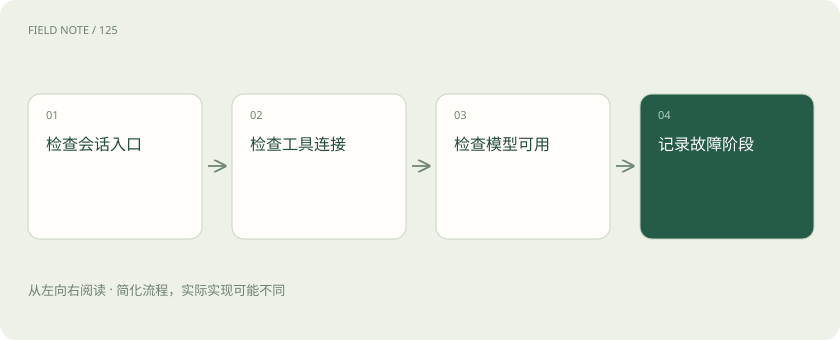

# Kiro接口边界：产品、ACP、MCP与模型供应商

> Kiro是帮你完成工作的智能体产品，ACP、MCP和模型接口分别连接不同角色。

专题：接入平台 · 整理于 2026-11-05

## 先说这篇在讲什么

你在编辑器里输入“查一下报错原因”，屏幕上只出现一次提问，背后却可能发生读文件、问模型、查工单和修改代码等多步操作。理解Kiro的关键，是分清每一步由谁负责。下面用编辑器连接Kiro、Kiro查询内部工单的例子，把几个接口名称放回各自的位置。

## 先看一个具体例子

编辑器通过ACP把查错任务交给Kiro；Kiro通过MCP查询工单，再调用产品支持的模型整理原因。

## 遇到陌生概念，可以先读

展开前置阅读建议

- [模型 API 地图：先分接口、模型、平台与客户端](api-protocol-map.md)
- [协议地图：HTTP、JSON-RPC、SSE、MCP、A2A、AG-UI 与 ACP 各管哪段](protocol-landscape.md)

## 先用一个类比理解

把编辑器看成办公桌，Kiro看成助理，模型看成帮助思考的服务，MCP工具看成助理能使用的业务系统。

类比只帮助建立直觉，不等同于完整机制。

## 一图看懂

## 一次提问可能启动许多步骤

用户让Kiro修复一个错误，Kiro可能先读取项目说明，再选择有关文件，把上下文交给模型，随后运行检查并整理结果。Kiro提供IDE、CLI等工作入口，是组织这些步骤的智能体产品。IDE是带有编辑和项目管理功能的开发界面，CLI是通过命令行操作的入口。

模型负责根据输入生成内容，产品还要处理工作目录、工具、权限和会话。一次界面提问因此不一定只有一次模型调用。观察到Kiro能回答问题，不能直接推断它提供了一个让其他应用任意调用的模型HTTP地址。

## ACP把编辑器接到智能体

如果希望在已有编辑器里使用Kiro，要研究的是编辑器如何连接智能体。ACP处理这一层的会话与交互，Kiro官方提供相应集成说明。编辑器发送任务、展示通知和权限请求，智能体执行工作并返回进展，这些属于双方需要配合的事情。

实际接线时要确认谁启动Kiro、谁保存会话、用户在哪里批准操作。支持ACP不能自动证明支持Chat Completions，因为后者处理的是应用向模型提交推理请求。把编辑器连接成功当作模型API连接成功，会把两个不同检查混在一起。

## MCP把智能体接到业务工具

Kiro如果需要查询内部工单，可以连接提供工单查询工具的MCP服务器。MCP让智能体接触外部工具、资源和提示等能力。服务器返回工单内容后，Kiro再利用这些信息继续处理任务。服务器地址在这里是工具入口，不是模型服务地址。

例如工具接收ticket_id并返回工单状态，ticket_id就是要查询的工单编号。服务器负责实际读取数据，Kiro负责组织调用，模型帮助理解任务。MCP连接成功只说明工具通道可用，不能说明模型选择、项目文件和组织权限也都正常。

## 看到provider先问提供什么

文档里的provider可以译为提供方，但必须看它提供什么。identity provider提供登录身份，context provider提供上下文资料，模型提供方则提供推理能力。MCP授权说明中出现这个词，也可能与登录授权有关，而不是允许接入任意模型。

Kiro模型页面列出的模型和Auto选择方式，表示产品可以怎样选择模型。能选模型不能直接推出存在自定义base URL配置。base URL是应用发送请求的服务根地址；若文档没有说明这个字段、支持入口与版本，就不应该凭一个相同的英文词补出功能。

## 产品订阅和公开API分别检查

订阅Kiro后能在产品里使用模型，说明你获得了产品规定的使用能力。若自己的客服程序也想调用模型，还需要服务方明确提供请求路径、身份验证、输入输出格式、错误处理和额度规则。产品中的模型菜单并没有自动补齐这些信息。

CLI可以自动运行任务，但它仍可能读目录、调用工具并维护完整工作过程，不能简单当成基础模型HTTP服务。截至2026年11月5日核验的模型、ACP和MCP页面，没有足够证据确认可注册任意模型base URL的通用公开约定；这只限定本次核验范围，不代表未来不会提供。

## 社区适配器说明了什么

有些社区项目尝试让其他客户端通过熟悉的格式使用Kiro相关能力。演示成功说明该项目实现了某种转换，但不能据此说Kiro官方发布了稳定的模型接口。项目作者观察到的内部地址和临时字段，也不自动成为官方承诺。

评估时可以阅读公开说明中的支持版本和故障记录，并标明哪些来自官方、哪些来自作者观察。没有公开说明的内部消息格式应写未知。尤其不能把某次成功转成长期保证，否则产品升级后出现的问题很难判断该由谁负责。

## 同样是失败，检查位置不同

编辑器连不上Kiro，先检查ACP集成、启动方式和版本。Kiro能接任务却查不到工单，则检查MCP服务器是否运行、是否公布查询工具、账号是否获准读取该工单。模型无法使用时，再检查产品入口、模型目录和组织配置。

这些问题在界面上都可能只显示“任务失败”，但修复位置不同。登录Kiro不等于登录所有MCP服务器，批准查询工具也不等于批准发送任意项目内容。记录失败阶段、目标服务和明确错误，比只写“模型坏了”更有助于排查。

## 按实际目标逐项验收

假设团队希望在现有编辑器中使用Kiro查询知识库，可以分三次验收：编辑器通过ACP创建会话；Kiro通过MCP取得允许读取的资料；产品使用可用模型整理答案。每一次都有明确结果，不必先假设存在统一Kiro模型API。

若目标是为多个业务应用提供模型网关，应另外选择有公开推理接口说明的服务。网关需要知道消息格式、鉴权和用量，智能体产品集成则还关心任务与工具。本例用于解释角色，没有真实账号测试；后续官方新增能力时，应依据配置字段和支持政策更新判断。

## 图解：证据判读顺序

缺少正式契约时，不把社区观察提升为官方规范。

## 图解：分层排障

错误所在层决定应核对的配置与责任对象。

## 放在一起对比

| 边界 | 承诺 | 核验对象 |
| --- | --- | --- |
| ACP | 编辑器与智能体交互 | 会话和权限生命周期 |
| MCP | 智能体访问工具资源 | 服务器能力与授权 |
| 模型provider | 提供推理能力 | 正式模型接口契约 |
| 社区转换器 | 项目自身适配 | 来源版本与维护承诺 |

## 读完先记住这一句

先辨认连接的两端，再判断该看哪种接口说明。

## 常见误区

把工单MCP地址填进模型base URL。这个地址提供查询工具，不负责生成模型回答。

## 想一想

Kiro支持ACP和MCP，能否推出它提供通用模型REST服务？

查看解释

不能。ACP连接工作界面与智能体，MCP连接智能体与工具；模型推理服务需要另外的公开接口证据。

## 关联阅读

- [模型 API 地图：先分接口、模型、平台与客户端](api-protocol-map.md)
- [流式适配：从字节、事件到完整工具循环](api-stream-translation.md)
- [推理网关：为什么企业不直接调用模型？](gateway.md)

## 原始资料

- [Kiro ACP集成](https://kiro.dev/docs/acp/)
- [Kiro模型](https://kiro.dev/docs/models/)
- [Kiro MCP](https://kiro.dev/docs/mcp/)
- [Kiro MCP配置](https://kiro.dev/docs/mcp/configuration/)
- [Kiro CLI命令与版本](https://kiro.dev/docs/cli/reference/cli-commands/)

原创讲解；图示和类比经过简化，数字示例不代表实测。工具功能以对应版本官方资料为准。
