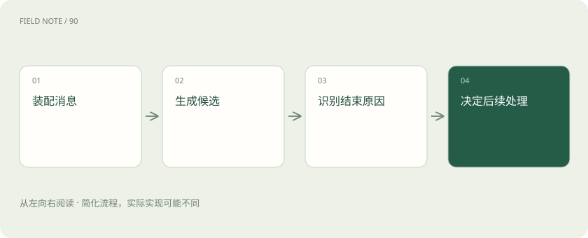
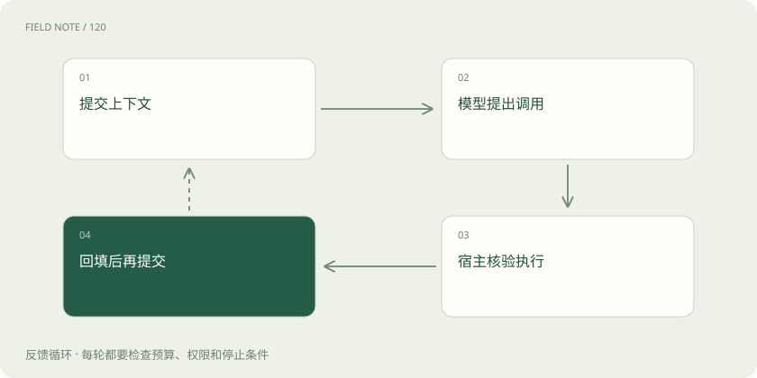
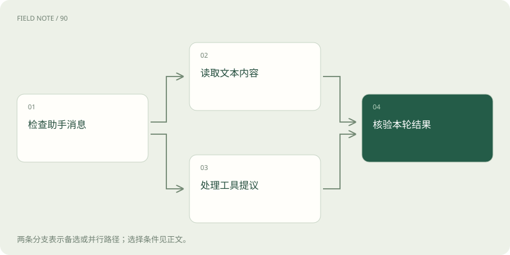

# OpenAI Chat Completions：消息、候选与工具往返

> 把必要消息交给模型，再根据返回内容决定展示文字还是执行工具；生成结束与业务办完要分别判断。

专题：接入平台 · 整理于 2026-11-05

## 先说这篇在讲什么

想象你做了一个客服窗口：软件把顾客的问题和必要历史发给模型，模型可能回一段文字，也可能提出查询订单的请求。Chat Completions 是组织这种往返的一种接口。这篇先走过一次完整对话，再解释 messages、choices 和工具编号分别装什么信息。

## 先看一个具体例子

用户询问蓝色商品库存，模型提出查询，应用验证订单后查仓库，将对应回执发回再生成解释。

## 遇到陌生概念，可以先读

展开前置阅读建议

- [模型 API 地图：先分接口、模型、平台与客户端](api-protocol-map.md)
- [上下文装配：决定模型这一轮看见什么](context-assembly.md)

## 先用一个类比理解

像把客户材料交给客服：客服可能直接答复，也可能开一张待查事项交给仓库。

类比只帮助建立直觉，不等同于完整机制。

## 一图看懂

## 一次请求带上一份材料

用户先说“我要蓝色”，下一句问“还有货吗”，应用通常要把必要的前文一起交给 /v1/chat/completions。messages 是本次交给模型的消息清单，choices 是返回的候选结果。聊天窗口可以保存很多轮，但服务不会仅凭同一个用户就自动找回全部历史。一次生成和整段聊天要分开理解。Chat Completions 仍受官方支持，不过每个模型支持的参数和能力仍需分别确认，兼容服务也不一定全部照做。

## 消息要说明是谁说的

“只查询，不修改订单”是应用规则，“换成蓝色”是用户需求，“仓库还有两件”应来自查询结果。messages 中的 role 用来区分这些来源，content 则装具体内容；支持图片的模型还可能需要多段不同类型的内容。顺序也很重要，否则“蓝色”可能找不到对应商品。应用要选好本轮历史，保留有效限制，并区分助手猜测与已经核实的库存。网页上的商品说明属于材料，不能因为写着命令句就获得操作权限。

## 收到回答先看是什么

查询库存后，模型可能直接解释，也可能要求调用仓库工具。choices 是候选集合，其中 index 标明候选编号，message 放助手输出，finish_reason 说明为什么停止。message 可能有文字，也可能有 tool_calls，不能假定 content 总有完整答案。如果因长度限制只写了半句，就不应显示“回答完成”。usage 记录令牌用量，也就是模型处理文字等内容的计量，不评价答案好坏；这些字段要各司其职，不能合成一个成功标志。

## 工具请求还没真的查仓库

模型说要调用查库存函数，只是在提出请求。应用先通过工具定义告诉它函数名称和参数结构，模型再在 tool_calls 中给出调用建议。真正查仓库的是应用，执行前还要验证订单归属、参数和权限。查完后，把真实结果放在 role 为 tool 的消息中，用 tool_call_id 指回原调用，并保留先前助手的调用消息供下一轮使用。查询超时就说尚未确认，不能当成零库存；修改订单还要记录业务编号，避免重试重复执行。

## 逐段返回需要拼完整

页面一个字一个字出现，是启用了 stream。此时 delta 是新到的一小段材料，可能包含文字、角色，也可能只是工具参数的一部分。比如订单号可能分几次到达，收到前半截就查询会找错订单。应用先按 choice 的编号区分候选，再按工具调用的 index 归并同一次调用，按顺序拼接参数，完整后才校验和执行。SSE 是服务逐条发送事件的方式，一次网络读取可能只有半条事件，也可能装了多条，不能直接按网络块当消息处理。

## 停止生成和完成业务不同

客服已经显示了答案，连接后面仍可能送来用量统计。finish_reason 解释某个候选停止的原因；设置 stream_options.include_usage 后，还可能收到 choices 为空、但带总 usage 的块，所以不能每次都强行读第一个候选。[DONE] 表示这条生成流结束，不证明换货已完成。若中途断线，最后统计可能收不到，费用应记为待核实而非零；页面也要区分部分文字、生成结束和仓库操作确认，避免一句“完成”掩盖不同状态。

## 格式约束和保存历史分开

要求工具按固定字段提交库存查询，与要求最终回答输出固定格式，是两件事。工具参数的 strict 约束参数结构，不会验证订单属于谁；回答格式约束作用于最终结果。store 关系到服务侧存储，也不等于用户长期记忆。应用保存了聊天记录，还必须把需要的记录放入后续 messages，模型才会看到。若只传摘要，应保留订单编号、已确认事实和限制。存储默认规则应核对当前文档并显式设置，重复提交历史还会占用上下文和产生计量。

## 用完整售后流程验收

拿一份脱敏记录，沿“用户问库存、提出工具请求、查仓库、回传、生成说明”逐步检查，就能发现只测问候看不到的问题。既要检查 tool_call_id 是否对应，也要测试超时、缺参和用户撤回授权；流式场景还应覆盖工具参数分片与空 choices 的用量块。迁移到 Responses 时，输入、输出读取和流事件处理都需调整，因为它不沿用 choices 的包装。这里的售后案例用于说明字段，没有进行真实订单操作，实际支持范围以模型和官方说明为准。

## 图解：工具往返闭环

回填结果后再次提交上下文，继续生成所需解释或下一项调用。

## 图解：返回结果分流

文本展示与工具处理是两条路径，最后都需核验本轮是否达到预期。

## 放在一起对比

| 观察对象 | 承担职责 | 不能推出的结论 |
| --- | --- | --- |
| message | 承载助手输出 | 业务已执行 |
| finish_reason | 说明候选终止原因 | 答案正确完整 |
| usage | 反映令牌计量 | 生成质量可靠 |
| DONE | 标记流终止 | 换货已经成功 |

## 读完先记住这一句

把必要消息交给模型，再根据返回内容决定展示文字还是执行工具；生成结束与业务办完要分别判断。

## 常见误区

看到 [DONE] 就把订单标为换货成功，忽略仓库实际处理记录。

## 想一想

文字已经显示完，为什么还要检查工具回执？

查看解释

文字完成只代表这次生成结束，库存或换货结果必须以应用执行和业务系统回执为准。

## 关联阅读

- [OpenAI Responses：内容项、事件与会话状态](api-openai-responses.md)
- [模型 API 地图：先分接口、模型、平台与客户端](api-protocol-map.md)
- [流式适配：从字节、事件到完整工具循环](api-stream-translation.md)

## 原始资料

- [OpenAI：迁移到 Responses](https://developers.openai.com/api/docs/guides/migrate-to-responses)
- [OpenAI：函数调用](https://developers.openai.com/api/docs/guides/function-calling)
- [OpenAI：流式响应](https://developers.openai.com/api/docs/guides/streaming-responses)
- [OpenAI：会话状态](https://developers.openai.com/api/docs/guides/conversation-state)
- [OpenAI：创建 Chat Completion](https://developers.openai.com/api/reference/resources/chat/subresources/completions/methods/create)

原创讲解；图示和类比经过简化，数字示例不代表实测。工具功能以对应版本官方资料为准。
