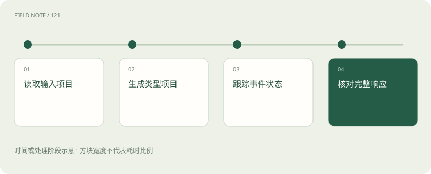
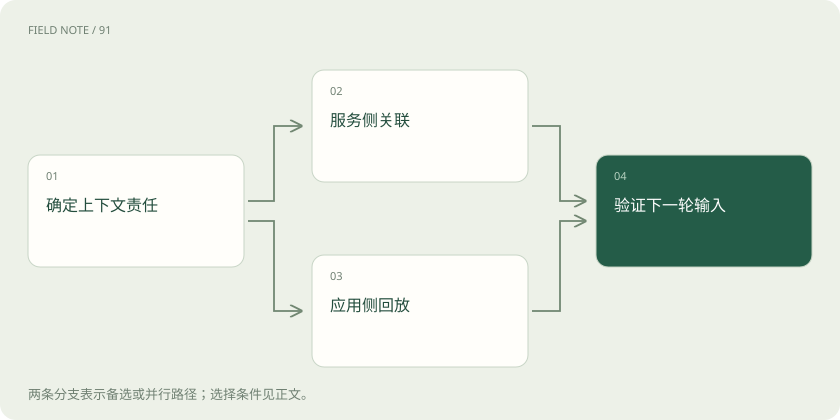
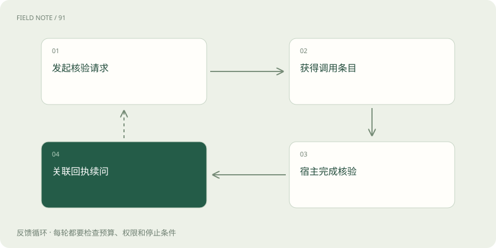

# OpenAI Responses：内容项、事件与会话状态

> Responses 把文字和工具请求分成不同内容项，应用需要识别类型、对上调用编号，并单独检查完成状态。

专题：接入平台 · 整理于 2026-11-05

## 先说这篇在讲什么

一次助手任务里，返回来的不一定只有一句回答，还可能有工具请求、工具结果和不同类型的内容。Responses 把这些内容分开组织，并提供连续交互相关能力。这篇用发票核验举例，说明应用收到每一项以后该怎样识别，而不是把它们都当作可以展示的文字。

## 先看一个具体例子

助手先提出预算查询，应用回传带正确 call_id 的结果，再继续生成发票核验说明。

## 遇到陌生概念，可以先读

展开前置阅读建议

- [模型 API 地图：先分接口、模型、平台与客户端](api-protocol-map.md)
- [上下文装配：决定模型这一轮看见什么](context-assembly.md)

## 先用一个类比理解

像一份办事档案，里面既有说明书，也有待办单和办理回执，不能只读封面。

类比只帮助建立直觉，不等同于完整机制。

## 一图看懂

## 先把回答拆成几类内容

用户问“这张发票能报吗”，助手可能先要求核验预算，再根据结果解释。/v1/responses 用 input 收材料，用 output 放返回内容；output 是一组带 type 的内容项，type 表明这一项是消息、函数调用或其他内容。这样应用能把给用户看的文字与需要执行的请求分开。它不是改名的 Chat Completions，也不能用 choices 去读。拿到响应只说明生成有了结果，报销是否通过还要依据业务规则和真实核验。

## 本轮规则要明确交进去

用户上传发票，应用还应告诉助手“只核验，不提交”。input 可以直接放简单文字，也可以用结构化内容项装消息、文件和工具结果；instructions 用来提供本轮指导。材料中的发票备注是分析对象，不能覆盖应用规则。图片和文件还要按模型支持的内容结构提交，数据库里存着文件地址并不代表模型已读到。复杂任务要逐项核对实际输入，确保规则、材料和查询回执都到了模型手里，提交权限还应由应用控制。

## 读取时先认类型再取文字

预算查询请求可能排在解释文字前面，因此不能把 output 第一项当成最终答案。应先看各项 type，再读取相应内容；message 内还可能有多个内容部分，包括文字或拒绝等表达。官方 SDK 的 output_text 是帮程序汇集文字的便捷取值，不是原始 REST 响应中同名的顶层字段。界面只展示文字可以很简洁，但应用仍需处理工具项并保存关联，否则“已核验”的一句话无法证明预算查询真的发生。

## 工具结果靠编号找到原请求

助手同时查预算和查发票是否重复，两条结果可能先后颠倒。模型用函数调用项提出函数名和参数，应用验证身份、权限和参数后才执行；返回时用 function_call_output，并通过 call_id 指明回答的是哪次调用。内容项 id、响应 id 和 call_id 用途不同，不能互换。strict 约束参数结构；当前省略它时 Responses 会尝试严格模式，不兼容可能回退，可从解析后的工具配置核对。结构正确仍不代表有权报销，超时也必须如实写成未确认。

## 接着聊仍要带上规则

用户追问“那上个月的呢”，可以用 previous_response_id 关联前次响应，也可以自行回放所需输入输出项，或用 Conversations 管理会话。这些方法帮助后续请求取得上下文，不等于建立跨用户永久记忆。尤其 previous_response_id 不会自动继承前次顶层 instructions，“只核验，不提交”等规则需要本轮重新提供。历史关联仍可能产生输入计量。自行回放时不能只复制可见文字，否则函数调用与回执关系会丢失；保存、删除和用户隔离也要另外设计。

## 逐段出现的内容有不同用途

页面显示“正在核验”时，预算系统可能还没有收到请求。Responses 的 SSE 事件会标明类型：response.output_text.delta 给出新生成的文字，函数参数有自己的片段与结束事件，内容项也有添加和完成事件。应用按类型、编号与索引把片段放回对应位置，参数完整并校验后再执行工具。文字段落结束并不表示整个响应结束。网络一次送到的数据也可能包含半条或多条事件，先还原完整事件再解释，才能避免错拼或过早宣告核验通过。

## 生成状态与报销状态分别记

预算查询已成功，后续解释却失败，这时重试写说明不应顺手再次提交报销。response.completed 表示响应生成完成，response.incomplete 表示不完整并需检查原因，response.failed 则需读取错误信息。收到过文字不能代替这些结果；已显示的半段内容应标为未完成结论。即使生成完成，也可能只是提出了工具调用，仍要执行、回传再继续。应用要分别记下模型生成状态和外部动作记录，重试前核对执行情况，才能避免重复操作。

## 迁移时逐步比较整条流程

把现有报销助手的一次普通问答先搬过来，再加入工具核验与追问，能逐步检查差异。原 messages 如何转成 input、原 choices 如何转为按类型读取 output、工具回执如何使用 call_id、流事件如何解析，都需要调整；结构化输出的配置位置也有变化。Chat Completions 仍受支持，可以逐个业务流程迁移。验收应覆盖拒绝、中断、多工具和状态续接，并查看规则每轮是否生效、调用是否重复、计量是否完整。显式设置 store 也不能代替全部数据管理，本例没有发送真实请求。

## 图解：状态携带选择

关联服务状态或自行回放项目，都应在下一轮验证规则和必要材料是否可用。

## 图解：核验迭代过程

回执关联原调用并续问，形成下一次核验请求所需的上下文。

## 放在一起对比

| 观察对象 | 承担职责 | 不能推出的结论 |
| --- | --- | --- |
| output item | 表达特定类型结果 | 每项都有可展示文本 |
| call_id | 关联函数调用回执 | 等同响应标识 |
| previous_response_id | 串联响应上下文 | 继承顶层指令 |
| completed | 响应生成完成 | 所有业务动作已成功 |

## 读完先记住这一句

Responses 把文字和工具请求分成不同内容项，应用需要识别类型、对上调用编号，并单独检查完成状态。

## 常见误区

把 SDK 的 output_text 当成原始返回字段，或以为关联旧响应就会继承所有规则。

## 想一想

关联上一条响应后，还需要再次提供“只核验”的规则吗？

查看解释

需要。previous_response_id 不继承前次顶层 instructions，应在新请求中重新提供有效规则。

## 关联阅读

- [OpenAI Chat Completions：消息、候选与工具往返](api-openai-chat.md)
- [模型 API 地图：先分接口、模型、平台与客户端](api-protocol-map.md)
- [流式适配：从字节、事件到完整工具循环](api-stream-translation.md)

## 原始资料

- [OpenAI：迁移到 Responses](https://developers.openai.com/api/docs/guides/migrate-to-responses)
- [OpenAI：函数调用](https://developers.openai.com/api/docs/guides/function-calling)
- [OpenAI：流式响应](https://developers.openai.com/api/docs/guides/streaming-responses)
- [OpenAI：会话状态](https://developers.openai.com/api/docs/guides/conversation-state)
- [OpenAI：创建 Chat Completion](https://developers.openai.com/api/reference/resources/chat/subresources/completions/methods/create)
- [OpenAI：Responses API 概览](https://developers.openai.com/api/reference/responses/overview)

原创讲解；图示和类比经过简化，数字示例不代表实测。工具功能以对应版本官方资料为准。
