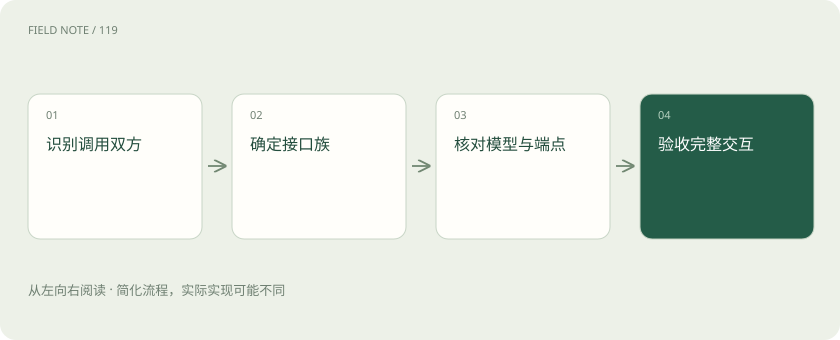
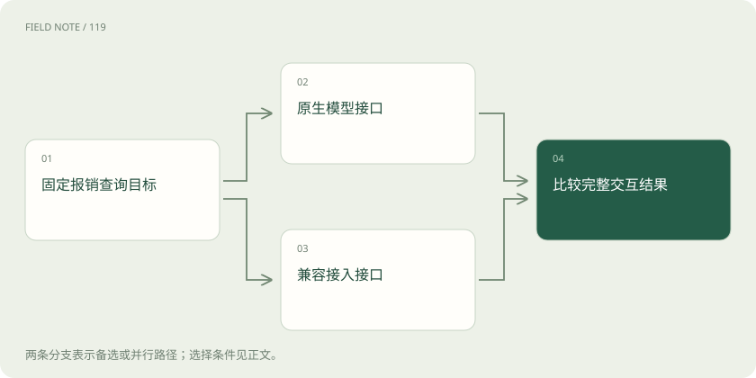
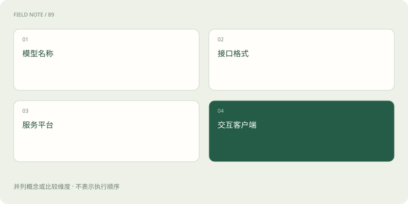

# 模型 API 地图：先分接口、模型、平台与客户端

> 把 Chat Completions、Responses、Messages、Gemini、Bedrock 和 Kiro 放回各自层次，理解兼容承诺需要覆盖哪些行为。

专题：接入平台 · 整理于 2026-11-05

## 前置阅读

- [协议地图：HTTP、JSON-RPC、SSE、MCP、A2A、AG-UI 与 ACP 各管哪段](protocol-landscape.md)
- [推理网关：为什么企业不直接调用模型？](gateway.md)

## 先用一个类比理解

像跨公司办理同一项业务：服务名称、申请表、运输通道和办事客户端是不同对象，表格长得相似也不代表流程相同。

类比只帮助建立直觉，不等同于完整机制。

## 一图看懂

## 行业口语中的协议包含几种东西

模型接入领域常把 API 请求格式叫作协议，但它可能指路径和字段，也可能指流式事件、鉴权方式或整条工具循环。这些接口多由厂商定义，不应一概称为开放行业标准。比较前先写明应用在调用谁、通过哪个端点、请求什么资源，以及期待哪类响应，才能避免把品牌名称当成格式名称。

本站用报销助手贯穿教学：用户提供收据，希望查询报销状态并整理说明。模型负责理解和生成，报销服务提供业务事实，应用负责授权和交付。相同目标可以经不同模型接口实现，但每一跳都有独立的请求、结果和失败含义，不能只凭最终都显示一段中文就断言接口相同。

## 模型不是它的调用格式

模型描述提供能力的对象，接口契约描述怎样向它提交输入并解释输出。同一个模型可能通过原厂 API、云平台和兼容网关提供服务；相同接口形状也可以承载不同模型。模型名相同不证明区域、版本、功能或行为完全一致，模型名不同也不一定要求应用换掉全部交互逻辑。

报销助手可以先保持业务目标不变，分别核对两条接入路径是否支持图片、结构化输出和工具调用。若一条只有纯文本能力，就不能通过删除收据图片来伪装迁移成功。对照表应同时记录接口族、模型标识、服务端点和已验证能力，缺一项都可能掩盖真正限制。

## OpenAI 的两套主接口形状

Chat Completions 以 messages 组织输入，以 choices 中的消息表达结果；Responses 用 input 与分类型 output items 组织更丰富的交互。两者的工具定义、调用回传和流式事件需要按对应契约处理，不是把 URL 换掉即可完成迁移。SDK 的便利属性也不一定对应原始 REST 字段。

例如只读取 choices 的应用无法直接理解 Responses 中独立的函数调用项。即使纯文本输入看起来可复用，应用仍要处理非文本输出、停止状态和后续工具结果。官方当前说明 Chat Completions 仍受支持，新项目推荐 Responses；这不意味着所有模型在两套接口上支持完全相同的能力。

## Messages 与 Gemini 需要读自己的结构

这里的 Messages 专指 Anthropic Messages API，不是任何请求中名叫 messages 的数组。它用内容块组织文本、工具等数据。Gemini 的 generateContent 使用 contents 与 parts，输出包含 candidates；当前 Gemini 还提供以交互步骤组织任务的 Interactions API，不能只用旧格式概括整个生态。

截至核验日期，Google 官方说明 Interactions 已正式可用并推荐新项目，generateContent 作为旧接口仍完整支持。阅读教程时应确认它讲的是哪套资源与状态机制，而不是把 steps、parts 和 candidates 混成一张通用表。收到多种内容块后，也不能只读第一段文字就丢弃工具请求或图片结果。

## 云平台还改变端点与鉴权

Bedrock 是模型服务平台，Converse、Invoke 以及其支持的兼容接口属于不同接入路线。支持情况还与模型、区域和服务端点有关。Azure OpenAI 同样需要核对资源、部署与所用 API 版本；服务承载方改变后，不能假设原厂请求的每个参数和状态资源都可直接迁移。

用户看到鉴权失败时，原因可能是凭据作用范围、区域、资源权限或端点选择，而不只是“密钥写错”。本站只讲责任边界，不要求读者创建凭据。评审时应让接入方案明确支持哪种认证、谁负责续期、请求对应哪个部署，并把这些条件和消息格式兼容分开记录。

## Kiro 位于产品与代理接线层

Kiro 是产品名称，不能与 Chat Completions、Responses 当作同一种模型 REST 格式并列定义。官方 ACP 接入用于把编辑器或其他应用连接到 Kiro 代理；MCP 则可以连接代理与工具。代理内部再调用什么模型服务，是第三个需要单独说明的边界。

若某个网关把一类接入命名为 Kiro，那可能是该项目的适配器标签，不能仅凭标签推导出一份官方稳定的模型协议。应查看它引用的公开契约和版本，区分官方支持、社区兼容实现和未公开内部交互。本教程不把逆向字段编成官方规范，也不以获取私有流量作为学习前提。

## 兼容层是一项有范围的承诺

OpenAI-compatible 通常表示某些接入方式可以沿用相似的 SDK 或请求结构。具体兼容哪些端点、角色、参数、工具和多模态，仍需查看该服务文档。Anthropic 的官方兼容说明就列出部分参数被忽略或有额外限制，说明请求能被接受不等于每个选项都已经生效。

Gemini、DeepSeek 和阿里云 Model Studio 也有各自兼容路径，不能由其中一家推断另一家的覆盖范围。报销助手必须测试关键约束是否落实，而不是只发送一句问候。若接口不支持必要能力，应明确拒绝或提供经用户理解的替代方案，不能静默删掉要求再宣称兼容。

## 用同一业务轨迹读懂所有接口

建议按纯文本、图片理解、提出工具请求、宿主执行工具、回传结果、生成最终交付的顺序读每家文档。记录每个阶段由谁发起、用什么标识关联、何时算结束、出错如何表达。对比的是交互语义，不是逐个寻找同名字段，也不是给接口按新旧排统一优劣。

报销查询需要保持单据编号和权限范围，工具结果还应说明数据时点。模型接口完成回答后，文件是否交付、业务状态是否正确仍由应用验收。下方协议对照页用于快速定位，本章后的专篇再解释字段与事件；所有能力均应按实际模型、端点和核验日期确认，本文未执行真实模型调用。

## 图解：同一业务的两种模型通路

两条通路从同一需求出发，最后用相同业务条件验收，不以能连接代替等价。

## 图解：四个容易混淆的名字

它们是独立维度；一个产品可能跨越多层，阅读配置时仍应分别说明。

## 放在一起对比

| 层次 | 例子 | 主要核对对象 |
| --- | --- | --- |
| 模型服务接口 | Chat / Responses / Messages | 输入输出、工具、事件与状态 |
| 模型平台 | Bedrock / Azure OpenAI | 端点、部署、鉴权与模型能力 |
| 产品与客户端 | Kiro | 代理接入与产品边界 |
| 代理与工具协议 | ACP / MCP / A2A | 交谈双方、任务与权限范围 |

## 真实场景

教学轨迹：同一张收据先被模型理解，再由应用查询获授权的报销单，工具结果回传后生成说明；换接口时保留这一目标及其验收条件。

## 常见误区

把服务品牌、模型标识、客户端产品和 API 请求格式放在同一层比较。

## 想一想

为什么能够使用同一个 SDK，仍不能证明两家接口完全兼容？

查看解释

SDK只是调用入口。端点、参数支持、内容块、工具循环、状态和错误行为都可能不同，需要对实际目标能力逐项验收。

## 关联阅读

- [OpenAI Chat Completions：消息、候选与工具往返](api-openai-chat.md)
- [OpenAI Responses：内容项、事件与会话状态](api-openai-responses.md)
- [Claude Messages：从内容块读懂工具与流式状态](api-claude-messages.md)
- [Gemini 原生接口：区分生成内容与交互状态](api-gemini-native.md)
- [Bedrock API族：从统一会话到端点能力矩阵](api-bedrock-families.md)
- [Kiro接口边界：产品、ACP、MCP与模型供应商](api-kiro-boundaries.md)

## 原始资料

- [OpenAI：迁移至 Responses](https://developers.openai.com/api/docs/guides/migrate-to-responses)
- [Anthropic：OpenAI SDK 兼容范围](https://platform.claude.com/docs/en/api/openai-sdk)
- [Gemini：Interactions 总览](https://ai.google.dev/gemini-api/docs/interactions)
- [Bedrock：支持的 API](https://docs.aws.amazon.com/bedrock/latest/userguide/apis.html)
- [Kiro：ACP 接入](https://kiro.dev/docs/acp/)
- [DeepSeek：接入格式](https://api-docs.deepseek.com/)
- [Model Studio：OpenAI-compatible Chat](https://www.alibabacloud.com/help/en/model-studio/compatibility-of-openai-with-dashscope)
- [Azure OpenAI：API生命周期](https://learn.microsoft.com/en-us/azure/foundry/openai/api-version-lifecycle)

原创讲解；图示和类比经过简化，数字示例不代表实测。工具功能以对应版本官方资料为准。
