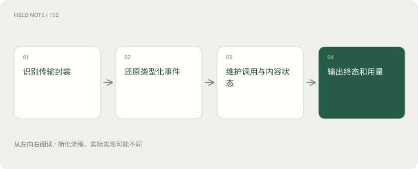
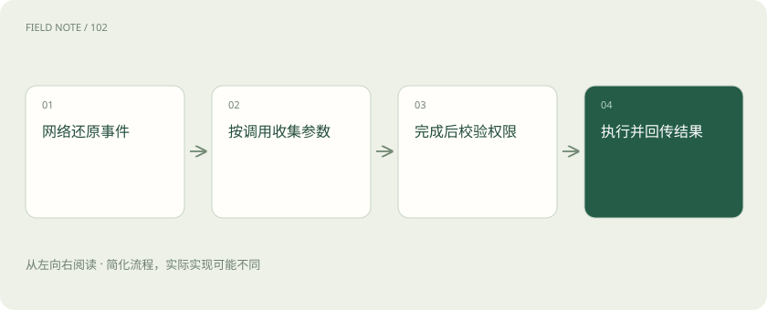
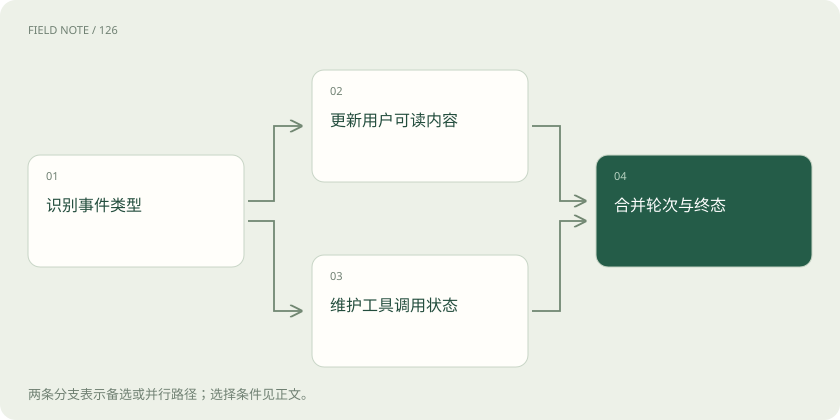

# 流式适配：从字节、事件到完整工具循环

> 理解 SSE 与 EventStream、内容分片与调用标识，避免网关转换时丢失终态、工具参数或用量语义。

专题：接入平台 · 整理于 2026-11-05

## 前置阅读

- [模型 API 地图：先分接口、模型、平台与客户端](api-protocol-map.md)
- [流式输出与 SSE：为什么显示了字，任务还没完成？](streaming-events.md)

## 先用一个类比理解

像同声传译不仅翻句子，还要保留谁在说、句子是否说完、对方提出了什么动作以及何时收到回执。

类比只帮助建立直觉，不等同于完整机制。

## 一图看懂

## 先区分网络分片与应用事件

一次网络读取可能只得到半个字符、一段事件，也可能一次收到多个事件。SSE 的事件边界、JSON 对象的边界和工具参数字符串的完成边界是不同层次。处理方应先按传输封装还原事件，再按模型契约理解内容，不能对每次收到的网络片段直接按完整答案解析。

教学例子是网关把模型的订单查询请求转给应用。若工具参数中的订单号被分成两段，第一段看似能组成另一个有效订单号，也不能提前执行。字节可读只说明传输有进展，必须等对应调用的参数达到契约规定的完成条件，再做完整校验和权限判断。

## 不是所有流式接口都使用 SSE

OpenAI 与 Anthropic 的相应 HTTP 流式接口使用 SSE，但其事件内容和终态名称不同。Bedrock 原生流式路线涉及 AWS EventStream，例如 InvokeModelWithResponseStream 官方明确使用相应事件流内容类型；不能用寻找 data 行的 SSE 解析器处理其原始二进制封装。平台内的兼容 API 又应按选定接口核对。

AWS SDK 可能已经替应用解码封装，返回可迭代的结构化事件；此时应用看到的是 SDK 对象，不是线上字节格式。设计说明应标明观察的是哪一层。把 SDK 日志里打印出的 JSON 误当作原始传输协议，会使网关在换语言、绕过 SDK 或处理代理转发时失败。

## 统一内部表示必须保留类型

适配器可以把不同厂商事件映射为内部的开始、内容更新、工具参数更新、用量和终态等类别，但这些类别是应用设计，不是新的行业标准。内部结构要保留来源接口、内容类型、块顺序和原始关联信息，避免为了统一显示把所有数据都压成一条文本流。

订单助手可能先收到文本说明，再收到工具请求，最终还产生结构化结果。界面可以只展示适合用户阅读的部分，但运行层仍要保留其他事件。未知类型应按明确策略保留、拒绝或上报，不能默默丢弃后声称完整兼容；未来新增事件也需要有可诊断的处理路径。

## 工具标识不能用消息顺序替代

不同接口用各自标识关联调用与结果。Chat Completions 的工具调用、Responses 的 function_call、Messages 的 tool_use 与 Gemini 的对应结构并非同一形状。适配时可以建立映射，但必须确保每个结果回到原来的调用，尤其是并行调用、重试与多个内容块交错到达时。

例如同一轮同时查询订单甲与订单乙，不能把“第一个到达的结果”交给“第一个发出的请求”。服务延迟会改变到达顺序。应保存调用身份、函数名称、完整参数和返回身份，映射还要能在断线后恢复。日志中的请求追踪ID与工具调用ID职责不同，也不能因为它们都叫ID就互相替换。

## 参数增量要到正确时机才执行

流式工具参数常以字符串增量出现，可能尚未构成合法 JSON。处理方需要按对应内容或调用标识积累，在参数完成后解析，并验证必填项、类型、业务对象与授权。即使格式满足 JSON Schema，也不表示库存、金额或用户权限在现实中有效，业务层检查仍然必需。

订单号完整以后，还要确认当前用户可读取该单。若解析失败，应把错误作为可解释结果处理，而不是替模型猜一个最接近的参数。客户端执行型工具由宿主执行；服务端托管工具又有自己的契约，不能仅看到工具事件就判断实际动作已经发生，更不能让显示中的片段触发业务写入。

## 文本结束与请求终态分开

内容块结束、一次模型轮次结束、工具等待与整个业务任务完成是不同事实。Responses 的完成、失败或不完整状态，与 Messages 的消息停止和停止原因需要按各自文档解释。网络连接关闭尤其不能统一映射为成功，因为连接可能在完整终态之前断开。

订单查询工具请求结束时，用户还没有得到最终说明；应用要执行工具、回传结果并继续模型交互。若网关此时发出一个笼统的完成信号，前端可能关闭任务并漏掉后续结果。内部终态应能表达正常结束、等待动作、被截断、失败及状态未知，并记录哪些判断来自明确事件，哪些只来自网络观察。

## 用量、思考与签名各有契约

用量字段可能在开始、增量或末尾出现，既可能是累计值也可能是增量值。Anthropic 官方特别说明 message_delta 的用量计数是累计的，简单逐事件相加会重复计费。缓存、推理或其他统计口径也不能未经确认就强行合成同一种数量，原始口径应能追溯。

思考摘要、不可解释签名与普通回答文字也不应混用。Gemini 的不同接口对 thought signature 有不同管理方式，跨模式续接要依官方规则保留，而非把签名当可翻译自然语言。若目标服务无法接受原服务状态，应明确重新建立上下文或判为不支持，不能伪造签名并宣称已无损迁移。

## 断线恢复以事实为中心

流开始后仍可能出现错误事件，HTTP 成功只代表连接阶段成功。恢复策略应检查已经确认的终态、已提交工具动作和可查询的服务状态。重新生成一份回答与重试一项业务操作是不同动作；是否允许重放取决于接口和应用设计，不能把所有流式连接都想象成可从任意字节续传。

测试可以在文本中间、工具参数中间、工具执行之后和最终用量之前分别断开，观察适配器是否误报成功、重复执行或丢失上下文。这里是本站的验收设计，未调用真实模型。可靠转换的目标是保留可以被用户和系统正确解释的交互事实，而不是让两个界面显示出同样的打字动画。

## 图解：分片到动作的完整边界

只有形成完整、合法且获授权的动作才进入执行；解析成功不是授权。

## 图解：文本与工具各走其路

展示与执行状态分别维护，再汇合解释轮次结果；不把全部事件转成聊天文字。

## 放在一起对比

| 观察到的信号 | 只能说明什么 | 还不能说明什么 |
| --- | --- | --- |
| 收到网络片段 | 连接有数据到达 | 形成完整事件或完整参数 |
| 参数已经完成 | 可以解析并检查参数 | 动作有权限或已经执行 |
| 内容块结束 | 该块输出告一段落 | 整个业务任务已完成 |
| 收到终态与用量 | 接口层状态有依据 | 文件交付或外部写入已验收 |

## 真实场景

教学反例：两次订单查询并行返回，网关若按到达顺序拼接结果，就可能把订单乙的金额写进订单甲的说明，即使两段JSON都完全合法。

## 常见误区

只翻译文本而丢弃类型、调用身份、停止原因或不透明状态，容易得到表面可用的错误兼容。

## 想一想

为什么工具参数的第一段已经是合法JSON，也不能立刻发起操作？

查看解释

它可能仍是未完成的参数前缀，后续分片会改变内容；应等调用的参数完成边界，再验证完整值与业务权限。

## 关联阅读

- [OpenAI Chat Completions：消息、候选与工具往返](api-openai-chat.md)
- [OpenAI Responses：内容项、事件与会话状态](api-openai-responses.md)
- [Claude Messages：从内容块读懂工具与流式状态](api-claude-messages.md)
- [Gemini 原生接口：区分生成内容与交互状态](api-gemini-native.md)
- [Bedrock API族：从统一会话到端点能力矩阵](api-bedrock-families.md)
- [兼容性验收：从能连接走向语义等价](api-compatibility-testing.md)

## 原始资料

- [OpenAI：流式响应](https://developers.openai.com/api/docs/guides/streaming-responses)
- [OpenAI：函数调用](https://developers.openai.com/api/docs/guides/function-calling)
- [Anthropic：流式事件与累计用量](https://platform.claude.com/docs/en/build-with-claude/streaming)
- [Gemini：思考与签名模式](https://ai.google.dev/gemini-api/docs/thinking)
- [AWS：原生流式封装](https://docs.aws.amazon.com/bedrock/latest/APIReference/API_runtime_InvokeModelWithResponseStream.html)
- [AWS：ConverseStream事件](https://docs.aws.amazon.com/bedrock/latest/APIReference/API_runtime_ConverseStream.html)

原创讲解；图示和类比经过简化，数字示例不代表实测。工具功能以对应版本官方资料为准。
