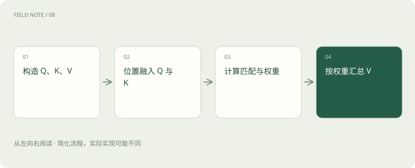

# Q、K、V 与位置：注意力如何读上下文

> Q、K、V 是注意力计算中的三种数字表示，可以用“我要找什么、我是什么、我提供什么”先建立直觉。

专题：模型能力 · 整理于 2026-11-04

## 先说这篇在讲什么

读“顾客退货，因为商品破损”，理解后半句时，需要联系顾客、商品和退货。注意力会决定当前位置从哪些位置取信息。Q、K、V 是实现这个过程的三个名字，它们不是模型里存好的三本字典。

## 先看一个具体例子

“甲把钥匙交给乙”与“乙把钥匙交给甲”包含相同词语，交接方向却相反。仅有词语集合不足以回答钥匙现在由谁保管。

## 遇到陌生概念，可以先读

展开前置阅读建议

- [Transformer、Attention 和 MoE：不看公式也能理解](transformer.md)

## 先用一个类比理解

像查档案：检索需求、索引卡与档案内容分别承担不同工作。

类比只帮助建立直觉，不等同于完整机制。

## 一图看懂

## Q：当前这一步在找什么

Q 是 Query 的缩写，可以先理解成当前位置发出的查找线索。它由当前的数字表示经过计算得到。这个类比只是帮助区分职责，Q 本身是一串数，不是一句真正写出来的问题。

## K 和 V：怎样被找到，能提供什么

K 是 Key，用来与 Q 比较，看是否相关；V 是 Value，是被混合到结果中的信息。一个位置通常可以同时产生这三种表示。它既可能向其他位置取信息，也可能向别的位置提供信息。

## 相关位置不是直接被复制出来

假设三个位置得到的关注比例为 10%、70%、20%，模型会按这些比例混合它们的 V。70% 表示贡献较多，不等于把第二个词原封不动复制到答案里。之后还要经过其他计算，才形成下一步预测。

## 位置和可见范围为什么重要

“甲追乙”和“乙追甲”使用同样的词，次序不同，意思就不同，所以模型还需要位置信息。生成后文时，也不能偷看尚未出现的真实后文。因果遮罩就是规定哪些位置允许查看，像做练习时盖住答案，但实际是用计算规则限制访问。

## 读完先记住这一句

先比较 Q 和 K 决定关注程度，再按这个程度混合 V。

## 常见误区

注意力权重不能直接充当完整的因果解释，长窗口也不保证远处信息被正确使用。

## 想一想

Q、K、V 是人工填写的三份文字吗？

查看解释

不是，它们通常是对隐藏表示进行学习得到的投影。

## 关联阅读

- [Transformer、Attention 和 MoE：不看公式也能理解](transformer.md)
- [Token、上下文和幻觉：为什么它会忘，也会编？](tokens-context.md)
- [智能体记忆：上下文、笔记与长期存储](agent-memory.md)

## 原始资料

- [Attention Is All You Need](https://arxiv.org/abs/1706.03762)
- [RoFormer：旋转位置编码原始论文](https://arxiv.org/abs/2104.09864)

原创讲解；图示和类比经过简化，数字示例不代表实测。工具功能以对应版本官方资料为准。
