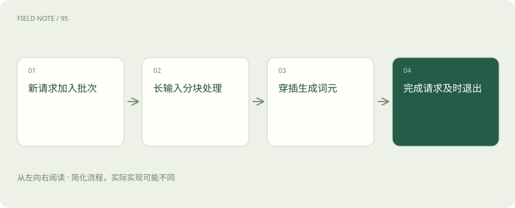

# 连续批处理与分块预填充：让不同请求一起走

> 连续批处理允许完成的请求退出、等待的请求加入，不必等整批最慢请求结束。

专题：推理设施 · 整理于 2026-11-04

## 前置阅读

- [Prefill、Decode 与 KV Cache：一次回答的内部旅程](prefill-decode.md)

## 先用一个类比理解

像餐厅不断补位，同时把大桌准备工作分段穿插到小桌服务之间。

类比只帮助建立直觉，不等同于完整机制。

## 一图看懂

## 概念边界

连续批处理允许完成的请求退出、等待的请求加入，不必等整批最慢请求结束。调度器每轮分配计算机会，实际效果受序列长度、显存容量和新请求到达方式共同影响。

## 内部怎样运作

分块预填充把长输入计算拆成多个部分，与其他请求的解码交错执行。它可缓解长输入对正在生成请求的干扰，但块大小和优先级会改变首字等待与后续输出间隔。

## 把机制放进具体场景

一个长文档请求到达时，若一次性完成全部预填充，正在聊天的用户可能感到输出停顿。分块后可在输入块之间安排解码，但长文档自己的首个输出也可能等得更久，因此要同时看首字延迟和词间延迟。

## 取舍与容易忽略的限制

批处理收益依赖到达模式和序列差异。短请求持续加入时，若调度器偏好吞吐，长输入可能迟迟得不到足够计算机会；若过度优先新请求，又可能拖慢已有输出。应观察不同长度请求的等待分布，而不是只用总词元吞吐解释体验，公平性与资源利用率需要共同考虑。

## 真实场景

离线批量总结不强调逐字流畅，可以接受更大的等待换取吞吐；在线客服则可能更重视输出间隔稳定。同一调度配置未必同时适合两类业务。

## 常见误区

吞吐最大配置未必适合交互体验，批量大小也不能无限增大。

## 想一想

连续批处理与分块预填充是同一个开关吗？

查看解释

不是，前者管理请求动态加入退出，后者改变长输入预填充的调度粒度。

## 关联阅读

- [Prefill、Decode 与 KV Cache：一次回答的内部旅程](prefill-decode.md)
- [TTFT、吞吐、P95 和成本：一张性能报告怎么看？](latency-cost.md)
- [PD 分离的下一层：KV 传输和容量配比](pd-kv-capacity.md)

## 原始资料

- [vLLM · optimization](https://docs.vllm.ai/en/latest/configuration/optimization/)

原创讲解；图示和类比经过简化，数字示例不代表实测。工具功能以对应版本官方资料为准。
