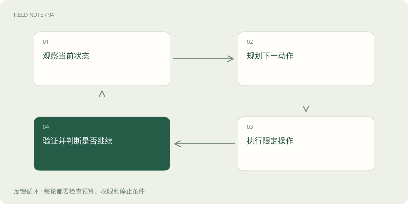
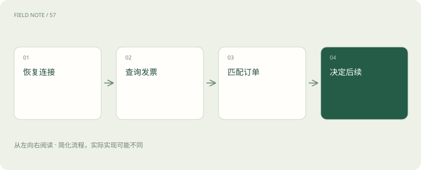
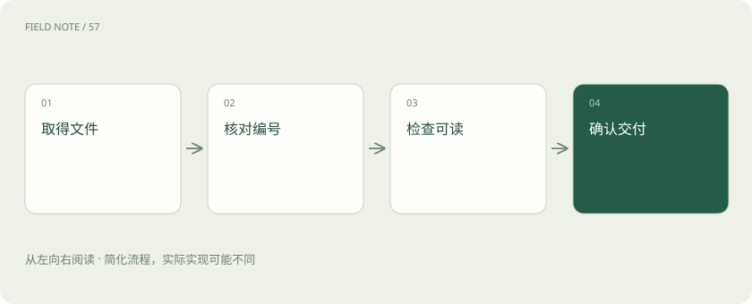

# 浏览器动作可靠性：从点击成功到订单状态正确

> 用订单开票说明如何逐步核对结果、处理超时和断线，防止点对按钮却办错业务。

专题：智能体 · 整理于 2026-11-05

## 先说这篇在讲什么

助手点了“开票”后突然断网，你最关心的是发票到底开没开。再次点击也许会造成重复，直接说失败也可能误报。下面从这一笔订单出发，讲清每一步怎样核对、什么时候等待、断线后怎样接着做，最后用文件和订单事实验收结果。

## 先看一个具体例子

订单甲确认开票后断网，恢复时先查已有发票；发现已生成便下载文件，避免重复提交。

## 遇到陌生概念，可以先读

展开前置阅读建议

- [工具可靠性：接口成功为何仍可能办错事](agent-tool-reliability.md)
- [浏览器与电脑智能体：看见页面之后如何行动](browser-computer-agents.md)

## 先用一个类比理解

像交接快递：要写清包裹是否已签收，不能只记录按过门铃。

类比只帮助建立直觉，不等同于完整机制。

## 一图看懂

## 先约定怎样才算办完

你让助手为订单甲开发票并把文件交给你。它按下开票，按钮变灰，但这只说明页面发生变化。真正完成至少要确认订单选对、发票已生成、文件属于该订单而且你能打开。开始前先读订单号、抬头和开票状态，并记下观察时间，作为后续比较依据。如果已经开过票，应寻找已有文件。这样就不会在遇到卡顿后，偷偷把“已完成”降低成“已提交”。把验收条件写在操作之前，也让你能判断助手最后交出的证据是否足够。

## 做一步，看清结果，再做下一步

在订单列表里找到甲之后，先打开详情，再检查详情中的完整订单号，确认正确才进入发票页。这就是观察、规划、执行、验证的循环。若把点击首行、勾选条款、确认开票一口气排队，第一步刷新失败就会让后面的动作落错位置。每次动作应说明当前必须满足什么条件，以及完成后预计看到什么。条件不符就回到观察，而不是连续点几下试运气。循环也有出口：验收通过就结束，权限不足、发生失败或预算用尽也应停止，不能为了继续循环而继续改动。

## 用完整订单号找位置

列表刚才第三行是订单甲，刷新后第三行变成乙。继续用行号或坐标点按钮，就会误操作。更稳妥的办法是先按完整订单号找到唯一的一行，再找这行内的按钮。Playwright定位器可以按角色和文字寻找元素，但不会自动理解哪笔订单才是目标；同名按钮多时仍要限定所在区域。虚拟滚动、分页和排序都会改变可见位置。详情页还可能同时列出父订单和子订单，不能只检查编号含有某个前缀。在提交开票这类会产生实际影响的动作前，再核对一次完整标识。

## 等待具体结果，别只数秒数

点击开票后，页面先显示“申请已接收”，过一会才显示“可下载”。助手应等待后一个条件，而不是固定睡五秒就宣布完成。Playwright提供操作前的可操作性检查和可重试断言，能减少按钮尚未准备好造成的错误，但按钮可点不等于业务处理结束。需要分别考虑元素是否就绪、网络请求是否结束、后台开票状态是否满足条件。网络暂时安静也不能证明财务系统完成工作。每种等待都要设上限；超时应记录最后看到的状态，转入恢复处理。

## 重新登录后，还要确认正在替谁办事

长任务做了一半，登录失效了。重新进入网站后，账号可能回到默认公司，语言或时区也可能变化。浏览器窗口还在，并不意味着原来的业务环境还在。恢复前要重新确认账号、租户、权限和订单，不能只看登录页消失了没有。同一浏览器多个标签页还可能共用登录状态，一个标签退出会影响其他标签。把这些内容列进恢复检查，能避免在另一家公司处理同名订单。日志不要保存会话令牌；需要人完成的身份验证应清楚交接，不应让模型反复尝试绕过。

## 超时以后，先查有没有已经开票

你刚按确认就断网，屏幕没有结果。此时可能请求根本没到，也可能服务器已经成功开票，只是回复丢失。直接再按一次，就可能重复申请。业务上让同一请求重复提交仍只产生一次效果，叫幂等；它需要服务端的请求标识或唯一约束支持，靠助手记得自己点过没有用。恢复后先查订单甲的开票记录与处理状态，找到发票就取文件，无法判断则报告结果不明并交给核查。只读动作、可撤销动作和不可重复动作应使用不同重试策略，浏览器自动重试不能变成无限重复业务提交。

## 保存已确认的事实，方便接着做

交接记录只写“做到第七步”，下一位助手仍不知道开票是否成功。更有用的记录包括目标订单、已经验证的结果、发出但未核实的动作及最近观察时间，这叫检查点。恢复时重新观察现场，再与检查点对照，旧截图只能解释历史，不能指导当前点击。若上次写着“确认已发出，结果未收到”，应从查询状态开始；若文件已校验只是交付失败，可复用文件。应专门测试提交前、提交后、下载途中断线的处理，保证三种情况不会一律从头重做。

## 既查办成了什么，也查有没有误改

最后打开交付文件，核对订单甲的发票编号、抬头、可读取性和交付结果，同时检查其他订单有没有被误改。绿色成功提示只是一个线索。批量任务应分别列出成功、失败和结果不明的订单，每笔都要有判断依据，单一成功率会隐藏需要人工处理的事项。可在测试环境模拟排序变化、同名按钮、长期处理中及响应丢失，检查助手是否在恰当位置停下，人能否凭记录接手。底层等待机制来自框架，订单唯一性、业务幂等与最终验收则需要另行设计。

## 图解：提交结果不明时

先读事实，再决定是否重试。

## 图解：下载交付验收

每步都保留与目标订单的关联。

## 放在一起对比

| 维度 | 能力 | 边界 |
| --- | --- | --- |
| 定位 | 完整订单标识 | 避免行号漂移 |
| 等待 | 业务状态满足 | 可点击不足以证明完成 |
| 重试 | 查询已有副作用 | 超时不等于失败 |
| 恢复 | 重建会话事实 | 旧截图不是当前状态 |

## 读完先记住这一句

超时先查业务事实，每次动作都用新证据核对。

## 常见误区

把没有收到回复当成没有开票，再次确认造成重复申请。

## 想一想

点击确认开票后没有收到回复，重新联网应该先做什么？

查看解释

先查询订单的发票记录与处理状态；确认已完成、仍处理中或结果不明后，再决定下一步。

## 关联阅读

- [工具可靠性：接口成功为何仍可能办错事](agent-tool-reliability.md)
- [浏览器与电脑智能体：看见页面之后如何行动](browser-computer-agents.md)

## 原始资料

- [Playwright自动等待](https://playwright.dev/docs/actionability)
- [Playwright定位器](https://playwright.dev/docs/locators)

原创讲解；图示和类比经过简化，数字示例不代表实测。工具功能以对应版本官方资料为准。
