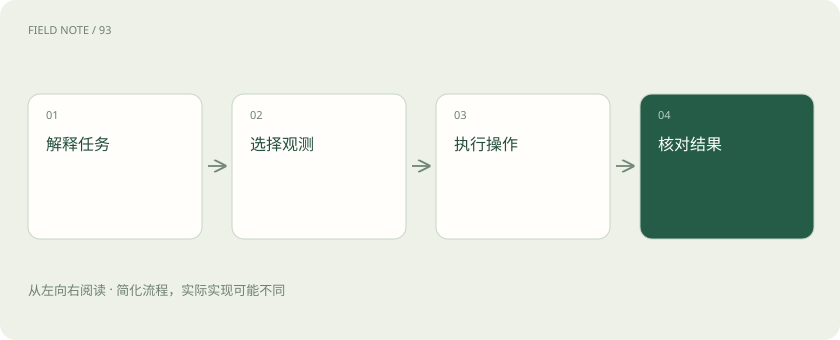
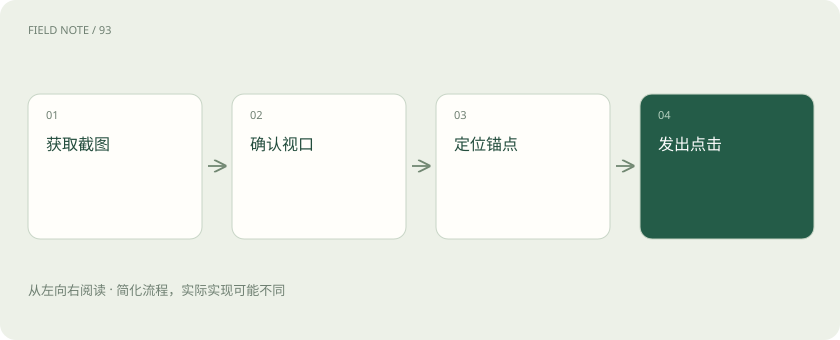
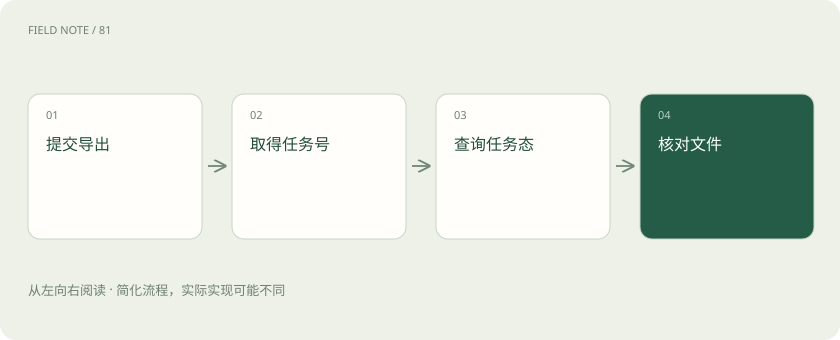

# 浏览器与电脑智能体：看见页面之后如何行动

> 区分接口、页面结构、可访问语义与像素操作，理解浏览器智能体的能力边界。

专题：智能体 · 整理于 2026-11-05

## 前置阅读

- [Agent 和工作流：从回答问题到执行任务](agent.md)

## 先用一个类比理解

像助理领取不同通行证：能读订单接口、看网页和操作桌面，是三种需要分别确认的权限。

类比只帮助建立直觉，不等同于完整机制。

## 一图看懂

## 先明确操作发生在哪里

浏览器智能体把自然语言目标转为网页操作，电脑智能体还可能跨越桌面应用、文件选择器与系统窗口。两者的共同点是需要观察环境、决定下一步并读取结果；区别在于能够看见和控制的表面。一个工具只能操作网页标签页，即使截图里出现系统弹窗，也不意味着它能点击弹窗。

以查找发票为例，后台页面里打开订单和下载文件属于浏览器范围，下载后的本地预览可能属于桌面范围。先画出任务涉及的表面和已有权限，再决定使用哪条通路。本站建议把“支持截图”与“支持桌面输入”分别列入能力清单，防止把观察能力当成操作授权。

## API直接描述业务对象

API通常提供订单、用户、退款等结构化对象，可以传递明确标识并返回状态。它绕过界面布局变化，适合已有正式接口且权限允许的操作。不过响应成功也可能只代表请求已接收，异步任务仍要查询最终结果。接口没有覆盖的人工审批步骤，也不会因为智能体理解页面就自动消失。

例如接口返回导出任务编号，不能立刻说发票已下载；需要继续确认任务完成和文件可读取。API通路的优势来自明确契约，而非天然没有风险。本站建议优先使用可审计、权限明确的业务接口，同时保留页面核验，核对展示给用户的状态是否与接口状态一致。

## DOM提供结构与属性

DOM是网页的文档对象结构，包含元素、属性和层级。工具可以依据文字、标签或稳定属性定位控件，不必猜它位于屏幕哪个位置。页面重新渲染后，旧元素引用可能失效，因此现代自动化框架常使用可重新求值的定位器。DOM里存在的元素也可能不可见、被遮挡或属于隐藏模板。

查找“导出”时，后台可能同时保留移动端按钮和桌面按钮。只匹配文字会得到多个候选。应结合区域、角色和可见性收窄目标。画布上的图形则可能只有一个canvas元素，内部按钮没有对应DOM节点；这种情况下，需要其他观测方式补足，不能无限追加选择器。

## 可访问树表达交互语义

可访问树把网页暴露给辅助技术的角色、名称和状态组织起来。它常能告诉智能体某项是按钮、复选框或展开的菜单，减少对样式细节的依赖。它不是完整DOM的复制，装饰元素可能被省略，自定义控件如果没有正确语义，也可能无法得到有用名称。

两个图标按钮如果都被命名为“操作”，语义定位仍然含糊。此时可以结合所在订单行和周边文本，也可以查看截图确认菜单。不要把可访问树视为所有可点击区域的真值表。本站建议将它作为解释交互意图的主要线索之一，并用可见结果检查真实页面是否遵守这些语义。

## 截图与坐标覆盖视觉表面

截图可以呈现画布、图标、遮罩和布局关系，适用于结构信息不足的界面。坐标点击依赖截图时刻的视口、缩放、滚动位置和窗口尺寸；截图后页面一旦移动，原坐标就可能指向另一个按钮。文字识别能辅助寻找标签，但小字、重叠和低对比度会造成错误。

例如刚识别出“确认下载”，通知条出现后页面整体下移，照旧点击就可能触发旁边的取消操作。应在动作前核对关键视觉锚点，必要时重新截图。截图能让模型理解页面，并不使鼠标动作自动具备业务语义；重要操作之后仍然要读取状态，确认实际发生了什么。

## Browser Use与Playwright的分工

Browser Use官方项目提供让模型使用浏览器的智能体能力；Playwright提供浏览器自动化基础设施，定位器、等待和断言是其重要机制。可以把前者理解为围绕任务选择动作的系统，把后者理解为可靠执行已确定页面操作的一组能力。实际版本的连接方式和支持范围应以各自官方文档为准。

用户提出“找出未开发票订单”，智能体需要解释条件、安排筛选和判断结果；底层自动化则负责定位筛选框、输入值并等待页面更新。框架不会自动知道企业里的“未开票”是否包含作废重开。本站建议先写清业务定义，再选择运行时，而不是用某个框架名称替代需求分析。

## RPA与MCP不在同一层

RPA通常强调预先配置的流程、规则和界面操作，智能体则可以根据新观察调整步骤，但两者能够组合：智能体识别请求，固定流程完成稳定子任务。MCP是一种连接模型应用与工具、资源等能力的协议，不是浏览器引擎，也不保证被连接工具能够点击任何网页。

一个MCP服务器可以暴露“读取订单”，也可以暴露浏览器操作；能力取决于实现和授权，而不是协议名字。RPA流程也能经工具接口被智能体调用。本站建议在架构图里分别标注决策者、协议、执行器和业务系统，这样失败时才能区分是计划错误、参数错误，还是页面已发生变化。

## 用覆盖矩阵验收能力

验收时应选择多种界面：标准表单、虚拟滚动表格、iframe、画布和系统文件对话框。逐项记录能否观察、能否操作、能否核对结果，以及需要人工接管的位置。不能用一次在演示网页上的成功，推断所有企业后台都可自动完成；会话过期和多因素验证尤其需要独立设计。

发票任务的验收结果应包含订单集合、文件数量及无法处理的原因。页面提示成功但下载目录没有文件，应判定为未完成。以上覆盖矩阵是本站工程建议，并非Browser Use或Playwright的官方成功承诺。保留观察截图与动作记录，可以帮助复现问题，同时要避免把包含个人信息的页面无限期保存。

## 图解：视觉动作前检查

布局变化后应重新观察，再计算坐标。

## 图解：业务接口完成判定

异步接口接收请求不等于文件交付。

## 放在一起对比

| 维度 | 能力 | 边界 |
| --- | --- | --- |
| API | 业务对象与契约 | 异步状态仍需核验 |
| DOM | 元素结构 | 画布内部可能不可见 |
| 可访问树 | 角色名称状态 | 取决于页面语义质量 |
| 截图 | 视觉布局 | 坐标依赖当前视口 |

## 真实场景

像助理领取不同通行证：能读订单接口、看网页和操作桌面，是三种需要分别确认的权限。

## 常见误区

把MCP、RPA、浏览器引擎与智能体混为同一类产品。

## 想一想

截图里能看到系统文件框，就说明浏览器工具能操作它吗？

查看解释

不能。需要确认工具是否拥有系统窗口输入能力；视觉覆盖不等于控制覆盖。

## 关联阅读

- [Agent 和工作流：从回答问题到执行任务](agent.md)

## 原始资料

- [Browser Use官方仓库](https://github.com/browser-use/browser-use)
- [Playwright定位器](https://playwright.dev/docs/locators)

原创讲解；图示和类比经过简化，数字示例不代表实测。工具功能以对应版本官方资料为准。
