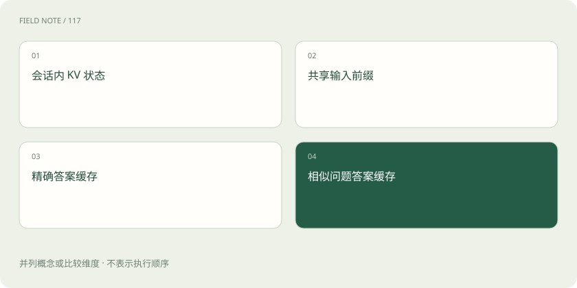

# 四种缓存：KV、前缀、答案与语义缓存有什么不同？

> 先确认缓存保存的是什么，才知道命中后省掉了哪一段工作。

专题：推理设施 · 整理于 2026-11-04

## 前置阅读

- [Prefill、Decode 与 KV Cache：一次回答的内部旅程](prefill-decode.md)

## 先用一个类比理解

厨房可以保留备菜状态、共用底汤、存现成套餐，或按相似订单推荐旧套餐。它们节省不同工序，也有不同的失效风险。

类比只帮助建立直觉，不等同于完整机制。

## 一图看懂

## KV 与前缀缓存保存计算状态

会话内 KV Cache 避免后续生成重复计算已有 Token 的部分状态；前缀缓存把可复用的公共输入状态留给兼容请求使用。复用通常要求模型、Token 前缀及相关配置相容。省掉输入计算不代表后续答案已经生成，也不意味着减少了所需输出长度。

## 答案缓存复用整个或部分结果

精确答案缓存可基于模型、输入、参数、资料版本等生成键，命中时直接返回已有结果。涉及订单状态或时间敏感数据时，还需要失效策略。只用问题文字做键，可能把不同用户、不同资料或不同语言要求下的答案错误复用。

## 语义缓存多了一层误匹配风险

语义缓存尝试把相近请求映射到旧答案，适合有明确容错边界的任务。“允许外借吗”和“不允许外借的例外是什么”很接近，但并不是同一个问题。应验证匹配是否保留实体、时间、否定词与权限条件，不能只调高相似度阈值就宣称安全。

## 缓存治理也属于业务正确性

缓存键和隔离范围要考虑租户与权限，更新文档后应能淘汰旧结果，故障时要看回源压力。统计命中率时应按缓存类型分别记录；命中次数高却频繁给错答案不是优化成功。冷缓存、热缓存与过期失效场景应分别测试。

## 放在一起对比

| 缓存 | 保存对象 | 主要省掉什么 | 主要风险 |
| --- | --- | --- | --- |
| 会话内 KV | 历史注意力状态 | 重复状态计算 | 显存与状态生命周期 |
| 前缀缓存 | 公共输入状态 | 重复 Prefill | 命中兼容性与隔离 |
| 精确答案缓存 | 旧响应 | 新推理调用 | 过期和缓存键遗漏 |
| 语义答案缓存 | 相似请求响应 | 新推理调用 | 语义误匹配 |

## 真实场景

两位用户都问“我的额度还剩多少”。若缓存键没有用户身份，就可能把甲的额度返回给乙。问题字面完全相同也不能复用个人结果。

## 常见误区

缓存感知路由常关注状态的位置，语义答案缓存关注请求的相似性，它们不是同一个功能。

## 想一想

前缀缓存命中后，能直接拿上次的完整答案给用户吗？

查看解释

不能据此推出。前缀缓存复用输入状态，后续输出仍需要生成；答案复用是另一种机制。

## 关联阅读

- [缓存感知路由：把请求送到有共同前缀的地方](cache-routing.md)
- [配额、预算与计量：三个不同的控制面](gateway-budgets.md)
- [引用、证据与拒答：知识库助手怎样才算有依据？](rag-evidence.md)

## 原始资料

- [vLLM · 自动前缀缓存](https://docs.vllm.ai/en/latest/features/automatic_prefix_caching/)
- [LiteLLM · 缓存](https://docs.litellm.ai/docs/caching/all_caches)

原创讲解；图示和类比经过简化，数字示例不代表实测。工具功能以对应版本官方资料为准。
