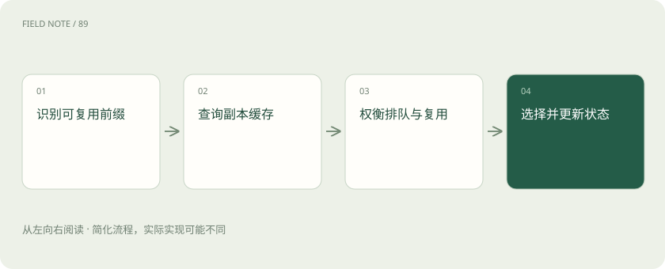

# 缓存感知路由：把请求送到有共同前缀的地方

> 共同前文已经算过时，可以优先送到保存着这份计算结果的副本，但还要看排队。

专题：接入平台 · 整理于 2026-11-04

## 先说这篇在讲什么

许多人同时根据同一份产品手册提问。如果某台模型服务已经计算过这段相同前文，下一个请求有机会少算一部分。缓存感知路由就是在安排接待位置时，也考虑这项已有工作。

## 先看一个具体例子

把时间戳放在每次请求的最前面，会让后面的长篇相同说明无法形成相同前缀。调整稳定与变化内容的排列，有时比增加缓存容量更直接。

## 遇到陌生概念，可以先读

展开前置阅读建议

- [智能路由与负载均衡：把请求交给谁？](routing.md)

## 先用一个类比理解

像去复印店，已有底稿的店可能省准备时间，但也可能排长队。

类比只帮助建立直觉，不等同于完整机制。

## 一图看懂

## 先分清复用的是哪一部分

这里主要说前缀缓存：输入开头的相同 Token 序列，已经形成部分可复用计算结果。新问题仍然需要继续生成答案。它不是把所有意思接近的问题都返回同一个旧答案，后者属于另一类答案缓存。

## 路由器怎样利用已有缓存

路由器是决定请求去哪里的组件。它如果知道各副本保留了哪些共同前文，就可以优先选择已有匹配结果的副本。是否能复用，还要看模型版本、具体序列和服务的隔离安排，不能只看文件名相同。

## 节省计算和多等一会，怎样取舍

假设热副本能省下一些输入处理时间，但前面排了很多请求，空闲的冷副本反而可能更快。路由应把缓存收益和队列等待一起看。缓存记录也可能过时，因为结果已经被腾出空间，实际执行时不一定命中。

## 没命中时，仍应能正常处理

缓存是一种加速机会，不是完成任务的必要证据。未命中应能回到正常计算。不同用户和团队的缓存复用，还应符合权限与服务安排，不能因为文字相同，就暴露他人请求是否出现过或共享不该共享的状态。

## 读完先记住这一句

缓存能省计算，但不能保证那个副本没有更长的队伍。

## 常见误区

语义答案缓存与 KV 前缀缓存不是同一层，命中率也不能直接等同端到端加速比例。

## 想一想

前缀缓存命中是否等于直接复用上次完整答案？

查看解释

不是，它主要复用输入处理的中间状态，后续生成仍需进行。

## 关联阅读

- [Prefill、Decode 与 KV Cache：一次回答的内部旅程](prefill-decode.md)
- [模型路由：质量、成本与失败代价怎么比](routing-evaluation.md)
- [连续批处理与分块预填充：让不同请求一起走](batching-prefill.md)

## 原始资料

- [vLLM · automatic prefix caching](https://docs.vllm.ai/en/latest/features/automatic_prefix_caching/)

原创讲解；图示和类比经过简化，数字示例不代表实测。工具功能以对应版本官方资料为准。
