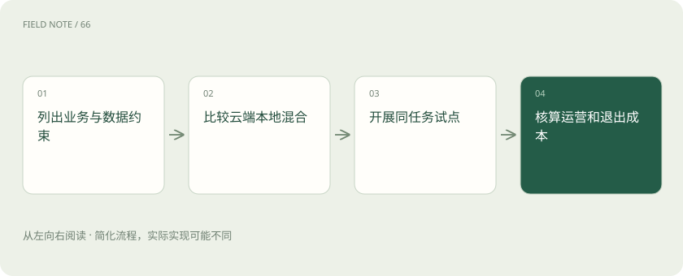

# 云端还是本地：从一项业务试点做选择

> 拿同一批维修任务试用不同方案，同时比较数据边界、回答质量和长期开支。

专题：行业技术栈 · 整理于 2026-11-04

## 先说这篇在讲什么

假设工厂想做一个维修问答助手：师傅输入设备故障，助手帮忙查手册。模型放在外部服务商那里，还是放在自己的机房？这不是单看哪边回答更聪明就能决定的事。我们需要把资料能去哪里、现场能等多久，以及谁来维护机器一起放进比较表。

## 先看一个具体例子

工厂经常断网，可以先让关键安全资料支持离线检索，并写明断网后哪些问题只能查原文、哪些任务必须停止。云端答案再好，现场连不上也用不了。

## 遇到陌生概念，可以先读

展开前置阅读建议

- [AI 技术栈全景：市场上这些工具分别卖什么？](industry-stack.md)

## 先用一个类比理解

外部订餐省去部分厨房维护，自建厨房则能自己安排设备和流程，但需要养设备、付人工。云端和本地的取舍也要算完整账。

类比只帮助建立直觉，不等同于完整机制。

## 一图看懂

## 先写下必须满足的条件

维修师傅问“这台机器报警后先检查哪里”，答案不仅要正确，还要及时。先列出哪些工单不能传出公司、设备术语是否需要准确识别、最长能等多久，以及系统停用时怎么办。把模型交给外部服务商运行，叫云端服务；放在自己控制的环境里运行，叫本地部署。云端减轻部分运维工作，本地便于控制环境，两者都要按这些业务条件检查。

## 用同一份考题做小试点

挑一批真实但已脱敏的维修问题，给不同方案相同资料和问题。记录回答是否准确、等待多久、用了多少费用，再试员工越权访问、服务中断和升级失败等情况。升级出错后能退回旧版本，叫版本回滚。小试点的价值是先看见这些实际表现，而不是只听“支持高可用”一类承诺。

## 一部分留公司，一部分交云端

比如敏感工单只在本地处理，允许外发的通用手册交给云模型，这叫混合方案。程序必须先判断资料属于哪一类，再决定发往哪里，这个选择过程叫路由。分类错了仍可能把敏感资料发出去。云端连不上时，也要明确是给出有限答案、排队等待还是暂停任务；不能假定本地模型随时能给出同样质量的结果。

## 算全年账，也算以后搬家的账

本地模型即使不按次收费，机器闲置时仍要承担折旧、供电和人员开支；忙起来也可能需要加机器。云端按使用量付费，能减少部分闲置，却要面对限流、价格和服务变化。把购置、运行、维护等支出合起来，叫总拥有成本。还要检查原有资料、接口和测试题能否搬到其他方案，避免将来更换时全部重做。

## 放在一起对比

| 方式或概念 | 主要作用 | 关键边界 |
| --- | --- | --- |
| 云端 | 服务商承担部分运维 | 数据与服务依赖 |
| 本地 | 控制部署环境 | 承担硬件与人员 |
| 混合 | 按约束分配任务 | 增加分类与路由责任 |

## 读完先记住这一句

先用业务条件和同一批任务比较，再决定模型放在哪里。

## 常见误区

自己部署仍需做好权限、补丁和监控；云端的一次调用价格，也不足以说明一整年的费用。

## 想一想

本地模型没有每次调用的接口费，长期就一定更省钱吗？

查看解释

不一定。要把硬件折旧、耗电、维护人员、升级和机器闲置的成本加进去，再与同等任务量下的云端账单比较。

## 关联阅读

- [AI 技术栈全景：市场上这些工具分别卖什么？](industry-stack.md)
- [文本、多模态、推理模型与开源权重，怎么区分？](model-choices.md)
- [模型路由：质量、成本与失败代价怎么比](routing-evaluation.md)

## 原始资料

- [rag solution design and evaluation guide](https://learn.microsoft.com/en-us/azure/architecture/ai-ml/guide/rag/rag-solution-design-and-evaluation-guide)

原创讲解；图示和类比经过简化，数字示例不代表实测。工具功能以对应版本官方资料为准。
