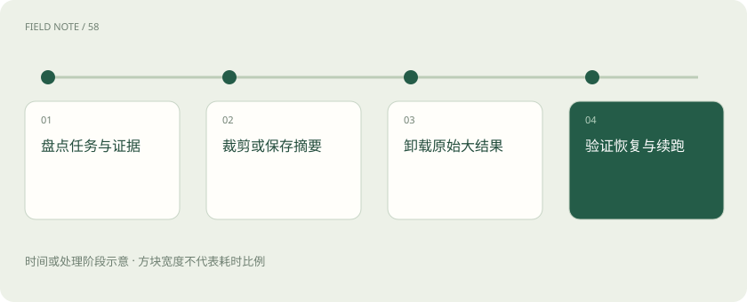
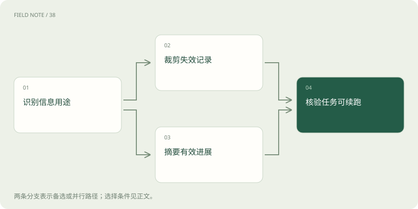
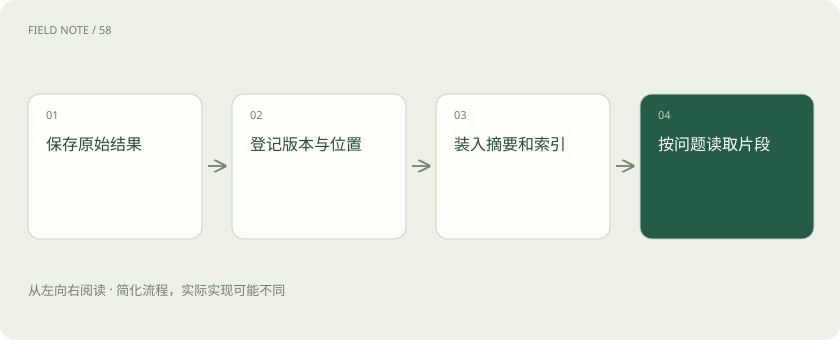

# 上下文压缩：缩短输入而不丢失任务

> 你替同事接手一趟出差安排，通常需要知道已经订了什么、还有什么没办、哪些要求不能忘，而不必重听几小时讨论。

专题：智能体 · 整理于 2026-11-05

## 先说这篇在讲什么

你替同事接手一趟出差安排，通常需要知道已经订了什么、还有什么没办、哪些要求不能忘，而不必重听几小时讨论。上下文压缩就是给助手做这种交接笔记。它能省空间，但摘要必然有所取舍，漏掉不能转机这样的条件，后续安排就可能出错。

## 先看一个具体例子

把“客户只要建议，还没授权购买；查询工具超时，库存未知”压缩成“建议购买、无库存”，就把两条意思都改了。好的短笔记要留下未授权和未知状态，而不只是减少字数。

## 遇到陌生概念，可以先读

展开前置阅读建议

- [上下文装配：决定模型这一轮看见什么](context-assembly.md)
- [智能体不是连续聊天：一张服务工单的状态旅程](deep-agent-state.md)

## 先用一个类比理解

把长聊天整理成能接手的笔记，像把办事经过整理成接手者看得懂的工作笔记。

类比只帮助建立直觉，不等同于完整机制。

## 一图看懂

## 先确定哪些内容不能丢

出差讨论很长时，先列出出发日期、预算、不能转机、已买票和待订酒店。这些内容决定后续行动，应优先保留。压缩的目的不是字数最少，而是让助手还能正确继续。删掉大量闲聊有帮助，删掉一句不能转机却可能让整个行程不符合要求。最简单的做法是给记录加上对象和日期，让人一眼知道这句话说的是哪次任务。同一个用户同时办两件事时，也不会因为名字相同就混在一起。明确对象以后，后面的查询和回答才能接上。

## 裁剪是直接去掉一些内容

裁剪指移除不再需要的消息，例如重复的酒店列表和已经撤销的方案。它不改写原句，但仍可能删错内容。最早消息里常有任务要求，所以不能只按时间删除。某条记录虽然旧，若保存了唯一订单号或重要限制，就应继续保留或移到专门的任务记录。还可以给每条内容写上来自哪里，例如用户刚确认、服务返回或助手推测。接手者无需猜语气，就能知道要不要再问。遇到互相矛盾的说法时，把分歧留下，别为了笔记顺口强行合并。

## 摘要是换一种更短的说法

摘要会重新表达信息，因此有损，不能保证所有细节都还在。原话可能赶不上早班车不能缩成赶不上早班车，否定词、数字、单位和条件都很重要。写摘要时分清已确认、猜测和待查询，让接手者知道哪些可以直接使用，哪些还需要核实。记录最好能回答现在可以做什么、还在等什么。等待付款确认和等待用户选日期会引出不同的下一步。把等待对象写具体，就能避免助手反复查询一个其实需要用户补充的问题。

## 长文件可以先放在外面

卸载是把日志、表格或全文保存在文件等外部位置，本轮只提供概要和有关片段。它减少输入，不代表原文消失，也不代表模型已经读过全文。要留下能用的文件入口、版本和片段位置；新问题涉及别处时再读取，入口失效就无法据此继续核对。如果返回内容不完整，也要说明缺了哪些部分。只查到一家店的价格，不能据此宣称已经比较全部候选。信息不足时保留问题，下一轮才有机会补齐，而不是被一段肯定的总结带偏。

## 工具请求和回复要一起处理

工具调用是助手提出的请求，回执是对应的执行结果，一些接口要求它们按规定配对。裁剪不能随便只留其中一半。订票请求超时后还应保留结果未知，不能摘要成购票失败；没有收到回复，既不能证明成功，也不能证明没有出票。可以在测试任务中故意停一次程序，再看看重新打开后读到了哪些内容。这样能发现实际保存位置和设想是否一致。若某一步尚未保存，就应明确它可能重做，而不要把自动恢复当作无条件承诺。

## 别把存档当成外部撤销

检查点是程序保存的进度，能让任务重新载入，但无法撤销车票服务已经完成的购票。压缩记录要留下请求号和业务状态。恢复后先查实际订单，再决定是否重试；否则同一个动作重复执行会造成重复付款等副作用，聊天摘要本身不会自动防重。重复读取通常只是多查一次，重复付款却会增加真实订单，所以两者需要不同处理方式。恢复设计应关注动作实际改变了什么。服务没有查询能力时，也应明确告诉接手者结果仍待人工确认。

## 多次压缩后回看关键原文

摘要再摘要容易逐渐丢掉细节，例如首次摘要保留可免费取消到周三，下一次只剩可取消。临近付款时应回看订单原文，而不是继续依赖简写。保存原始材料版本也很重要，文件更新后旧行号可能指向不同内容，原来的结论需要重新核对。对变化较快的信息，可以写清再次使用前需要重查。例如余票、权限和合同版本都不宜长期照搬。稳定的任务编号则可以继续保留。这样不必把所有事情从头做，也不会完全相信过期记录。

## 用一次接手练习检查效果

让助手仅依据压缩后的材料说明剩余事项，检查是否仍记得不能转机、订单是否已确认，以及哪里能找到原始价格条款。再放入一次超时和一次日期修改，观察会不会重复买票或使用旧要求。能省多少字只是一个指标，能否正确续办才是关键。任务结束后仍可留下一份简短结果，说明做成了什么、哪些事项没有执行。它能帮助用户决定后续怎么处理。检查时最好对照订单、文件等实际结果，而不是只看最后回答是否显得自信。

## 图解：压缩方法的分路

失效信息可删除，有效进展需提炼，两路都接受恢复核验。

## 图解：证据卸载流程

索引进入上下文，原件留在可访问存储。

## 放在一起对比

| 方案 | 保留内容 | 适用边界 |
| --- | --- | --- |
| 裁剪 | 剩余原始记录 | 适合明确失效内容 |
| 摘要 | 事实与进度提炼 | 需要检查遗漏和语义变化 |
| 卸载 | 摘要及原件入口 | 需要可靠读取和版本控制 |

## 读完先记住这一句

压缩应保住继续做事需要的条件，关键结论仍要能回看原文。

## 常见误区

以为系统保存过全部聊天，模型这一轮就一定读到了每一句；实际还要检查哪些信息进入了本轮输入。

## 想一想

摘要读起来更流畅，是否足以说明压缩成功？

查看解释

不够。还要检查要求、否定条件、已经发生的动作和未知事项是否保留。漏掉这些，后续任务可能在顺畅阅读中走错方向。

## 关联阅读

- [上下文工程：在有限窗口里保住关键事实](context-engineering.md)
- [短期记忆：线程怎样接着做事](short-term-memory.md)
- [RAG：让模型先查资料，再组织答案](rag.md)

## 原始资料

- [Anthropic：有效上下文工程](https://www.anthropic.com/research/effective-context-engineering-for-ai-agents)
- [LangChain：记忆概览](https://docs.langchain.com/oss/python/concepts/memory)

原创讲解；图示和类比经过简化，数字示例不代表实测。工具功能以对应版本官方资料为准。
