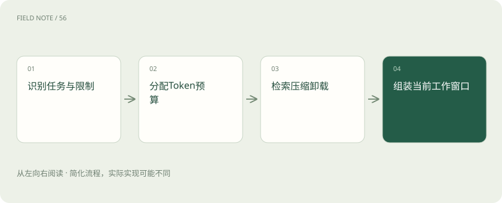
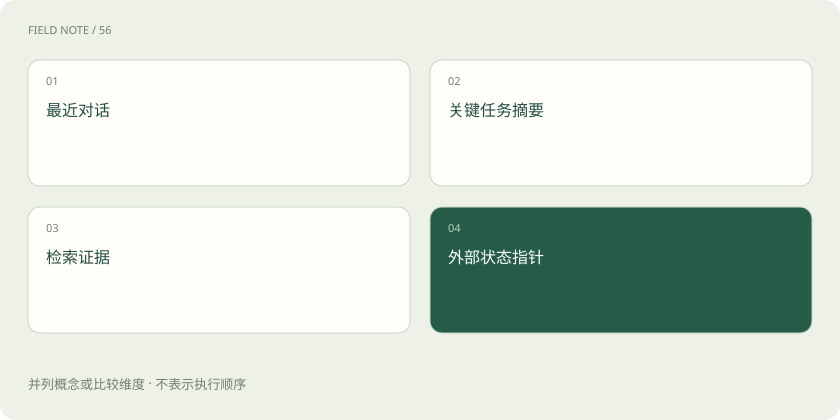
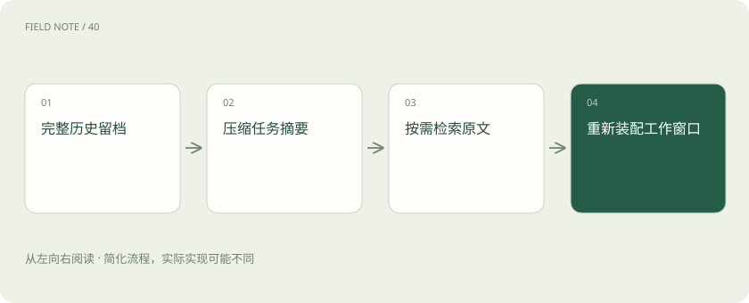

# 上下文工程：在有限窗口里保住关键事实

> 上下文工程，就是为模型这一轮挑选、整理并放入真正需要的信息。

专题：智能体 · 整理于 2026-11-05

## 先说这篇在讲什么

你让同事处理一张工单，会把客户要求、故障记录和当前进度交给他，不会把公司所有文件一股脑搬过去。给模型安排这一轮的材料，也需要做类似选择。这就是上下文工程：该让它看什么、哪些先保留、哪些可以稍后再取。

## 先看一个具体例子

客户要求“先给维修建议，不要直接下单”。后面即使有很长的聊天和工具记录，这项限制仍要保留在当前输入里；否则模型可能只看见备件缺货，直接提出购买操作。

## 遇到陌生概念，可以先读

展开前置阅读建议

- [Token、上下文和幻觉：为什么它会忘，也会编？](tokens-context.md)
- [智能体记忆：上下文、笔记与长期存储](agent-memory.md)

## 先用一个类比理解

把上下文看成当前工作桌：文件柜可以很大，但桌面有限，办这件事需要的材料要先找出来放上去。

类比只帮助建立直觉，不等同于完整机制。

## 一图看懂

## 先问这件事需要哪些材料

客户说机器发烫，请给维修建议。模型可能需要设备型号、最近的故障、允许做的动作和手册相关段落。它通常不需要上个月所有客服聊天。上下文工程从任务开始，挑出本轮真正有帮助的信息。这里的“工程”不是一种神秘算法，而是一组整理输入的做法：从哪里取材料、取多少、怎样排列，以及缺少时该怎么办。材料安排得好，已有能力才更有机会用到正确地方。

## 模型参数、文件柜和桌面别混在一起

参数是训练得到的内部数值；数据库、文件和产品记忆可以放长期资料；上下文是本轮交给模型处理的内容。它们可以合作，但不是同一样东西。你把一份维修手册存到系统里，通常没有修改模型参数；只有系统选出相关内容放进输入，模型才可能据此回答。文件柜里有一本书，不代表办事的人此刻正在翻那一页，这个比方能帮助你理解存储与取用的距离。

## 当前窗口有限，所以先保留重要要求

一次允许处理的内容长度叫上下文窗口，通常按 Token 计算。Token 是前面讲过的处理单位。窗口很大，也不能保证每条信息都被有效利用。应先留当前任务、不能违反的要求和已经确认的关键状态，再考虑一般背景。例如“不要直接购买备件”比十轮寒暄更重要。若只保留最近几句话，早先的重要限制可能恰好被删掉，任务方向就会改变。

## 历史对话为什么不能只靠从头搬到尾

完整历史可能包含过时计划、已经纠正的误解和重复内容。全塞进去既占空间，也可能让新旧说法互相干扰。可以保留当前阶段需要的对话，把较早部分整理成摘要，原始记录另存以备查。摘要要说明现在确认了什么、哪些事还没做、还等谁提供信息。把“试过重启但失败”缩成“已处理重启”，就可能误导下一轮，以为故障已经解除。

## 参考资料要选对，也要让人知道出处

RAG 会从资料库找出可能相关的片段，放进当前输入。挑选时不能只看字面相像，还要看设备版本、日期、适用范围等条件。若手册写“先断电再复位”，就不能切块后只传“按复位键”。出处也有用：回答不确定时可以回看原文，而不是继续猜。检索负责把材料找来，上下文整理还要决定保留哪些条件、怎样避免矛盾资料混作一条规则。

## 工具结果也需要整理，不是原封不动越多越好

数据库查询可能返回很多行，网页可能带大量导航和广告。模型需要的是任务有关的字段和事实，而不一定是整份杂乱输出。可以保留订单状态、时间和查询编号，把无关内容缩减；但是不能删掉影响结论的单位、限制或错误信息。尤其别把工具失败后返回的空列表理解为“没有符合条件的订单”，失败说明也属于本轮应看到的重要材料。

## 临时笔记帮助下一轮接着做

Agent 连续办事时，需要知道目标、当前状态、已经执行的步骤和下一步等待条件。可以把这些整理成简短工作笔记，再和本轮的新输入一起提供。笔记不能替代外部系统真实结果，例如工具超时之后，不能直接写“退款失败，可以再退一次”。应该保留“结果未知，需要先查询”。上下文不只影响回答措辞，也会影响下一步是否重复操作，所以状态描述要准确。

## 不够放时，按价值缩减，而不是随便砍尾巴

可以先删重复记录、缩短无关背景、只留下相关工具字段；仍不够时，再分步处理或按需取回细节。压缩通常会丢一些信息，所以关键约束、原始出处和未确认事项应特别保留。不要只以字数变少为成功标准。例如把十页合同压成一页很漂亮，却漏掉金额适用条件，后续推理可能一路顺畅地得出错误结论。更深入的压缩方法会在后续章节展开。

## 怎样知道整理后真的更容易做对

可以准备一组类似任务，对比整理前后是否仍能找到关键要求、引用正确材料和接着当前状态办事。还可以只改一个条件，例如把“可以下单”改成“先给建议”，看行为是否随之改变。输入更短、响应更快都有价值，但最终仍看任务是否做对。上文的桌面比方只说明材料选择，模型实际是在做数值计算；窗口越大或笔记越多，都不是可靠完成任务的保证。

## 图解：工作窗口的信息来源

四类信息按任务需要选择；摘要保留约束，证据支持判断，指针用于按需回读。

## 图解：上下文工程的关键检查

原始历史、摘要和检索材料各有位置，只有选入部分进入当前窗口。

## 放在一起对比

| 责任环节 | 具体判断依据 | 对应处置 |
| --- | --- | --- |
| 先算清一轮预算 | 假设一次请求总额度为 32000 Token，预留输出 4000，系统与规则 2000，工具定义 3000，当前问题 1000，则历史与证据最多还有 22000 | 若保留历史 6000，证据预算剩 16000 |
| 检索按问题带回证据 | 检索先用当前子问题定位候选，再根据相关性、时间、权限和来源筛选片段 | 排名最高不等于法律或业务上最适用，旧版制度可能词面更相似 |
| 遗忘与长期记忆不能混为一谈 | 遗忘是当前窗口不再包含某段材料；长期记忆是系统在窗口之外有选择地保存并重新取回信息 | 长期记忆并非每个 Agent 必需，单次报表任务往往只需任务状态 |

## 读完先记住这一句

模型只能利用本轮实际拿到的材料；保存过，不等于这次看得见。

## 常见误区

不能把聊天窗口里仍有记录，理解为每一轮模型都在读取全部记录；也不要用一段过短摘要替代关键限制和原始证据。

## 想一想

资料已经存进数据库，为什么模型本轮还可能不知道？

查看解释

因为存储和取用是两步。应用要先找到相关资料，并真正放进这一轮输入；没被取出的内容不会因为存在数据库里就自动参与回答。

## 关联阅读

- [Harness：让模型持续工作的运行环境](harness-runtime.md)
- [智能体设计模式：按任务结构选择控制方式](agent-design-patterns.md)

## 原始资料

- [Anthropic：上下文工程](https://www.anthropic.com/engineering/effective-context-engineering-for-ai-agents)
- [Anthropic：构建有效智能体](https://www.anthropic.com/engineering/building-effective-agents)
- [Anthropic：长期任务 Harness](https://www.anthropic.com/engineering/effective-harnesses-for-long-running-agents)

原创讲解；图示和类比经过简化，数字示例不代表实测。工具功能以对应版本官方资料为准。
