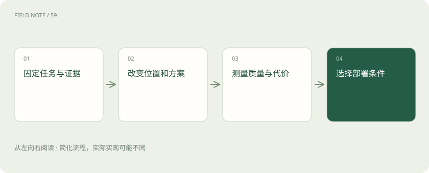
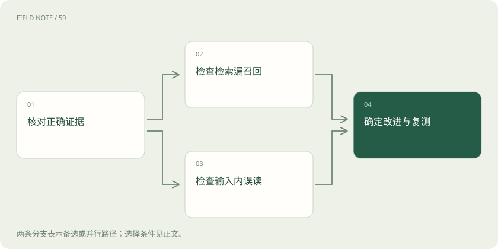
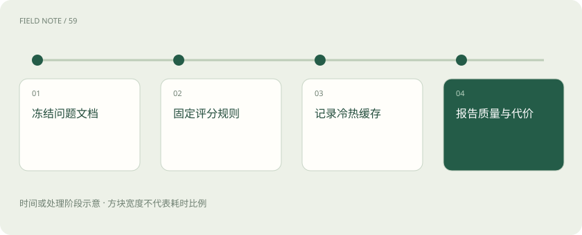

# 上下文评测：容量之外还要测什么

> 检验信息位置、检索选择与真实成本，区分缓存加速和内容记忆。

专题：智能体 · 整理于 2026-11-05

## 前置阅读

- [上下文装配：决定模型这一轮看见什么](context-assembly.md)
- [上下文压缩：缩短输入而不丢失任务](context-compaction.md)

## 先用一个类比理解

像验收图书馆：能放多少书是一项指标，读者能否找到并正确引用证据是另一项。

类比只帮助建立直觉，不等同于完整机制。

## 一图看懂

## 容量不等于有效使用

上下文窗口描述接口或模型可接受的输入输出规模，不能直接推导出模型在任意位置都能稳定使用所有信息。有效使用还涉及找到证据、关联多处线索、处理冲突并遵守要求。系统接受请求且没有报长度错误，只证明输入符合某些边界，不证明回答已经覆盖文档中的全部关键内容。

教学中的采购助手读入一整套招标文件后，仍可能漏掉补充通知中的排除条款。验收需要让它根据具体条款判断资格并给出出处，而不是询问“是否读完”。当任务要求跨文档计算或核对例外时，也应分别设计样本，不能用简单关键词检索成绩替代综合任务质量。

## 位置敏感需要受控检验

Lost in the Middle 研究在所测试的模型和多文档问答、键值检索任务中发现，相关信息的位置变化可能明显影响表现，部分设置中首尾表现优于中间。这是特定实验条件下的证据，不意味着所有当前模型、所有长度与所有任务都必然服从同一条曲线，也不能据此捏造某个产品的准确率。

可以保持问题、证据内容与干扰材料基本一致，只移动证据到开头、中部和结尾，并重复运行。这样更容易判断位置是否影响当前系统。若移动时同时改变文档数量或删掉矛盾材料，就无法把差异单独归因于位置；测试记录应保留样本版本与实际输入。

## 长文本与检索是可比较方案

长文本方案把较完整材料交给模型，有利于保留跨章节关系，但会带入更多无关内容。RAG 先选择片段，能压缩输入，却可能漏掉关键例外或切断条款之间的依赖。两者可以组合：先检索定位章节，再读取相邻段落或全文，而不是必须在全量输入和少量片段之间二选一。

招标任务可同时比较全文、固定片段检索和检索后扩展阅读。评测时使用同一问题集和文档版本，记录检索阶段是否找到了正确证据，以及生成阶段是否正确理解。若证据根本未进入输入，应优先调查召回和筛选，不能一概归因于模型推理能力不足。

## 模型机制与信息选择分层

位置编码及 RoPE 扩展、长序列训练、注意力实现和上下文并行属于模型与系统层面的议题；RAG、摘要和按需读取则决定应用把哪些信息送进输入。前者可能改变模型可处理长度、学习行为或运行资源需求，后者改变具体任务的信息配置。它们相互影响，却不是可以互相替代的同一种技术。

这里仅说明讨论边界，并不穷尽长上下文机制，也不提供未经核验的算法细节。应用团队即使无法改动模型训练，仍可评测证据选择和消息组织；升级支持更长窗口的模型之后，也需要重新验证既有检索与压缩方案，不能假设原有最佳配置会自动保持最优。

## 质量指标必须对应任务

质量可以拆成事实正确、证据引用、关键限制遵守、遗漏率与无法确定时的处理。采购助手除了答对资格，还应引用适用版本，识别缺少的材料，并在证据冲突时说明待核实点。单一总分可能掩盖严重失误，因此需要保留不同错误类别和代表性失败样本。

评分依据应尽量绑定可检查的条款、标准答案或人工复核规则。对存在多种合理答案的题目，要允许不同措辞但检查关键判断。模型自评可以辅助筛选待复核样本，却不能单独充当事实真值；尤其当生成与评分使用相似线索时，双方可能同时忽略同一项例外。

## 成本和延迟测完整链路

成本不只是输入令牌，还包括输出、检索服务、工具调用、摘要生成和失败重试。延迟也应覆盖从用户提交到得到可用答案的全过程，并分别观察检索、模型生成、工具等待与恢复开销。只比较模型首次响应时间，可能把快速给出错误结论的方案误选为最佳体验。

教学评测可以记录每题总费用、完成耗时和结果是否可用，再在相同质量要求下比较方案。需要区分缓存冷启动和命中情形，以及典型等待与较慢尾部样本。本文没有实测跑分，任何具体收益都应在明确模型、服务配置、任务集和测量日期后报告。

## 前缀缓存不是内容记忆

KV Cache 保存注意力计算中的键值中间状态，常用于避免生成过程中重复计算；前缀缓存进一步在满足服务兼容条件时跨请求复用相同前缀的计算。它帮助减少重复计算，并不自动保存用户偏好、更新事实或决定哪些证据应该进入下一轮。内容记忆则保存可供后续选择和读取的信息，涉及来源、范围、更新与删除规则，不能因为有缓存就省略这些管理。

同一份固定说明反复出现在前缀中，可能适合缓存；用户本轮新增的预算上限仍需作为有效内容进入输入。缓存命中也不证明旧说明正确或新证据已被读取。比较性能时要记录命中条件，比较答案时仍要核对实际输入版本，避免把计算复用误写为模型长期记住了任务。

## 建立回归集而非一次演示

回归集应覆盖短文档、长文档、位置移动、冲突版本、无答案问题以及跨文档依赖。每次改变模型、检索、摘要规则或工具定义时，重新运行相关样本，并检查总体收益是否以某类重要任务退化为代价。真实线上错误应转成脱敏样本补入集合，使评测逐渐接近实际使用环境。

结果报告需要说明样本范围、重复次数、评分方式与失败分布，不把单次成功演示当成稳定能力。选择方案时可以先设定质量门槛，再比较费用和等待；不同业务的门槛不同，无法从窗口大小直接得出统一采购结论。最终判断来自可复现任务结果，而不是宣传中的最大容量。

## 图解：定位失败阶段

证据未进入和进入后误读是两类诊断路径，最后都回到复测。

## 图解：公平比较准备

控制评测条件后再解读方案差异。

## 放在一起对比

| 方案 | 保留内容 | 适用边界 |
| --- | --- | --- |
| 全文输入 | 较完整材料 | 关注干扰与跨章节使用 |
| RAG | 检索选择片段 | 关注召回与例外遗漏 |
| 混合读取 | 检索定位并扩展 | 关注额外读取成本 |

## 真实场景

采购团队固定招标文档与问题集，比较全文、检索和检索后扩展阅读，移动例外条款位置，同时记录引用正确性、总费用和完成耗时。

## 常见误区

把缓存命中或窗口增大当作答案质量提升的证明。

## 想一想

如何区分检索失败和长上下文使用失败？

查看解释

先核对正确证据是否进入实际输入；未进入时检查检索，已进入再用位置和干扰对照检查使用表现。

## 关联阅读

- [上下文工程：在有限窗口里保住关键事实](context-engineering.md)
- [短期记忆：线程怎样接着做事](short-term-memory.md)
- [RAG：让模型先查资料，再组织答案](rag.md)

## 原始资料

- [Anthropic：有效上下文工程](https://www.anthropic.com/research/effective-context-engineering-for-ai-agents)
- [LangChain：记忆概览](https://docs.langchain.com/oss/python/concepts/memory)
- [Liu 等：Lost in the Middle](https://arxiv.org/abs/2307.03172)

原创讲解；图示和类比经过简化，数字示例不代表实测。工具功能以对应版本官方资料为准。
