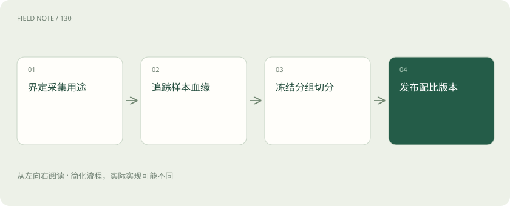
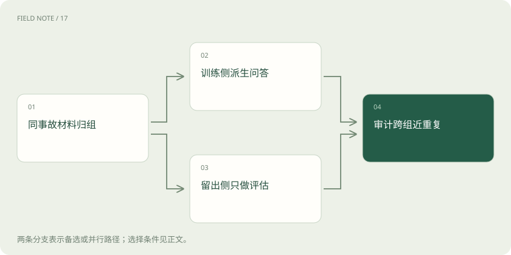

# 训练数据生产：从原始材料到可追溯版本

> 把许可、血缘、去重、标注与抽样连成一条可复查的数据链，解释为何测试隔离必须提前设计。

专题：训练与对齐 · 整理于 2026-11-05

## 前置阅读

- [训练数据质量：先修教材再加课时](data-quality.md)

## 先用一个类比理解

像食品生产的原料台账：成品出了问题，要能追到批次、配方与供应来源。

类比只帮助建立直觉，不等同于完整机制。

## 一图看懂

## 先确定训练行为需要什么证据

本站教学例子是一家设备服务团队，希望助手根据维修记录判断下一步检查项目。原始材料包括手册、工单和工程师复盘。三者并不能直接拼在一起：手册说明标准流程，工单记录实际发生的动作，复盘则可能包含事后才知道的答案。若把最终故障原因直接放进输入，训练任务就变成阅读答案。

负责人先定义真实使用时可获得的字段：设备型号、报警现象、已做检查，以及允许建议的动作范围。样本答案需要依据当时证据，而不是完整故事。这个任务合同决定采集范围，也决定如何识别无效材料。模型若需要识别不确定性，就必须保留证据不足的记录，不能只收集成功维修的漂亮案例。

## 采集许可是用途与来源的记录

下载到文件不代表可以训练、再分发或用于商业服务。团队应记录来源主体、取得渠道、允许用途、保留期限与撤回联系点，并区分文档版权、个人信息和合同约束。开源处理工具的许可只覆盖工具本身，不能替代手册、工单或模型权重的使用条件。存在疑义的材料先隔离，不能通过改写文字自动消除来源义务。

维修工单还可能包含客户地址、设备位置与员工姓名。去掉姓名仍可能通过时间和地点重新识别客户，因此应按任务需要删减字段、控制原始记录访问，并保留删除传播关系。这里提供的是数据治理思路，具体许可判断需要依据实际合同与适用规则，不能用公开可见作为统一的准入标准。

## 数据血缘要能从样本返回材料

血缘记录回答一条训练样本从哪里来、经过谁处理、依据哪个规则产生。至少连接原始文件标识、页段或工单编号、采集日期、清洗规则版本、标注批次和派生样本标识。内容指纹有助于发现相同材料，却不能代替来源证明；两个网站转载同一手册，指纹相近而权利链可能不同。

假设某批手册撤回授权，团队需要定位所有相关问答、改写版本和合成扩展，而不只是删除原始文件。已经训练完成的模型也不能因为删掉训练目录就宣称消除了影响；应评估受影响版本、替换方案与重新训练需求。血缘的价值在于支持影响范围调查，而不是给每个样本多加一个装饰性的编号。

## 去重同时检查文本与事件

完全相同的记录可以用规范化后的内容指纹识别；近重复则要考虑格式变化、转述和模板。维修团队可能把同一事故分别写成工单、日报和培训题，字面差异很大，却共享答案。若只按文本随机切分，它们会分散到训练与测试两侧，让记忆同一事故看起来像泛化。

合理顺序是先识别文档家族、事故实体和相近片段，再以组为单位切分。去重也不是删除所有相似文本：两个相近报警由不同原因造成，恰恰可能是关键难例。应保留区分依据，抽查被删除与保留的边界，并记录规则造成的语言、型号或少数故障类型覆盖变化。

## 标注规范描述判断过程

标注不只是填写一个标签。规范需要说明观察依据、允许答案、无法判断条件和冲突处理方式。例如报警温度升高可能来自传感器异常或真实过热，若工单缺少独立读数，标签应允许“补充测量”，而不是强行二选一。这样模型才会学习证据不足时的合理行为。

先让多位标注者独立处理同一小批材料，再讨论分歧。分歧可能来自文字歧义、专业知识差异或规范缺口，不能全部归为员工不认真。修订规则后还要回查旧批次。最终保存标注依据和仲裁版本，才能判断后续质量变化来自材料改善，还是标签定义悄悄发生了变化。

## 配比改变模型实际看到的世界

文件数量不等于训练暴露量。长手册可能贡献远多于短工单的词元；重复采样也会提高某类案例权重。团队应分别观察来源占比、词元占比、任务类型和难度分布。即使稀有故障在业务中很少，也可能因风险高而需要增加覆盖，但不能据此声称训练分布代表真实发生频率。

例如提升传感器异常样本后，应同时观察助手是否把真实过热误判为传感器问题。配比是效用取舍，需要在固定验证集上检查常见情形与关键少数群体。仅凭总体正确率选择配方，会让数量多的简单工单掩盖危险建议。每次调整只改变少量因素，保留与上一版可以比较的记录。

## 训练验证测试隔离要先于派生

训练集用于更新参数，验证集用于选择配方和停止时点，测试集用于最后检验。它们不是三份名字不同的文件，而是三种访问权限。若团队反复查看测试错误并据此补数据，测试集已经参与开发，不能继续把它当作完全未见证据。需要准备新的独立评估或明确说明选择偏差。

同一工单的摘要、翻译、改写与合成问题应留在同一个分组内。涉及未来事件预测时还要按时间安排边界，避免训练中出现测试时尚未发布的维修结论。切分策略必须对应部署问题：跨设备型号泛化与同型号新工单泛化是不同目标，不能使用同一个随机划分解释两者。

## 版本发布应包含可复查清单

一个可用版本同时冻结样本清单、来源许可状态、清洗与标注规则、分组切分、采样配方和已知限制。Hugging Face Datasets 的字段结构帮助保持列类型一致，但类型正确不保证标签正确；缓存指纹也不等于完整治理审计。数据卡应说明哪些型号、语言和故障类型不足，而不是只有总行数。

发布前用少量样本从训练条目追溯到原始证据，再从撤回来源反向定位所有派生条目，验证血缘能双向工作。版本比较要解释新增、删除与重新标注的原因。这样当模型表现退步时，团队可以判断是分布变化、标签更新还是训练流程问题，而不是只能猜测“数据可能不够多”。

## 图解：事故分组与用途隔离

分支表示两种互斥用途，最终审计不把内容重新合并。

## 图解：撤回来源的处置路径

新撤回事件可以再次启动流程；更新记录不会产生撤回事件，也不保证自动消除已训练影响。

## 放在一起对比

| 选择 | 机制或收益 | 限制与核验 |
| --- | --- | --- |
| 精确去重 | 识别相同内容 | 不能识别全部事件重复 |
| 事件分组 | 阻断事故泄漏 | 需要可靠实体关联 |
| 词元配比 | 控制训练暴露量 | 不等于真实业务概率 |
| 版本清单 | 支持复查与回退 | 不自动证明许可有效 |

## 真实场景

本站教学例子：同一压缩机事故的工单和培训问答必须整体进入同一分组；新增问答继承事故标识与许可状态。

## 常见误区

先随机切分再生成改写，会把同一事实的不同表述散布到训练与测试。

## 想一想

为何删除原始工单后，还要检查派生问答和已发布模型版本？

查看解释

派生文本仍可能包含同一信息，训练影响也不会随文件删除自动消失；血缘用于界定需要处理的范围。

## 关联阅读

- [训练数据质量：先修教材再加课时](data-quality.md)

## 原始资料

- [Datasets 字段结构](https://huggingface.co/docs/datasets/about_dataset_features)
- [Hugging Face 数据集卡](https://huggingface.co/docs/hub/datasets-cards)

原创讲解；图示和类比经过简化，数字示例不代表实测。工具功能以对应版本官方资料为准。
