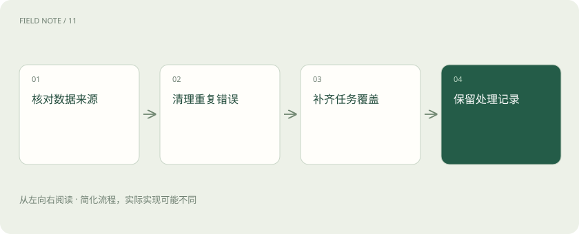

# 训练数据质量：先修教材再加课时

> 训练材料是否正确、是否重复、有没有覆盖真正需要的情况，都会影响学到的本领。

专题：训练与对齐 · 整理于 2026-11-04

## 先说这篇在讲什么

你要教一个人修机器，如果教材反复印错型号，就算让他多读十遍，也可能把错误记得更牢。模型的训练资料也有同样的问题。这篇先看“好材料”具体好在哪里，再理解为什么不能只追求数量。

## 先看一个具体例子

用户把设备编号中的字母和数字混写，虽然文本不整洁，却很有代表性。保留经过人工校正的对照样本，有助于覆盖真实输入习惯。

## 遇到陌生概念，可以先读

展开前置阅读建议

- [训练、微调与推理：学习和使用是两回事](training-inference.md)

## 先用一个类比理解

像编教材，重复印刷同一页不能弥补缺少整章内容。

类比只帮助建立直觉，不等同于完整机制。

## 一图看懂

## 正确，比数量本身更重要

训练会受到材料中规律的影响。若错误答案反复出现，模型可能把错误模式学得更牢。先检查关键事实、标签和样例答案；标签就是你告诉训练系统“正确结果是什么”的标记。

## 常见情况和少见难题都要有

如果客服材料几乎全是普通咨询，模型处理退款争议时可能缺少练习。覆盖面指资料是否包含实际会遇到的不同情况。清理材料时，也不能因为某种情况只出现一次，就把这个重要的罕见案例删掉。

## 重复、格式和来源也会影响学习

同一句话复制很多次，不等于新增了很多知识，还可能让它在训练里占比过大。角色、日期和金额的格式若前后不一致，也容易让训练目标变乱。记录材料来自哪里，有助于回头修错、检查授权和更新过时内容。

## 改了资料，怎样知道到底改善了什么

保留一份能代表真实任务的独立问题，比较使用不同资料训练出的结果。若训练材料和考题混在一起，高分可能只是因为答案已经练过。某个案例出错，也要先查资料是否漏写条件，不能直接认定模型太小。

## 读完先记住这一句

更多材料只有在有用、可信、合适时，才可能带来更好的训练效果。

## 常见误区

重复去除不能替代事实核验，数据越多也不意味着每类需求都得到照顾。

## 想一想

去掉完全重复文本后，教材就可靠了吗？

查看解释

没有，近似重复、事实错误、时效性和覆盖偏差仍需要处理。

## 关联阅读

- [SFT：用示范回答教会任务形式](sft-behavior.md)
- [评测集怎么分：避免把背过的题当能力](eval-splits.md)
- [知识蒸馏：把老师能力迁移给学生](distillation.md)

## 原始资料

- [Hugging Face · 5](https://huggingface.co/learn/llm-course/en/chapter5/5)

原创讲解；图示和类比经过简化，数字示例不代表实测。工具功能以对应版本官方资料为准。
