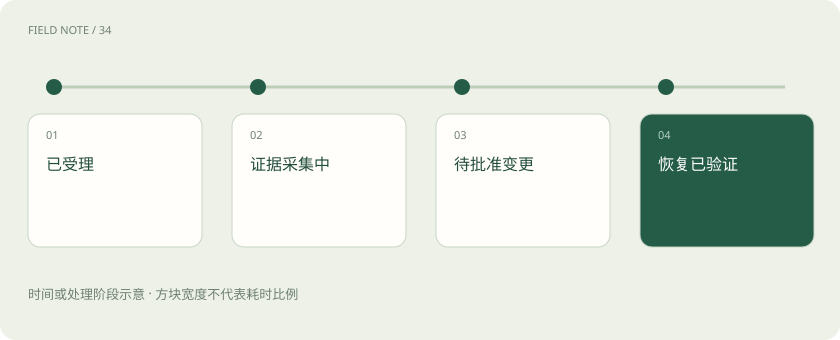
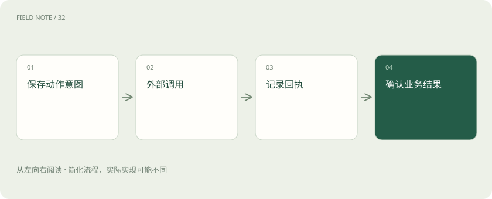

# 智能体不是连续聊天：一张服务工单的状态旅程

> 把目标、观察、工具和检查点串成可恢复的执行过程。

专题：智能体 · 整理于 2026-11-04

## 前置阅读

- [Agent 和工作流：从回答问题到执行任务](agent.md)
- [计划与停止：智能体怎样避免一直忙下去](agent-planning.md)
- [智能体记忆：上下文、笔记与长期存储](agent-memory.md)

## 先用一个类比理解

智能体像值班协调员，语言是计划载体，工单状态和系统回执才决定工作有没有完成。

类比只帮助建立直觉，不等同于完整机制。

## 一图看懂

## 先把愿望变成验收条件

假设用户要求处理工单 T42：应用连接数据库超时。目标不是“调查一下”，而是定位原因、生成有证据的处置建议，并在授权范围内完成动作。约束包括不能重启生产库、不能读取无关租户数据、必须在十分钟内交付初步结论。没有明确终止条件，智能体容易把持续搜索误当作进展。

## 状态中分开放置四种信息

目标记录要达到什么；事实记录工具已经观测到什么；假设记录待验证解释；计划记录下一步准备做什么。再加预算、权限和已执行动作清单。这些字段不能全部混成聊天摘要，例如“可能是连接池耗尽”若在压缩后变成“连接池已耗尽”，后续动作就建立在被篡改的事实之上。

## 计划应当允许被证伪

初步计划可以是读取告警时间、查询应用错误、比较数据库连接数，再决定是否检查网络。它是依赖图，不是必须按顺序完成的故事。若数据库监控正常但应用连接等待异常，就应转向连接池。每一步写明希望获得哪项观察，能够防止为了完成清单而进行无目的工具调用。

## 工具调用有结构契约

读取监控的工具应限定工单关联服务、时间窗口和租户，输出指标、时间戳、单位与完整性标志。模型负责选择工具和提出参数，执行层负责身份、权限、参数校验及超时。工具返回的文本是数据，不应成为提高权限或改变系统目标的新指令；日志内容可能包含不可信输入。

## 观察不是成功描述

假设工具返回“连接池等待 80%，数据库连接使用 35%”，这只是两个指标的观测，还需要核对采样时间、聚合口径与实例覆盖。超时返回可能意味着未知，不能解释为“没有异常”。状态更新应保留原始回执标识，将观察和解释并列，而不是让自然语言总结替代可追溯证据。

## 用实际轨迹检验推理

T42 在 10:00 创建；10:01 读到某应用实例连接等待上升；10:02 发现数据库总体连接正常；10:03 对照发布记录，发现该实例配置刚变更。智能体此时可提出连接池配置异常的假设，但不能宣告因果成立。接下来应比较变更前后配置或同版本其他实例，排除业务突增等替代解释。

## 读操作和写操作分界

诊断结果支持建议回退配置时，是否执行取决于用户授权、变更流程与风险门槛。可先生成变更计划，写明目标实例、旧值、新值、预期影响与回滚条件。即使工单标题写着“立即修复”，也不自动授予重启所有资源的权限；执行授权必须与实际动作和范围对应。

## 检查点应在边界上落盘

在外部写入之前保存动作意图、参数、幂等标识和审批状态，收到回执后保存结果。这样进程中断后可以辨别“未执行”“已成功”“结果未知”。只保存聊天文本无法可靠区分这些状态。检查点恢复还应重新确认权限和时效，因为十分钟前有效的审批未必适用于后来变更的参数。

## 记忆按时效和证据分层

本次执行状态服务于当前工单；跨任务记忆可以保存经过审核的故障模式与操作经验。租户凭据、临时日志和未经证实的猜测不应自动进入长期记忆。每条长期知识应有来源、适用系统和更新时间；经验只能帮助提出假设，不能覆盖这次监控数据和正式运行手册。

## 结束要对照原目标

T42 的最终交付应区分已确认事实、主要假设、已完成动作、仍待审批事项和后续观察窗口。如果没有执行变更，可以完成“诊断与建议”阶段，但不能把工单直接标成“故障已恢复”。目标状态由验收证据决定，不由回答语气或模型认为自己已经足够努力决定。

## 状态恢复还要处理世界变化

检查点保存的是过去的观察，不是永远成立的现实。工单恢复时，故障可能已经被其他值班人员修复，配置也可能再次变更。因此对关键事实设有效期，恢复后重新查询当前工单状态与目标资源版本，再决定继续原计划。

外部写入可以附带预期版本条件：只有配置仍处在诊断时看到的版本才执行回退。版本不匹配就停止并重新评估，避免旧计划覆盖新修复。这个条件不是模型推理技巧，而是把并发现实纳入动作契约，让恢复既能接续任务，也能承认世界已经改变。

## 图解：T42 状态变化

不同状态需要不同退出证据。

## 图解：执行检查点

进程恢复以持久状态为准。

## 放在一起对比

| 信息 | 例子 | 用途 |
| --- | --- | --- |
| 事实 | 数据库使用率35% | 约束解释 |
| 假设 | 配置引发等待 | 指导验证 |
| 计划 | 对比配置差异 | 安排下一步 |

## 真实场景

进程在提交回退请求后崩溃。恢复时先读取持久化动作记录和变更系统状态；如果变更系统已完成，则继续验证恢复指标。若状态未知，先查询而非重新提交。这个恢复动作依赖业务状态，不依赖模型能否从历史对话回忆起上次说了什么。

## 常见误区

让模型把全部历史改写成一段摘要会损失动作标识、否定状态与权限边界；结构状态应独立于可压缩的对话。

## 想一想

工具返回“请求已接收”能否标记修复完成？

查看解释

不能。接收、执行成功与业务恢复分别需要不同证据。

## 关联阅读

- [让智能体能停、能恢复、能安全交接](deep-agent-reliability.md)
- [让每个结论都有边界：RAG 的证据责任](deep-rag-evidence.md)

## 原始资料

- [LangGraph persistence](https://docs.langchain.com/oss/python/langgraph/persistence)
- [LangGraph durable execution](https://docs.langchain.com/oss/python/langgraph/durable-execution)
- [MCP tools](https://modelcontextprotocol.io/specification/2025-06-18/server/tools)

原创讲解；图示和类比经过简化，数字示例不代表实测。工具功能以对应版本官方资料为准。
