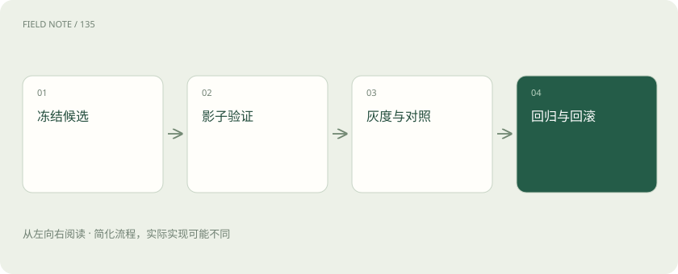
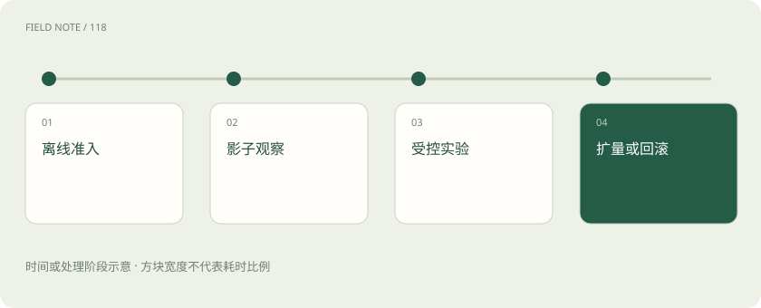
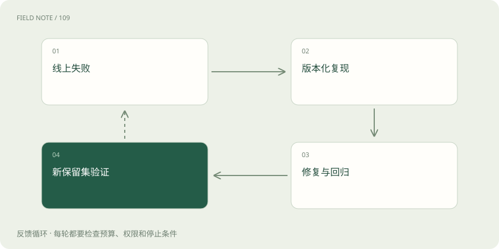

# 从离线分数到线上结果：一次可回滚的发布

> 先用固定题检查，再试真实请求和少量用户，把质量、等待与费用一起看，并随时准备恢复旧版。

专题：评测运行 · 整理于 2026-11-04

## 先说这篇在讲什么

新版助手练习题做得不错，接下来怎样让真实用户使用？可以先把真实问题复制给它试答，再给少量用户试用，最后比较实际任务结果。每一步都要能发现问题、停止扩大，并恢复旧版。本篇把这些步骤连起来，看看质量、等待时间和费用怎样一起影响发布决定。

## 先看一个具体例子

新检索器总体正确率提高，回答历史政策却错得更多。如果这类任务很重要，应停止扩大使用，恢复旧资料快照和策略，再用带历史日期的题复现。修好后重新走离线检查和小范围试用，不能只凭平均分上涨继续发布。

## 遇到陌生概念，可以先读

展开前置阅读建议

- [线上 A/B：离线高分之后还要看什么](online-ab.md)
- [回归、灰度与回滚：模型更新怎样避免越升级越差？](release-regression.md)
- [可观测性与安全：回答错了，应该查哪里？](observability-security.md)

## 先用一个类比理解

像新交通规则先演练再试行，既要看到真实效果，也要知道异常时怎么恢复。

类比只帮助建立直觉，不等同于完整机制。

## 一图看懂

## 先把准备发布的整套东西记下来

像记录一道菜的完整配方，发布助手要记录模型、提示词、检索资料快照、请求路由、工具输入输出约定和评分规则。只恢复模型，提示词仍是新版，可能恢复不了旧行为。先固定这套候选版本，检查答题质量、权限、工具会不会产生错误动作和资源消耗，并列出仍然存在的失败情况。这样后面测试的是同一套系统，发现差异也能知道当时运行了什么。

## 练习题通过，只代表可以继续试

离线测试是在准备好的固定题目上运行，适合公平比较和重现错误，却模拟不了全部真实流量、并发和用户反应。除了整体成功率，还要分任务类型看，有些严重错误必须直接挡住发布。同时记录耗时、输入输出词元数量、工具和重试费用。通过这一步，表示满足了进入下一阶段的要求，并不表示所有真实用户都会受益。

## 先复制真实问题，让新版在旁边试答

影子模式就是把真实请求另送一份给候选系统，但用户仍看原系统答案。它能暴露真实输入长度、格式、选路、超时和费用问题。涉及写入的工具必须改用只读、沙箱或禁止写入的替代方式，否则复制一份下单请求可能真的多下一单。由于用户没使用候选答案，影子测试看不到他们是否因此办成事，也不能完整衡量互动体验。

## 让少量真实用户试用，并盯住重要问题

灰度发布是先控制使用新版的人数或组织范围，再逐步扩大。要看关键错误和负载，也要覆盖计划服务的任务类型；只挑最容易的客户，可能把风险看小了。影响大的动作仍可要求人工确认。提前约好遇到什么情况就停止扩大，而不是等所有数字一起变坏。灰度限制影响范围，但选中的少量用户不一定能形成公平对照。

## 需要比较收益时，让两组同期随机使用

A/B 可以按用户、会话或租户稳定分组，让同一个会话不在两个模型间来回跳。两组同期运行，尽量只改变要测试的部分。若实验组挤占共享服务器，让对照组变慢，就混入了资源影响；用户互相分享答案也可能干扰比较。开始前说清主指标、不能变坏的保护指标、需要多少样本、何时停止，避免看到一天领先就宣布成功。

## 多点一次赞，不一定多办成一件事

点赞、复制、停留和追问容易统计，但只是间接信号。用户追问多了，可能聊得深入，也可能是第一轮没讲清。把这些信号与任务完成、关键错误、转人工和问题恢复时间一起看。还要留够观察时间：有的任务几分钟完成，有的要过几天。过早结算可能把尚未完成当失败，也可能漏掉之后才暴露的问题。

## 一次请求慢了，逐段查看它在哪里等

把总耗时拆开：入口排队、检索、重新排序、模型生成第一段文字、继续生成、调用工具和传给客户端。一次质量错误也要关联所用证据、模型版本和业务结果，只有一句“失败”很难排查。除了平均值，查看最慢那一批请求，并按长短输入等条件分组，避免少数用户持续受损却看不出来。日志要脱敏、限制保存时间，同时保留用于串联步骤的请求编号。

## 算费用时，看看多少钱才办成一件事

模型费用只是部分开支，还包括找资料、排序、缓存、重试、影子运行、人工审核和运营处理。举个假想例子：甲做1000次任务花100元，成功900次，每次成功约0.111元；乙花80元，成功600次，每次成功约0.133元。乙每次请求便宜，但完成同样数量的合格任务可能更贵。比较费用时要一起看成功标准，不能靠降低质量让账面数字变好。

## 扩大使用前，就写清怎样停和怎样退

可以约定权限泄露立即停止，关键错误超过要求就暂停，最慢请求耗时或费用持续超限就回滚，具体阈值由业务决定。回滚需要恢复模型、提示词、路由和兼容的资料版本。已经发出的消息、创建的工单和执行的业务变更不会自动撤销，要另有补偿或人工处理办法。发布前验证旧版确实能启动和接回流量，避免应急时才发现恢复路径失效。

## 把真实出错案例变成下次必查的题

发生新故障后，保存脱敏输入、当时版本、必要证据和判错理由，并标明问题出在检索、模型还是工具。开发可以用它修复，以后也要反复测试；但已经拿来练习的题不能再冒充没见过的考试题。最终保留测试集仍需隔离。定期从新流量抽样，看看任务类型、裁判判断和费用是否变化，系统发布后仍要持续检查。

## 一场实验的结论，也有适用时间和条件

这周在某类用户、某个模型和某种流量下有效，不代表节日高峰仍然一样。资料增加、用户结构变化、服务商更新，都可能改变结论。保存实验当时的条件，关键变化发生后再评。固定回归题负责拦住已知错误，新抽样负责寻找新问题：只做旧题容易越练越熟却脱离现实，只看随机新题又可能漏掉罕见严重故障。两种检查一起用，才能持续了解真实表现。

## 图解：发布路径

按箭头逐步检查，每一步的结果都决定下一步是否继续。

## 图解：故障回流

线上发现错误后修复并再次测试；练过的案例不能算作陌生考试题。

## 放在一起对比

| 阶段 | 可验证 | 不能独自证明 |
| --- | --- | --- |
| 离线 | 固定集质量 | 真实流量效果 |
| 影子 | 输入兼容负载 | 用户收益 |
| A/B | 同期效果差异 | 所有未来分布 |

## 读完先记住这一句

发布要逐步验证真实效果，并准备好整套配置的恢复和已执行动作的补救。

## 常见误区

每天看结果、挑领先那天提前结束，容易误判。按提前约好的观察规则进行，或使用适合持续观察的序贯分析方法。

## 想一想

影子测试通过了，为什么还要让少量用户试用？

查看解释

影子测试能看真实请求是否跑得通，但用户没用候选答案，我们还不知道他们是否真能办成事；工具副作用和完整互动也常被隔离，所以还需受控试用。

## 关联阅读

- [一句话穿过 Transformer：从文字到下一个词](deep-transformer-journey.md)
- [一份能够指导决策的评测集怎样建立](deep-eval-design.md)

## 原始资料

- [Google SRE canary](https://sre.google/workbook/canarying-releases/)
- [OpenTelemetry gen AI](https://github.com/open-telemetry/semantic-conventions-genai/blob/main/docs/gen-ai/gen-ai-spans.md)
- [Evaluation best practices](https://developers.openai.com/api/docs/guides/evaluation-best-practices)

原创讲解；图示和类比经过简化，数字示例不代表实测。工具功能以对应版本官方资料为准。
