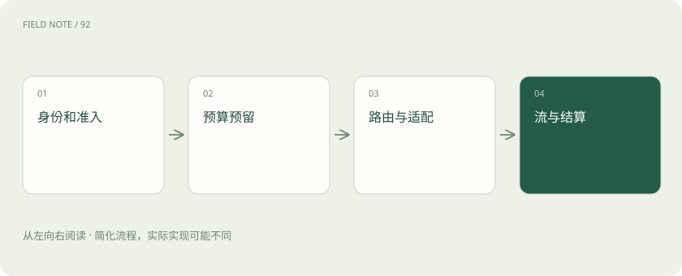
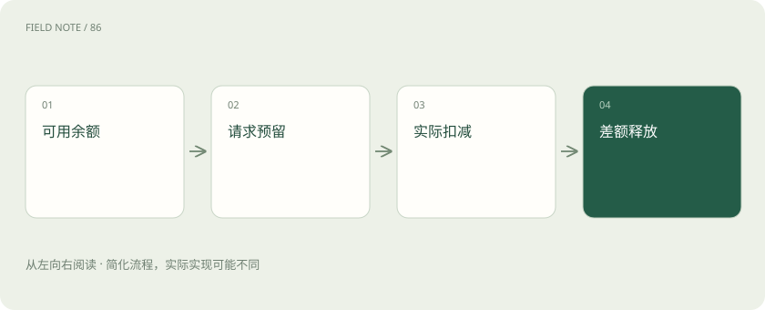
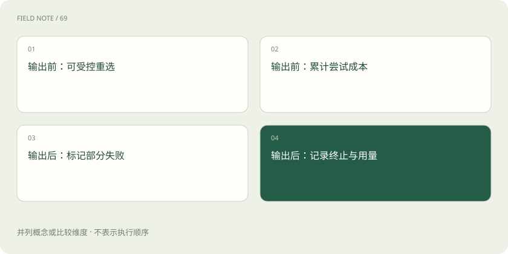

# 一次模型请求穿过网关的全过程

> 把认证、预算、路由、流式回传和结算放回同一请求。

专题：接入平台 · 整理于 2026-11-04

## 前置阅读

- [推理网关：为什么企业不直接调用模型？](gateway.md)
- [配额、预算与计量：三个不同的控制面](gateway-budgets.md)
- [流式输出与 SSE：为什么显示了字，任务还没完成？](streaming-events.md)

## 先用一个类比理解

网关像交通调度与收费站的结合：既判断能否通行，也记录实际走了哪条路和花了多少。

类比只帮助建立直觉，不等同于完整机制。

## 一图看懂

## 入口先建立请求身份

客户端发来业务请求后，网关为其分配关联标识，校验凭证并映射到租户、应用与操作者。认证回答“是谁”，授权回答“能调用哪些模型、工具和数据”。两者应分开记录。客户端自己填写的租户字段不能成为授权依据，否则换一个参数就可能占用别人的预算或访问别人的资源。

## 先形成允许集合

模型权限、数据驻留、上下文长度、工具能力和输出格式要求先过滤候选。随后才能讨论价格和负载。某便宜模型不满足结构化输出或所在区域要求，不能通过质量得分高来抵消硬约束。拒绝应提供可诊断原因，但不泄露其他租户的模型清单、容量和内部凭证。

## 限流与预算解决不同问题

每秒请求数约束流量突发，Token 速率约束处理压力，金额预算限制一段时期的支出。三者可能分别触发：一个超长请求并没有超过请求数，却可能占满 Token 配额。配额应按租户和资源层级组合，避免某个应用占满总池；限流返回应说明何时可重试，而不是促使客户端立即重发。

## 预留防止并发超支

生成结束前不知道准确输出长度，可以按输入量和允许最大输出估算预留。假设余额 10 元，两个并发请求各预估最多 6 元，若都先放行就可能超支。原子预留让第二个请求看到可用余额只剩 4 元。预留是占用额度，不等于最终收费；超时和取消都需要释放或进入待对账状态。 若允许重试或回退，预留还应覆盖整个请求可发生的总费用，或在下一次尝试前原子追加预留；无法取得额度就停止，不能只给第一次调用预留。

## 路由决策保存依据

在允许集合内根据任务质量要求、价格、队列、延迟目标和可用性选路径。记录策略版本、候选排除原因与最终选择，以便解释为什么同类请求被送往不同服务。选择之后再次核对目的端能力和限额，防止配置更新与请求执行之间出现竞态，尤其是权限撤销或模型下线。

## 适配器统一语义而非字段

供应方对消息角色、工具调用、停止原因、用量和错误格式的表达可能不同。适配器需要把它们映射到内部契约，同时保留原始语义和无法映射的差异。接口形状相似不表示模型行为相同；如果某端不支持特定能力，应显式拒绝或走经过验证的替代路径，不能静默丢字段。

## 首字节之前与之后不同

尚未向客户端发送内容时，某些失败可以在预算允许下切换候选；一旦已流式返回部分答案，再切另一模型可能出现重复、矛盾或截断。应定义是否终止流、标记部分失败或由客户端重新发起。工具调用片段还需完整组装并校验，不能把半个参数对象提前当成可执行指令。

## 断连不是自动免单

客户端断开连接时，网关应尽可能取消上游任务，但取消请求被接收不保证上游已经停止。已消耗资源仍可能计费，最终用量可能晚到或缺失。网关要区分用户可见完成、上游执行完成与财务结算完成三个状态，避免把断连请求直接删除，造成供应方账单无法核对。

## 按实际用量完成结算

收到权威用量后，将预留转成实际扣减并释放差额。假设预留 6 元、实际 2 元，应释放 4 元；若供应方用量缺失，使用明确标记的估计值并等待对账。输入缓存、输出、推理或其他计量字段应按供应合同处理，不能用字符数硬套统一价格。重复回调必须幂等结算。

## 日志连接质量与账本

请求链保留租户、策略、模型版本、时间分段、停止原因、用量状态与账本流水关联。敏感提示词按需要脱敏或不留全文。运营可以由此区分排队慢、上游慢、客户端慢和重试放大，也能计算每个合格任务总成本。缺少对账状态的成功率会把部分失败与额外费用藏在链路之外。

## 预留过期不能简单归零

网络分区时，请求可能仍在上游运行，网关却迟迟收不到用量。预留如果永久保留会锁死额度；如果到时立即释放，又可能让租户在实际费用未确认前继续消费。可以把额度转入待对账占用，设置保守的临时处理和明确的纠偏流水。

所有调整保留原请求关联标识，迟到回执不能造成第二次扣款。对账任务还应识别上游已计费但本地无完成记录的请求。这样的账本状态管理使平台能解释余额变化，也防止把偶发链路故障放大成长期财务差异。

## 图解：金额状态

账本操作需原子且幂等。

## 图解：流式分界

四项并列说明两阶段的不同责任：重选仍受预算和能力约束，已经输出后不应静默拼接另一模型答案。

## 放在一起对比

| 控制 | 对象 | 时点 |
| --- | --- | --- |
| 授权 | 允许资源 | 调用前 |
| 预留 | 最大预算占用 | 放行前 |
| 结算 | 实际费用 | 用量确认后 |

## 真实场景

一个请求预留 0.10 元，首个候选在输出前失败，备用模型完成并计费 0.04 元，首个候选另产生 0.01 元。请求总成本是 0.05 元，释放 0.05 元；不能只记录最终模型的费用。数字为假想演示，不代表实际定价。

## 常见误区

网关返回统一接口不等于各供应方的上下文限制、缓存语义和工具行为完全一致；能力差异必须进入准入和评测。

## 想一想

为什么请求结束后账本仍可能未结算？

查看解释

流结束、用量回执和供应方账单可能异步到达，需保留待对账状态并处理迟到信息。

## 关联阅读

- [路由不是选便宜模型：在硬约束下优化合格任务成本](deep-routing-policy.md)
- [让智能体能停、能恢复、能安全交接](deep-agent-reliability.md)

## 原始资料

- [Envoy rate limit](https://www.envoyproxy.io/docs/envoy/latest/intro/arch_overview/other_features/global_rate_limiting)
- [LiteLLM budgets](https://docs.litellm.ai/docs/proxy/users)
- [OpenAI streaming](https://developers.openai.com/api/docs/guides/streaming-responses)
- [OpenTelemetry gen AI](https://github.com/open-telemetry/semantic-conventions-genai/blob/main/docs/gen-ai/gen-ai-spans.md)

原创讲解；图示和类比经过简化，数字示例不代表实测。工具功能以对应版本官方资料为准。
