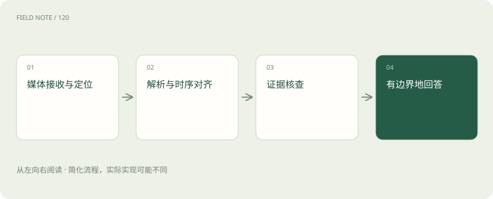
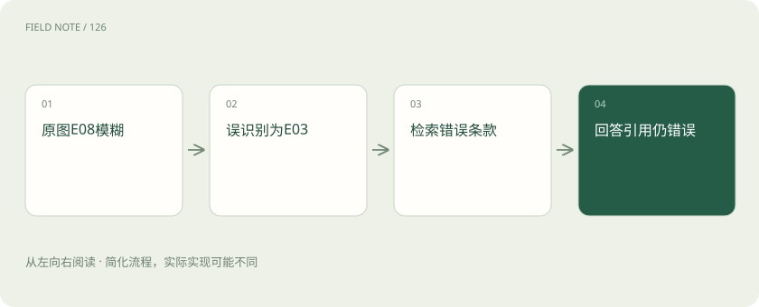
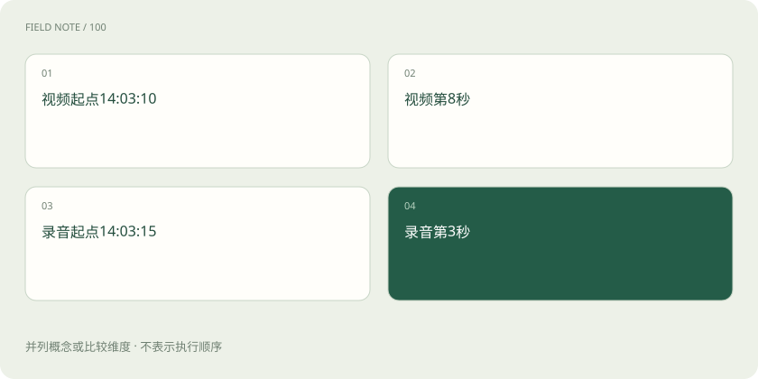

# 从现场图片、视频和录音到可核查的故障结论

> 沿一张故障工单理解不同媒体怎样成为证据，以及误差怎样跨阶段传播。

专题：多模态 · 整理于 2026-11-04

## 前置阅读

- [视觉理解与 OCR：看见文字不等于读懂表格](vision-ocr.md)
- [视频理解：多看几帧还要理解时间关系](video-understanding.md)
- [ASR 与 TTS：从声音到文字，再到声音](speech-asr-tts.md)

## 先用一个类比理解

多模态系统像联合勘查：照片记录外观，录音记录陈述，视频记录变化，任何一种材料都不自动等于原因。

类比只帮助建立直觉，不等同于完整机制。

## 一图看懂

## 工单先定义需要证明什么

假设现场工单 M17 附带控制面板照片、二十秒视频和操作员录音，问题是“设备为什么停机，能否重新启动”。目标至少包含识别设备与报警、重建事件顺序、查询适用手册和判断允许的处置。三份媒体来自同一现场，但可能拍摄于不同时间；不能因为一起上传就认定完全同步，更不能仅凭报警文字推断根因。

## 接收时保存原始坐标

原始媒体保留访问权限、文件指纹、采集时间、上传时间和设备标识。图片派生区域要保留与原图的坐标映射，视频帧要保留时间戳，录音分段要保留起止时间。采集时间可能受设备时钟影响，上传时间只能证明何时进入系统。后续答案应能定位到“视频第十二秒”或“照片左上角”，而不是只有不可核验的摘要。

## 图片分辨率决定可见信息

面板照片中，一个小数字可能只有几个像素；降低分辨率后，小数点、负号和相邻字符容易混淆。可先用整图理解布局，再对报警框、铭牌和表格局部裁切，但裁切不能丢掉单位与表头。提高输入细节通常增加处理量，却无法恢复拍摄时已经模糊的信息；关键字段应允许请求重拍，而不是让模型补全看不清的数字。

## OCR 与版面分析分工

OCR 提取字符，版面分析恢复标题、阅读顺序和表格关系，视觉理解还可处理指示灯、位置和图形。若照片表格包含“当前温度”“设定上限”两列，必须保留行列对应，不能把两个数值拼成一句含糊描述。对 M17，应把原始识别、候选歧义和确认值分开，尤其不要让后续语言润色悄悄把不确定字符变成确定报警码。

## 视频采样有明确盲区

每秒取一帧能降低处理成本，但假设某指示灯只亮了二百毫秒，固定采样可能完全错过。可先稀疏浏览，再围绕状态变化密集取帧；仍需承认未被采样的区间没有直接视觉证据。帧时间应来自媒体时基，不能把第十张采样图误称为视频第十秒。顺序变化比单帧识别更难，需要验证动作先后和持续时间。

## ASR 转录不是现场事实

录音“先关阀，再停泵”若把“先”听成“未”，会改变操作顺序。噪声、多人重叠、口音和设备术语都会影响转录，必要时保留候选、说话人及时间段。说话人分离说明谁在何时说话，不保证其陈述真实；操作员说“温度没升高”属于陈述证据，传感器记录才是另一类观测，两者不能自动合并成已确认事实。

## 将不同时间轴对齐

假设视频在 14:03:10 开始，录音在 14:03:15 开始，视频第八秒与录音第三秒可能对应同一时刻；若开始时间未经确认，只能说两者可能相关。记录时间偏移及误差范围，结合可见停机动作、蜂鸣等事件建立对齐锚点。不能为了生成连贯故事而精确到原始材料不支持的秒数，更不能用上传顺序替代事件发生顺序。

## 误差会沿证据链放大

如果 OCR 把 E08 识别为 E03，检索就可能找到错误故障条款；回答即使忠实引用检索材料，仍会给出错误处置。排查应回到最早失真的环节，记录“原图字段—识别文本—检索条件—条款—结论”的谱系。关键设备型号和报警码可以要求人工确认或多路径核对；两次识别使用相同模糊图片，也不等于获得两份独立证据。

## 回答综合材料但保持来源

M17 可先报告照片中可确认的报警、视频中观察到的停机顺序和录音中的操作员陈述，再引用对应型号手册说明可能原因。若材料不能排除危险状态，应给出需要补充的检查项并交给授权人员决定复机。对现象的识别、对原因的推断和对操作的授权是三个层次；多模态丰富输入，并没有消除它们之间的证据门槛。

## 图片生成属于另一条任务链

根据故障描述画示意图，可以帮助解释管路或操作位置，但生成图是新合成内容，不能充当现场照片或证明设备实际布局。编辑照片时也应保留原始版本与变更说明。理解图片回答“图里有什么”，生成图片回答“要创造什么画面”，两者可以在产品中配合，但输入输出契约与验收方法不同，不能用生成的逼真程度替代事实准确性。

## 评测按媒体和任务分层

图片层测报警码、数字、单位和表格单元格对应；视频层测事件覆盖、先后关系与时间定位；音频层除了转录错误，还单独测关键术语、否定和操作顺序。最终任务层检查手册适配、证据支持、缺失信息处理和处置边界。将模糊、噪声、遮挡、短事件和多人口音分层，才能知道总体分数提高是否掩盖某类关键风险。

## 图解：报警码误差链

引用正确不能补救上游字段识别错误。

## 图解：时间对齐

仅在采集时钟可靠时，两处才可对齐到14:03:18。

## 放在一起对比

| 组件或环节 | 负责什么 | 不能替代什么 |
| --- | --- | --- |
| OCR与版面 | 文字与行列结构 | 原始图片核验 |
| ASR与时间段 | 语音内容与定位 | 陈述真实性判断 |
| 视频取帧 | 选中时刻的视觉证据 | 未采样时段的观察 |
| 图片生成 | 合成说明性画面 | 现场事实证据 |

## 真实场景

在 M17 中，整图显示设备型号尾号模糊，裁切后仍无法区分 A 与 B；两个型号的 E08 处置不同。系统应暂停具体复机建议，请现场补拍铭牌，并保留已有观察。继续搜“最常见型号”的手册会把一个可见的不确定输入转成隐蔽的错误决策。

## 常见误区

字幕、ASR 文本和视频画面可能来自同一素材，不应把它们视作三份相互独立的佐证；派生结果应保留共同来源。

## 想一想

为什么转录完全通顺仍可能导致错误？

查看解释

语言通顺不能证明数字、否定词和顺序被忠实保留；这些细小差异可能改变检索对象和操作含义。

## 关联阅读

- [让每个结论都有边界：RAG 的证据责任](deep-rag-evidence.md)
- [智能体不是连续聊天：一张服务工单的状态旅程](deep-agent-state.md)
- [一份能够指导决策的评测集怎样建立](deep-eval-design.md)

## 原始资料

- [Azure Document Intelligence layout](https://learn.microsoft.com/en-us/azure/ai-services/document-intelligence/prebuilt/layout)
- [OpenAI vision guide](https://developers.openai.com/api/docs/guides/images-vision)
- [OpenAI speech-to-text guide](https://developers.openai.com/api/docs/guides/speech-to-text)

原创讲解；图示和类比经过简化，数字示例不代表实测。工具功能以对应版本官方资料为准。
