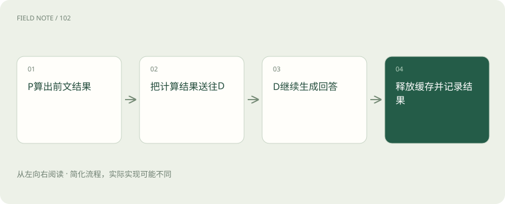
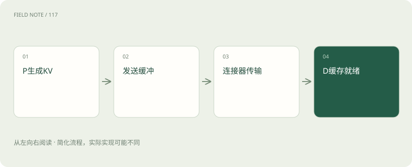
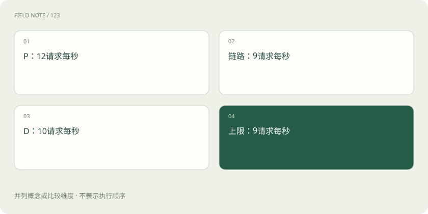

# 一次请求怎样跨过 P 与 D：拆分推理的收益和账单

> 沿一条请求，看分开处理输入和输出后，缓存怎样交接、容量怎样配合。

专题：推理设施 · 整理于 2026-11-04

## 先说这篇在讲什么

把模型的“处理材料”和“生成答案”分开，不是把两个按钮放到两台机器上就结束。两边要交接算过的状态，还可能互相等待。这篇沿一条请求走一遍，并用简化数字看懂缓存大小与链路瓶颈。

## 先看一个具体例子

P 每秒准备 12 份任务，链路每秒只能交接 9 份，D 每秒能完成 10 份。再给 P 加资源，也不能绕过每秒 9 份的交接限制。

## 遇到陌生概念，可以先读

展开前置阅读建议

- [Prefill、Decode 与 KV Cache：一次回答的内部旅程](prefill-decode.md)
- [PD 分离：把读题和写答案交给不同实例](pd-disaggregation.md)
- [PD 分离的下一层：KV 传输和容量配比](pd-kv-capacity.md)

## 先用一个类比理解

像把备料和烹饪分成两个区域：可以各自加人，但送食材的通道、等候空间和两边节奏也要配合。

类比只帮助建立直觉，不等同于完整机制。

## 一图看懂

## 先看不拆开的流程

同一模型实例先处理输入，再继续生成，前面的 KV 结果留在本地，不用跨实例搬走。它也可以同时安排多个请求，或把长输入分块处理，减少对其他请求的干扰。因此合设不是落后做法，而是必须保留的比较起点。请求少、输入短时，增加另一套交接可能比省下的工作还多。先了解原来在哪儿花时间，才知道拆分在解决什么。

## P 算完后，留下什么

Prefill 会根据输入在各层生成后续要用的 K 和 V。它们是注意力计算中的数值信息，不是整段答案，也不是权重文件。缓存大小与输入 Token 数、模型层数、KV 头数、每头长度和数据精度有关。分组查询注意力等设计还会改变需要保存的 KV 头数。因此不能看模型参数占了多少空间，就直接推断每个请求的缓存也是同样大小。

## 请求怎样从 P 到 D

入口先安排处理输入的 P 实例，再安排可以接收相应状态的 D 实例。连接组件负责把缓存块送过去，D 有了需要的数据后继续生成。两边模型和缓存格式要匹配，即使模型名字相同，不同权重版本也未必能互用。某些实现会由 P 产生首个输出 Token，再把后续交给 D，所以首个输出的计时应根据实际过程定义，不要把所有实现画成完全一样。

## 中间的管道为什么也会慢

缓存可能先从 GPU 搬到主机内存，再过网络，到另一台设备；具体路径由实现决定。网络标称很快，不代表整次交接能达到那个数字。复制、等待缓冲、请求协调和多个传输共享链路都会花时间。可以类比快递运输：公路限速高，不等于包裹从出库到签收的总时长只由开车速度决定。实际应看状态什么时候能被下一段使用。

## 一步步算一个缓存例子

常见估算式是：2×层数×Token 数×KV 头数×每头维度×每个数的字节数。前面的 2 表示 K 和 V 两份。假设 32 层、4096 Token、8 个 KV 头、每头 128 维、每个数 2 字节，约为 512 MiB。这是模型和输入的假设例子，不是所有请求都这么大；它还没算块预留、对齐、管理信息或其他临时空间。公式的用途是看哪些因素让缓存增长。

## 传输时间先算下限，再补实际开销

若假设可用传输速度为 20 GiB/s，搬 0.5 GiB，单看数据搬运约需 0.025 秒，也就是 25 毫秒。这里 GiB 是按二进制计量的容量单位。这只是简化下限，不是硬件成绩。还要算排队、协调、同步和并发时共享带宽。即使数据本身只需这些时间，用户的首个输出也可能仍要等更久，所以不能由这一步直接宣布回答提速多少。

## 看整条链，哪段最忙

先把单位统一成固定请求每秒可处理多少。假设 P 能 12、链路能 9、D 能 10，整体长期不可能超过 9。继续加 P 可能只是让更多缓存排队等待。这个最小值也只是上界，为了避免波动让队伍越来越长，通常还要留余量。长输入影响 P 与传输，长输出延长 D 的工作；请求类型变化后，两边合适的配比也会变化。

## 排队的不只是任务名，还有真实数据

P 快而 D 慢时，已经算出的 KV 要占地方等着。十个短问题和十个超长手册请求，虽然队伍人数相同，占用空间可能差很多。系统应限制在途缓存，必要时少接请求、暂缓 P 开工，这就是把下游压力传回上游。用户取消或网络断开后，也要释放不再需要的状态，否则表面任务结束了，空间却还没腾出来。

## 怎样避免用不公平的结果宣布胜利

假设两种方案都用四张同型号卡。合设用四个实例，分设用一张 P 和三张 D，就应该把双方放在同一批任务、相近输入输出长度和延迟要求下比较。不能拿四卡分离去赢单卡合设，再把差别全算成架构收益。缓存是否已经热起来、是否预热完成，也要一致说明。比较的是同样资源完成合格工作，而不是某个孤立峰值。

## 最后把收益和新增负担都写出来

分离让两段可分别扩展，也有机会减少长输入干扰输出；代价是缓存搬运、缓冲和跨池协调。观察首个输出、输出间隔、成功吞吐、排队和每项合格任务成本，才能知道是否合适。有的业务改善较慢请求的体验，却不一定提高低负载效率。保留输入和输出长度的组合，不要只拿两个平均值拼出一个现实中不存在的“平均用户”。

## 图解：缓存跨池

状态可用后 D 才能消费。

## 图解：三段容量

相同负载假设下由最窄阶段约束。

## 放在一起对比

| 方案 | 主要收益 | 额外成本 |
| --- | --- | --- |
| 合设 | 状态就地复用 | 阶段争用 |
| 拆分 | 独立扩容调度 | KV传输协调 |
| 分块Prefill | 缓解长输入干扰 | 调度取舍 |

## 读完先记住这一句

PD 是否值得，要把计算、状态交接、等待和同资源下的实际表现一起比较。

## 常见误区

512 MiB 和 25 毫秒都是带假设的教学算例，不是任意模型、硬件或负载下的实际成绩。

## 想一想

为什么 P 的处理速度提高了，整体反而可能出现更多等待？

查看解释

若 D 或传输没有跟上，P 会更快地产生待交接缓存，队列和空间压力增加，而最终完成速度仍受后面限制。

## 关联阅读

- [一份能够指导决策的评测集怎样建立](deep-eval-design.md)
- [路由不是选便宜模型：在硬约束下优化合格任务成本](deep-routing-policy.md)

## 原始资料

- [vLLM disaggregation](https://docs.vllm.ai/en/latest/features/disagg_prefill/)
- [vLLM KV connector](https://github.com/vllm-project/vllm/blob/main/vllm/distributed/kv_transfer/README.md)
- [DistServe](https://arxiv.org/abs/2401.09670)

原创讲解；图示和类比经过简化，数字示例不代表实测。工具功能以对应版本官方资料为准。
