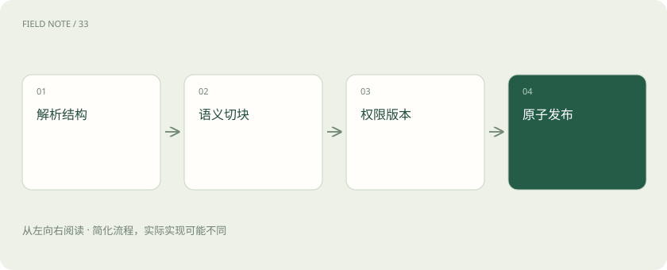
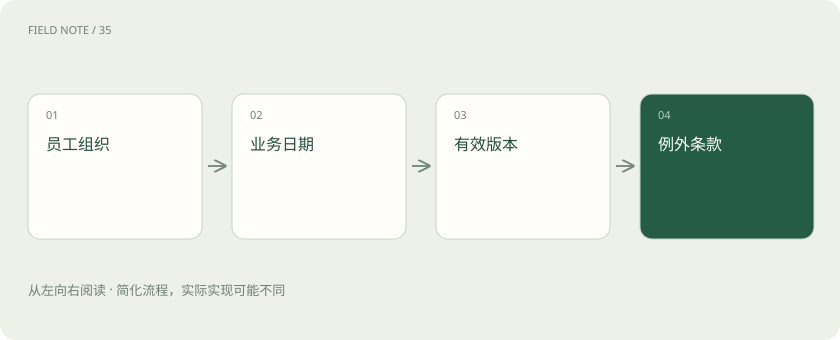
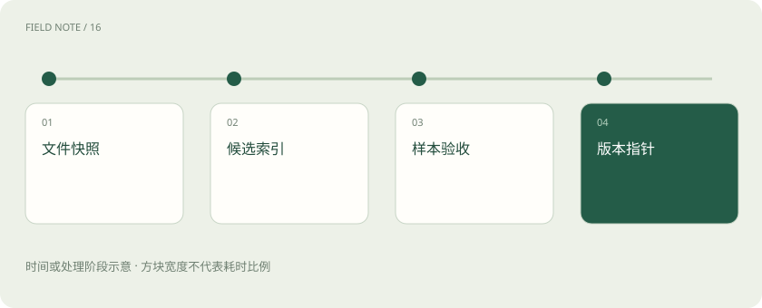

# 把政策文件变成可追责的知识库

> 检索质量首先取决于材料如何进入系统。

专题：AI 应用 · 整理于 2026-11-04

## 前置阅读

- [解析与切块：知识库先要读对文档](rag-parsing.md)
- [训练数据质量：先修教材再加课时](data-quality.md)
- [引用、证据与拒答：知识库助手怎样才算有依据？](rag-evidence.md)

## 先用一个类比理解

入库像档案馆编目：内容、版本、适用范围和借阅权限必须一起登记。

类比只帮助建立直觉，不等同于完整机制。

## 一图看懂

## 先定义回答的事实单位

以假想差旅政策为例：总部员工住宿每日上限 500 元，某地区分支上限 400 元，生效日为 2026 年 10 月 1 日。用户问能报多少，答案不仅依赖数字，还依赖人员范围、地区、日期和例外审批。知识库的最小有效单位必须能保留这些关系；孤立的“500 元”没有足够解释能力。

## 解析先恢复阅读结构

PDF 文字提取可能把双栏混排、页眉插入正文、表格行列打散。扫描件还需 OCR，数字和小数点错误会直接改变政策含义。解析结果应保留页码、标题路径、表格坐标和原文定位。对数字密集页、低置信 OCR 与跨页表格进行抽查，比仅检查提取字符总数更能发现问题。

## 表格不能任意拆成句子

假设住宿标准表三列分别是人员等级、地区与金额，把单元格“400”单独索引会丢失行列语义。可以把每一行转成带表头的完整描述，并保留原表定位；对跨行合并单元格要补全继承关系。表格转文本是解释过程，应保存转换规则，便于发现错误后批量重建。

## 切块围绕解释闭包

按固定长度切块方便控制体积，但可能把“以下情况除外”与主规则分开。按标题或段落切分更贴近语义，却可能得到过长片段。实践中先按结构切，再在长度约束内拆分，并把标题路径和必要定义附入子块。重叠可以减轻边界损失，但会增加存储、重复召回和上下文挤占。

## 元数据要参与判断

每块至少关联文档标识、版本、有效起止时间、所属组织、适用地区、权限标签与原文坐标。正文用于语义匹配，元数据用于过滤和解释范围。不要指望向量相似度学会所有权限规则；两个内容高度相似的政策可能恰好分别属于不同事业部，语义接近反而容易造成越权。

## 权限在读取前生效

用户身份映射到可访问组织和文档集合，在检索和内容读取时强制约束。只在生成后删除敏感答案太晚，因为未授权材料可能已经进入模型上下文、缓存或日志。权限变更需要处理索引副本和缓存失效；如果索引暂时无法确认最新授权，应有明确的拒绝或降级策略。

## 版本不是覆盖一个文件

政策修改后应保留旧版本有效区间，支持回答历史报销问题。当前查询默认选择已生效版本；问“九月份出差”则需要按业务发生时间找当时规则。发布日期、生效日期与入库时间是三个字段，不应合并。新旧政策同时召回时，要用范围和时间消歧，而不是让模型任选一段。

## 增量入库要可以重放

文件哈希、解析器版本、切块规则和嵌入模型版本共同决定索引产物。只改解析规则也可能需要重建向量；只替换向量模型却保留旧向量，可能让检索空间不兼容。每次任务记录处理状态和失败原因，通过稳定文档标识避免重复追加，并使中断后的重试能安全恢复。

## 发布采用一致快照

如果先发布新向量而元数据仍旧，用户可能检索到新内容却得到旧权限或旧引用。可以构建完整候选索引，验证计数、样本定位、权限过滤和新旧政策查询后再切换版本指针。失败时回到旧快照，并保留待修任务；可用性与新鲜度的取舍应有服务目标。

## 验收使用政策问题集

对上述案例至少检查总部当前、分支当前、总部历史、无权限用户、例外审批和缺失地域六类问题。分别看是否召回正确条款、是否保留限制、能否定位原页。入库验收通过不代表生成一定正确，但能排除“模型根本没有拿到完整材料”这一大类问题，让后续调优有明确起点。

## 删除与纠错也是入库功能

知识库不能只有新增入口，还要有撤回和纠错入口。一份文件因授权问题撤回时，应使正文、向量、父段缓存和引用访问一起失效；若仅删除搜索条目，旧链接或缓存仍可能暴露内容。

解析错误则需要追踪所有派生产物：原文“400”被识别成“4000”，修正文档后还要重建相关块、向量和摘要，并将曾受影响的回答标记为待核查。保留从源文件到派生片段的谱系，才能知道修复范围，而不是全库盲目重建或遗漏藏在缓存中的错误。

## 图解：政策适用筛选

金额之前先判断适用范围。

## 图解：索引发布

切换点保证内容和元数据一致。

## 放在一起对比

| 处理对象 | 保留信息 | 丢失后的后果 |
| --- | --- | --- |
| 表格 | 行列标题 | 金额错配 |
| 政策版本 | 有效时间 | 旧规当新规 |
| 权限 | 授权范围 | 越权召回 |

## 真实场景

某员工 9 月出差、11 月报销。查询应以政策规定的业务日期字段为准，召回 9 月有效版本；如文件未说明按出差日还是报销日执行，答案应指出歧义并请求政策管理员确认，不能用最新入库版本替代法律或组织解释。

## 常见误区

“每块都加上完整文档”会恢复关系，却可能让索引重复和上下文膨胀。应保留最小必要上下文，并允许按父文档补取。

## 想一想

为什么删除文件不等于立即撤销访问？

查看解释

索引、对象存储副本、检索缓存与应用缓存可能仍保留内容，需要联动删除或使授权检查独立于旧副本。

## 关联阅读

- [从候选召回到证据上下文：检索是一场逐级筛选](deep-rag-retrieval.md)
- [从原始语料到可发布模型：训练是一条受约束的生产线](deep-training-lifecycle.md)

## 原始资料

- [Azure document layout](https://learn.microsoft.com/en-us/azure/ai-services/document-intelligence/prebuilt/layout)
- [Azure chunking](https://learn.microsoft.com/en-us/azure/search/vector-search-how-to-chunk-documents)
- [Elastic document security](https://www.elastic.co/docs/deploy-manage/users-roles/cluster-or-deployment-auth/controlling-access-at-document-field-level)

原创讲解；图示和类比经过简化，数字示例不代表实测。工具功能以对应版本官方资料为准。
