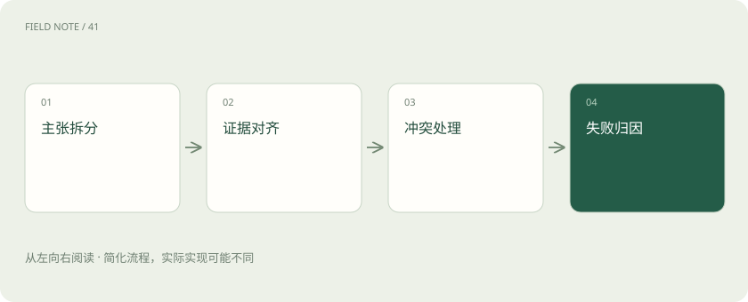

# 让每个结论都有边界：RAG 的证据责任

> 可靠回答要逐个核对结论，也要检查有没有漏掉用户行动所需的条件。

专题：AI 应用 · 整理于 2026-11-04

## 先说这篇在讲什么

助手说“你能报五百元，月底前提交”，还附了制度链接，可原文也许只证明金额，没有提截止日期。这篇把一句答案拆开核对，解释怎样确认条件、处理冲突，以及如何分辨是材料缺失、检索漏找，还是模型读懂之后仍然说错。

## 先看一个具体例子

原文说“上限四百元，超过需事前审批”，只答“四百元”可能让用户错过可申请的例外；要把影响决策的审批条件一并说明。

## 遇到陌生概念，可以先读

展开前置阅读建议

- [引用、证据与拒答：知识库助手怎样才算有依据？](rag-evidence.md)
- [Recall、MRR 与 nDCG：检索到底好在哪](retrieval-metrics.md)
- [大模型评测：不要只问排行榜第一是谁](evaluation.md)

## 先用一个类比理解

像核对一张报销单：金额对了不代表日期、人员和审批条件都对，每一项都要找到对应凭据。

类比只帮助建立直觉，不等同于完整机制。

## 一图看懂

## 一句回答里，可能藏着好几个结论

“你可以报销五百元，并在月底前提交”听起来只有一句话，实际包含资格、金额和截止日期。找到金额出处，并不能证明另外两项。核查时需要把答案拆成可以独立判断真假的事实或规则，这叫原子主张，并不要求每项都恰好是一个短句。“建议尽早提交”这类建议也要与“必须月底前提交”的政策事实分开，让用户知道哪些是规定，哪些是帮助他安排事情的建议。

## 相关的资料，未必能推出这个答案

一段写着“总部员工上限五百元”的制度，与分支员工问报销的问题很相关，却不能证明分支也适用。需要把具体结论、支持它的段落、必要条件和中间判断对应起来。如果还依赖“此员工属于总部”这样的假设，就应明确说“如果你属于总部”，或者询问用户。不能把没有确认的前提悄悄补上，再把推出来的结果当作确定事实。

## 引用先看找不找得到，再看证明了什么

检查分两层：先确认出处真实存在、链接能打开、页码和段落定位正确；再看定位到的内容是否真的支持那句话。真实制度也可能引用错条款，正确格式也能装着无关内容。因此评测既要看引用是否准确，也要看答案中有多少结论被证据支持。第一层通过不能代替第二层，否则一个能访问的链接就可能给整段无依据的回答披上可信外衣。

## 少了什么信息，会改变最终结论

规则通常受到时间、地区、组织、员工类型和例外条件限制。用户没有说所属组织，不能默认套用最常见组织的制度。可以给出带条件的答案，也可以问清关键字段。但不是少了任何字段都得追问：要看它会不会改变结论。若不同地区标准一样，地区缺失未必妨碍回答；若总部与分支金额不同，就要明确保留这种不确定性。

## 两份文件数字不同，先别急着选一个

看到四百和五百，先检查是否分别对应不同地区或时期，再看它们是正式制度还是解读材料。如果正式修订关系已写清，可以解释新规替代了哪条旧规。如果同一时间、同一范围内的正式文件仍然冲突，应把冲突和来源列明，并交给制度负责人确认。取平均值没有政策依据，搜索排名更高也不意味着那份文件更有权威。

## 回答不了，要说清是哪一步缺了什么

没有可访问资料、资料已经过期、用户没说关键地区、来源彼此冲突，以及材料不能推出结论，是不同的情况。对应做法可能是走授权渠道、更新资料、补充条件、联系负责人或继续检索。只说“知识库没有”会让人不知道如何继续，也可能掩盖权限问题。说明原因时仍应遵守访问规则，不要为了解释无权访问而透露受限材料。

## 给错误找主因，按最早断掉的位置查

可以先检查是否发生权限越界，再看源资料是否缺失或解析错误，之后看有没有检索漏找、组装丢段，最后检查生成与引用关系。一个案例允许有多个标签，但主因应选最早导致任务无法成功的环节。例如原文数字识别错了，后面模型照错数字回答，不该又把同一个源头错误重复算成三次独立故障，否则统计会让修复方向失真。

## 模型拿齐资料之后，仍可能怎么说错

资料完整不表示模型一定正确使用。它可能扩大适用范围、抄错数值、把否定说成肯定、漏掉例外、使用过期规则，或补出没有依据的话，还可能隐去冲突、绑定错误引用。分类要有清楚例子：五百抄成五千是数值错误，把总部的五百用于分支则是范围错误。只给它们统一贴“幻觉”标签，难以判断该改提示、数字核对还是适用条件处理。

## 既要敢回答，也要知道何时停下来

如果只计算已经回答的问题有多准，系统可能靠拒绝难题提高分数；如果只计算回答了多少，又可能鼓励猜测。应一起看可回答问题的成功率、不可回答问题是否适当拒答、结论有多少被原文支持，以及关键证据有没有齐全。影响大的规则错误还应单独统计，避免大量简单正确答案把少数会误导用户行动的问题淹没在平均分里。

## 复查昨天的回答，要能还原昨天的资料

今天看到的制度可能已经更新，不能直接据此判断昨天的回答为何出错。每次请求可记录经过适当脱敏的查询条件、候选标识、最终上下文版本，以及答案结论与引用的对应关系，让诊断能回到当时状态。保存这些关系不等于复制所有敏感原文；日志仍要受权限和保留期限约束。关键是能够还原依据，而不是收集越多正文越好。

## 没有说错，也可能没有把事情讲够

制度说“上限四百元，超过需事前审批”，只报出四百元没有数字错误，却漏了用户可能需要的行动条件。评测应为每道题列出必要信息，区别关键遗漏与可省略背景。但这不等于把所有找到的文件都贴给用户，冗余也会增加误用机会。围绕用户的决定说明现在能确定什么、还缺什么、下一步怎么做，并让每个必要条件对应到原文，答案才既够用又可核查。

## 图解：主张核查

把答案拆成可独立核查的结论，再逐条对照原文和适用条件；证据不足或来源冲突时，说明缺口后再决定回答、追问或拒答。

## 图解：冲突消解

把答案拆成可独立核查的结论，再逐条对照原文和适用条件；证据不足或来源冲突时，说明缺口后再决定回答、追问或拒答。

## 放在一起对比

| 故障 | 判定依据 | 修复方向 |
| --- | --- | --- |
| 语料缺失 | 源库无必要条款 | 补充治理 |
| 检索漏召回 | 源库有而候选无 | 检索策略 |
| 引用错配 | 材料有但指错 | 主张绑定 |

## 读完先记住这一句

每个影响用户决定的结论，都要有适用且完整的原文支持。

## 常见误区

答案中没有错误句子，也可能因遗漏关键条件而误导用户；链接能打开同样不代表内容支持结论。

## 想一想

一句话有金额、资格和截止日期，只给金额找到依据够吗？

查看解释

不够。这是三个可以分别核查的结论，不能用金额的引用替其他部分作证明。

## 关联阅读

- [智能体不是连续聊天：一张服务工单的状态旅程](deep-agent-state.md)
- [从候选召回到证据上下文：检索是一场逐级筛选](deep-rag-retrieval.md)

## 原始资料

- [RAG original paper](https://arxiv.org/abs/2005.11401)
- [ALCE citation evaluation](https://arxiv.org/abs/2305.14627)
- [RAGAS evaluation](https://arxiv.org/abs/2309.15217)

原创讲解；图示和类比经过简化，数字示例不代表实测。工具功能以对应版本官方资料为准。
