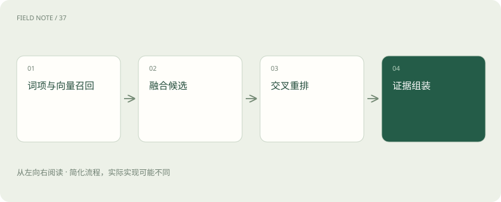
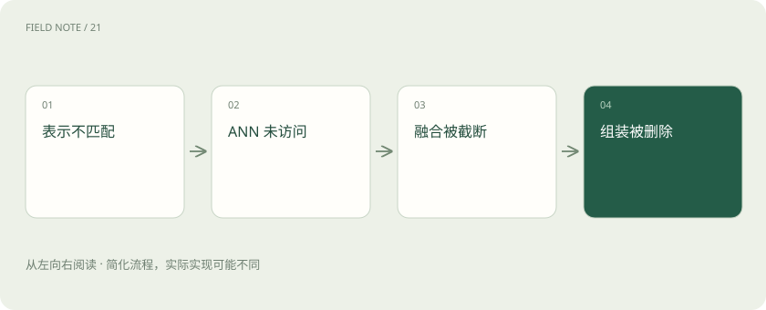

# 从候选召回到证据上下文：检索是一场逐级筛选

> 用一个融合排序算例说明检索各层解决的问题。

专题：AI 应用 · 整理于 2026-11-04

## 前置阅读

- [混合检索与 RRF：让关键词和语义互补](hybrid-rrf.md)
- [ANN、HNSW 与索引：为什么快了却可能漏结果？](vector-index.md)
- [重排：候选找到了，为什么还要再排一次](reranking.md)

## 先用一个类比理解

召回像把可能有关的卷宗搬到桌边，重排再决定先读哪份，上下文组装决定实际递给答题者哪些页。

类比只帮助建立直觉，不等同于完整机制。

## 一图看懂

## 检索目标不是找同义句

用户问“分支出差住店能报多少”，相关材料可能写的是“住宿费用限额”。系统需要语义召回，也要识别分支名称、制度编号等精确信息。任务目标是找到足以支持回答的条款集合，而不是返回一条看起来最相似的句子；限制条款和例外可能与问题措辞并不相似。

## BM25 的作用与边界

BM25 基于词项匹配，考虑词频、词项稀有度与文档长度等因素，通常适合编号、人名及精确术语。它依赖分词和查询表达，用户换用不同说法时可能漏检。为弥补缺失而加入同义词或查询改写时，需要保留原始关键实体，不能把一个明确地区改成宽泛概念后丢掉适用范围。

## 稠密向量如何补位

嵌入模型将问题与片段映射到向量空间，按约定相似度寻找邻近项，能连接部分词面不同但语义接近的内容。然而空间相近不等于政策适用。否定词、数字、版本差异和组织限定都可能被弱化，因此元数据过滤与后续精排仍必不可少，尤其不能用语义相似度替代权限。

## ANN 为什么会漏候选

精确扫描所有向量成本较高，近似最近邻索引用图或分区等结构缩小搜索范围。更大的搜索范围往往增加延迟和召回机会，但具体关系取决于索引与数据。应以精确检索结果或人工相关集作参照，区分嵌入表示本身找不到和 ANN 搜索没访问到这两种失败，调参方法不同。

## 融合前先统一候选身份

BM25 分数与向量相似度不在同一量纲，直接相加会让数值尺度左右排序。融合前应以稳定片段标识去重，并确认两个检索器使用同一权限与版本条件。否则同一条款因不同切块标识重复出现，或者未授权结果参与融合，后面的排序即使计算正确也不符合系统目标。

## 手算 k 等于六十的 RRF

RRF 为每个候选累加 1/(k+名次)，名次从 1 开始。设 A 在词项榜第 1、向量榜第 3；B 分别第 2、第 1；C 只在向量榜第 2。k=60 时，A=1/61+1/63≈0.03227，B=1/62+1/61≈0.03252，C=1/62≈0.01613，因此 B、A、C。缺席不贡献分数，并非自动排在末位再加分。

## RRF 也有自己的偏好

这个算例说明，多路共同出现会提高排名，原始分数领先幅度则被丢弃。k 越大，前几名之间的贡献差越小，多路一致性相对更突出。融合窗口也重要：若候选在某一路第 101 名，而只取前 100，它对那一路的贡献就是零。应在验证集比较窗口和参数，不能把 60 当成普遍最优。

## 重排重新看问题与片段

交叉编码器类重排器联合读取问题和候选，能够评估比独立向量更细的匹配关系，但成本随候选数量和文本长度增长。它只能重排已召回材料，不能凭空恢复从未出现的例外条款。候选召回不足时盲目更换重排器，容易把问题误诊成排序精度不足。

## 组装不是截取前五条

给定上下文预算，要同时考虑条款覆盖、重复、来源权威性和定位信息。先保留直接回答主规则的片段，再补定义、范围与例外；必要时从父段落取回上下文。两个重复主条款可能不如主条款加一条例外有用。组装后的材料仍应保留片段标识，以便答案引用与诊断追踪。

## 用漏斗指标定位损失

分别测召回候选中的证据覆盖、重排前后相关项位置、最终上下文中的必要条款覆盖和生成正确率。如果候选包含例外但组装删掉它，问题在预算选择；若上下文齐全却答案忽略例外，问题在生成使用。按阶段记录候选标识与分数，才可能把总体失败分解成可修复环节。

## 检索预算要按价值分配

候选数从二十增加到两百可能提高证据覆盖，也会增加重排成本和无关材料。应观察新增候选是否带来此前缺失的必要条款，而不仅是相关片段数量。对明确编号查询，可以优先精确命中；对范围复杂的政策题，则需要更广的候选与父段补取。

查询改写同样需要验收：把口语转成制度术语可能有帮助，但若把“离职前”改成“离职后”，系统会高效地检索错误问题。保存原查询、改写查询和命中差异，可以识别检索改进究竟来自更好表达，还是不知不觉改变了用户意图。

## 图解：召回损失定位

每一级都可能失去必要证据。

## 图解：算例榜单

缺席项贡献为零。

## 放在一起对比

| 阶段 | 输入 | 解决不了 |
| --- | --- | --- |
| 召回 | 问题与索引 | 完整业务推理 |
| RRF | 多路名次 | 未召回证据 |
| 重排 | 候选文本 | 知识库缺失 |

## 真实场景

对“上海分支试用员工住店上限”查询，候选 A 是总部一般规则，B 是上海分支规则，C 是试用期特殊条款。融合榜首 B 不能单独解决问题；重排与组装必须让 C 进入上下文，然后判断特殊条款是否覆盖 B。榜首正确不等于证据完整。

## 常见误区

召回率分母应是与任务相关的必要证据，而不是整个知识库；没有标注相关集的“召回率很高”通常无法解释。

## 想一想

重排分数很高，为什么仍会答错？

查看解释

候选可能只在语义上相关却范围不符，也可能缺少例外，或生成阶段没有正确使用完整材料。

## 关联阅读

- [让每个结论都有边界：RAG 的证据责任](deep-rag-evidence.md)
- [把政策文件变成可追责的知识库](deep-rag-corpus.md)

## 原始资料

- [Elastic RRF](https://www.elastic.co/docs/reference/elasticsearch/rest-apis/reciprocal-rank-fusion)
- [Elastic similarity](https://www.elastic.co/docs/reference/elasticsearch/index-settings/similarity)
- [Faiss indexes](https://github.com/facebookresearch/faiss/wiki/Faiss-indexes)
- [Sentence Transformers rerank](https://www.sbert.net/examples/sentence_transformer/applications/retrieve_rerank/README.html)

原创讲解；图示和类比经过简化，数字示例不代表实测。工具功能以对应版本官方资料为准。
