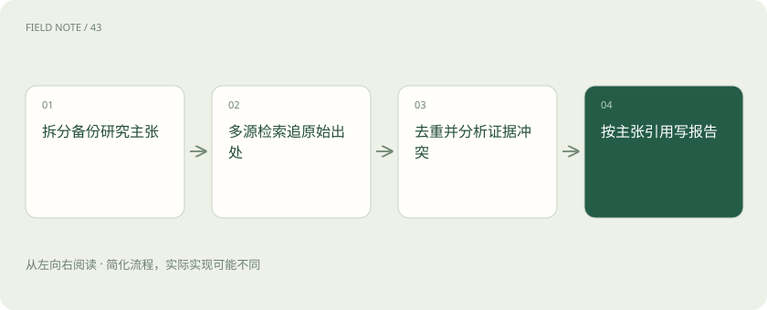
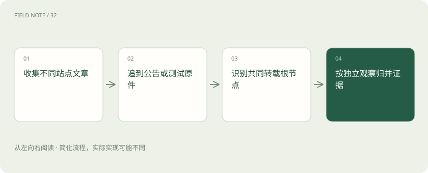
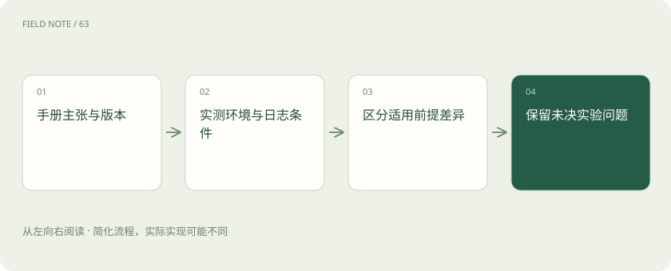

# Deep Research：把搜索变成证据审计

> 把每项结论接到直接证据上，并保留适用条件与未决问题。

专题：AI 应用 · 整理于 2026-11-05

## 先说这篇在讲什么

搜索到十篇文章，也不代表一个结论已经可靠。本篇以比较数据库备份能力为例，说明如何先列清要证明的事情，再找直接证据、追查转载来源、核对版本和解释冲突。最后交付的不只是答案，还应包括答案适用于哪些条件，以及哪些问题仍需实测。

## 先看一个具体例子

手册证明支持时间点恢复，失败案例提示日志缺失；报告分别说明功能条件与尚无实测的速度。

## 遇到陌生概念，可以先读

展开前置阅读建议

- [RAG：让模型先查资料，再组织答案](rag.md)
- [Agent 和工作流：从回答问题到执行任务](agent.md)
- [Recall、MRR 与 nDCG：检索到底好在哪](retrieval-metrics.md)
- [让每个结论都有边界：RAG 的证据责任](deep-rag-evidence.md)

## 先用一个类比理解

像核对证词：三个人转述同一位目击者，仍只有一条原始观察。

类比只帮助建立直觉，不等同于完整机制。

## 一图看懂

## 先把大问题拆成可核对的小问题

采购同事问“两种数据库哪个恢复更好”，这句话太宽。先拆成支持哪些恢复方式、能恢复到多细的时间点、适用于哪个版本、恢复实际需要多久。恢复指数据丢失后从备份找回数据的过程。每个小问题就是一项待验证主张。官方手册可以说明功能存在，却不能直接证明实际恢复更快。先写清本次是在核验功能还是比较性能，避免从一份功能列表跳到“全面领先”的结论。没有统一环境的测试，也不应写成生产速度保证。

## 搜索之前给每次查询安排任务

可以先查官方手册，再查版本变化，再找失败边界，最后留一部分查询处理冲突。比如练习时限制十二次查询，这不是统一标准。用一张记录表写下搜索词、想补足的事实和实际收获。如果第四次搜索仍指向同一篇公告，就换成版本号加“限制”“恢复失败”等具体词。搜索预算既控制时间，也提醒自己改变方向；反复添加“最好”“全面”只会得到更多宣传语，不一定得到新的事实。剩余次数应优先用于尚未回答的核心问题。

## 十个网址可能只有一个来源

厂商发一篇公告，媒体转载，社区再引用，看起来有三份材料，其实可能都来自同一个观察。给每份材料记下最初发布者、转载关系、日期和测试环境，再把同根内容合并。这种追踪叫证据谱系，就是查清消息从哪里传来。作者和域名不同不代表证据独立，独立材料应带来新的观察或测试。独立测试也不是自动可信：如果使用旧版本或很小的数据量，仍不足以说明当前生产环境的恢复表现。数量与适用性需要分别判断。

## 新网页不一定讲新功能

读到“支持分钟级恢复”，要继续问：哪个版本、云上还是本地、使用什么备份模式、需要哪些配置。页面今天更新，里面的测试仍可能来自几年前；旧手册也可能恰好适用于正在使用的长期维护版本。记录页面更新时间、功能引入版本、事件发生时间和查阅日期，不要混在一起。升级后默认配置可能改变，旧结论需要重新检查前提。把日期改成今天不能使旧测试变成新证据，从云版本的能力也不能直接推断所有本地部署都支持。

## 出现相反说法先比较条件

手册说能恢复到指定时间，用户却说恢复失败，两者未必互相否定。先检查用户是否保留了所需日志、备份链是否完整、目标版本是否匹配。备份链指恢复时需要连续使用的一组备份材料，缺一段就可能失败。把双方主张、运行条件、能否同时成立和缺少什么证据列成表。同样条件下仍然冲突，就保留争议并安排验证；不能找更多转载给某一方“投票”。缺少恢复日志时应明确未决，不能写成基本可用来消除表面矛盾。

## 把可复查的动作展示出来

研究过程中可以记录搜索词、打开的网页、摘录、实验回执、工具错误和下一步决策摘要。这些是别人能够复查的观察。界面显示“正在思考”只是进度文字，不是数据库性能证据。某些演示里出现ChatModel:think或summary，也只是具体实现中的名称，不能当作所有研究代理的统一标准，更不能据此声称读到了模型私有思维链。读者真正需要的是知道查了什么、哪些动作成功、为什么还缺证据，而不是把进度动画当成论证。

## 写完每个关键句都回查原文

先列主张，再给每个重要结论连接直接支持它的页面与段落。例如写“恢复五分钟”，应核对原文到底是在说目标、一次典型测试，还是服务保证。这三者含义不同。有引用链接不代表引用支持句子，读者点开后应能重建判断过程。自己的推断要标明条件，未测试事项单独列出。可以借鉴Ragas这类评估工具的忠实度检查，即回答是否得到给定材料支持；但即使句句符合材料，也不能证明材料真实、来源独立或版本适用，这些仍需另查。

## 交付时把不知道的部分留下来

当核心问题已有适用版本的证据、主要冲突已解释，并且继续搜索不再补足关键缺口，就可以停止。报告写清结论、出处、适用条件和未解决问题。如果查询次数耗尽仍没有独立性能测试，就交付功能核验结果，并说明性能优劣尚未成立。完成研究不是把每个格子都填成确定答案，而是让下一位读者知道哪些已证实、哪些只是条件性推断、哪些需要实验。查询配额、来源关系和冲突表都可调整，它们是研究方法建议，并非产品统一规定。

## 图解：独立来源的追溯

网站数量与独立证据数量不同，转载同一原件归为同一来源谱系。

## 图解：冲突分析的底稿

条件不同可能同时成立，同条件冲突需要新证据。

## 放在一起对比

| 对象或路线 | 处理依据 | 适用边界或检查点 |
| --- | --- | --- |
| 厂商手册 | 功能与约束 | 不能证明真实恢复时长 |
| 独立实测 | 特定环境的观察 | 不可直接推广全部规模 |
| 转载文章 | 发现原始公告 | 不能增加独立证据数 |
| 研究报告 | 条件化综合结论 | 须公开未决冲突 |

## 读完先记住这一句

研究质量取决于主张与证据能否对应，而不是搜索次数。

## 常见误区

把多个转载当成独立验证，或把一次恢复目标写成性能保证。

## 想一想

三个网站都说五分钟恢复，就能下结论吗？

查看解释

不能。先查是否同源，再核对版本、测试环境，以及五分钟指目标、案例还是保证。

## 关联阅读

- [把政策文件变成可追责的知识库](deep-rag-corpus.md)
- [从候选召回到证据上下文：检索是一场逐级筛选](deep-rag-retrieval.md)

## 原始资料

- [Ragas：上下文精度](https://docs.ragas.io/en/stable/concepts/metrics/available_metrics/context_precision/)
- [Ragas：回答忠实度](https://docs.ragas.io/en/stable/concepts/metrics/available_metrics/faithfulness/)
- [LangChain 检索概念](https://docs.langchain.com/oss/python/deepagents/retrieval)

原创讲解；图示和类比经过简化，数字示例不代表实测。工具功能以对应版本官方资料为准。
