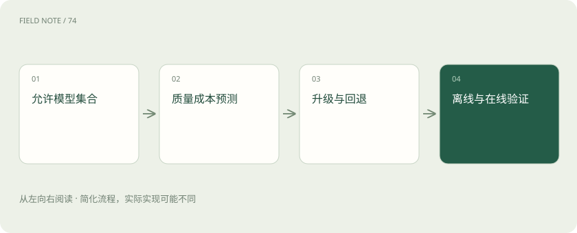
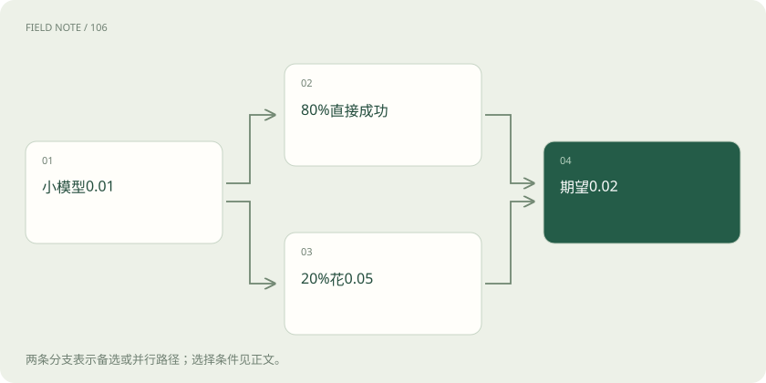

# 路由不是选便宜模型：在硬约束下优化合格任务成本

> 用算例理解预测、升级、负载、缓存与回退。

专题：接入平台 · 整理于 2026-11-04

## 前置阅读

- [智能路由与负载均衡：把请求交给谁？](routing.md)
- [模型路由：质量、成本与失败代价怎么比](routing-evaluation.md)
- [缓存感知路由：把请求送到有共同前缀的地方](cache-routing.md)

## 先用一个类比理解

像给工作分配合格人员：先看资格，再看成功把任务交付的总成本。

类比只帮助建立直觉，不等同于完整机制。

## 一图看懂

## 先区分约束与偏好

数据区域、模型授权、工具支持、上下文长度和关键质量门槛属于不可随意交易的约束。价格、等待时间和负载属于优化因素。路由先构建允许集合，再在集合内评分；若集合为空就解释无法服务。让一个综合加权分数抵消权限违规，会把不应发生的事情包装成“最优选择”。

## 任务特征需要可获得

请求长度、语言、是否需要工具、业务类别和结构要求可以帮助预测质量与耗时。但在线时拿不到的标准答案不能用作路由输入，否则离线结果存在信息泄漏。任务分类器也有成本和误差，必须把分类延迟、费用与误判后果纳入总账，不能只算下游模型的标价。

## 质量预测不是自信口号

可以根据历史标注任务估计不同模型在不同任务层的成功概率，并进行校准。模型自己说“我有九成把握”不等于真实九成正确。新领域或稀少样本应有较宽不确定区间，倾向保守升级或人工处理。预测器版本与训练分布需要记录，否则无法解释策略为何突然改变。

## 算一笔升级路径的账

假设小模型每次成本 0.01 元，直接成功概率 0.8；剩下 0.2 被可靠判别器识别并升级，强模型成本 0.05 元、升级后成功概率 0.95。忽略判别器费用时，期望成本为 0.01+0.2×0.05=0.02 元，最终成功概率为 0.8+0.2×0.95=0.99。这是假想的完全识别前提，不是实测能力。

## 把检测错误补回算例

若判别器漏掉一半失败，则只有 0.1 升级，最终成功概率变成 0.8+0.1×0.95=0.895，成本为 0.015 元。看似更省，其实保留了大量错误。若还误报正确答案，会增加不必要升级成本。实际比较应使用联合错误分布，而非把小模型、判别器和强模型当成彼此独立且完美的组件。

## 负载改变实时最优解

低价模型队列很长时，可能无法满足时限；高价模型空闲反而更容易按时完成。策略应观察队列、可用并发和近期服务错误，而不只是静态单价。频繁根据瞬时负载切换又可能引发流量振荡，因此需要平滑、迟滞或容量预留。判断指标应覆盖尾延迟，而非只看平均响应时间。

## 缓存命中要先判断可复用

缓存键需要覆盖租户、权限、模型、提示词版本、知识版本与关键生成参数。两个问题语义相近，不一定具有同一政策范围；语义缓存尤其要防止把不同用户的个性化结论互相复用。命中节省一次推理，但失效治理、存储、查找和错误复用也有成本，应单独测量。

这里讨论的是响应缓存：命中后复用已有答案；语义缓存还会按问题相似度判断是否可复用。它与 vLLM 的 KV 前缀缓存不同，后者复用匹配提示词前缀的中间计算，当前请求仍继续生成，并不直接返回旧答案。两者可能共存，但命中率、失效条件和正确性验收应分别统计。

## 回退不能违反原任务

模型不可用时，候选必须仍满足原始权限、能力和质量约束。若备用端不支持工具，不能静默返回一个假装执行成功的自然语言答案。超时后回退还涉及重复工具动作和重复计费，需要与请求执行状态协同。允许降级时应明确降级内容，例如只提供分析而不执行操作。

## 离线比较用同一任务分布

先固定分层任务集，模拟策略的选择、升级和失败路径，计算成功率、约束违规率、延迟与总成本。训练预测器的样本不能同时成为最终验收集。必须与固定强模型、固定小模型等简单基线比较，否则复杂策略可能只是隐藏了额外成本，并没有改善用户得到合格结果的效率。

## 上线逐步验证并保留退出

影子流量先验证选路和预算，不把答案交给用户；随后小流量观察真实任务结果与运行负载。策略应具备版本化、快速回退和分租户禁用。总成本以合格任务为分母，还要计入重试、判别、缓存与人工处理；单次调用便宜不能推导整条业务链便宜。

## 策略需要认识分布外请求

新语言、新工具类型或明显超出历史长度的输入，可能让质量预测器失去校准。与其继续输出看似精确的成功概率，不如标记覆盖不足，采用保守路径或限定功能，并将这类请求纳入新的标注队列。

同时要防止反馈闭环：如果某类任务永远只路由到小模型，就无法知道强模型在该类任务的反事实表现。可在安全范围内安排少量受控探索或离线补评，保持比较依据。探索有成本也有风险，应与正式生产策略分开记录，不能混入普通成功率而不说明。

## 图解：约束筛选

筛选后才按价格负载优化。

## 图解：升级算例

建立在失败可完整识别的假设上。

## 放在一起对比

| 策略 | 可能收益 | 隐藏成本 |
| --- | --- | --- |
| 直接强模型 | 较简单 | 所有请求高价 |
| 小模型升级 | 部分请求节省 | 检测与串行等待 |
| 缓存优先 | 避免重复推理 | 失效与错误复用 |

## 真实场景

若固定强模型成本 0.05 元、成功率 0.95，则每个成功任务的期望成本约为 0.0526 元。上述完全识别的升级方案约为 0.0202 元，但两者只有在相同任务分布和服务限制下才可比；漏检、额外延迟或判别费用都可能改变结论。

## 常见误区

平均指标可能掩盖某个组织、语言或困难任务层退化。策略验收应同时约束关键分层和最坏可接受风险。

## 想一想

为什么失败后总是换最强模型仍不够？

查看解释

检测可能漏报，失败可能来自工具或证据，上游部分输出也可能使无缝回退不可行。

## 关联阅读

- [一次请求怎样跨过 P 与 D：拆分推理的收益和账单](deep-pd-trace.md)
- [一次模型请求穿过网关的全过程](deep-gateway-lifecycle.md)

## 原始资料

- [RouteLLM paper](https://arxiv.org/abs/2406.18665)
- [LiteLLM routing](https://docs.litellm.ai/docs/routing)
- [vLLM prefix cache](https://docs.vllm.ai/en/latest/features/automatic_prefix_caching.html)
- [LiteLLM response and semantic caching](https://docs.litellm.ai/docs/caching/all_caches)

原创讲解；图示和类比经过简化，数字示例不代表实测。工具功能以对应版本官方资料为准。
