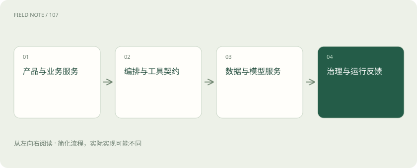
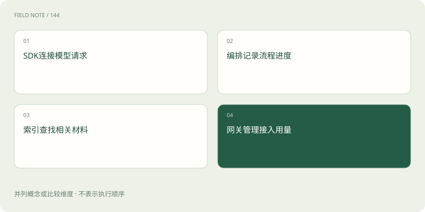
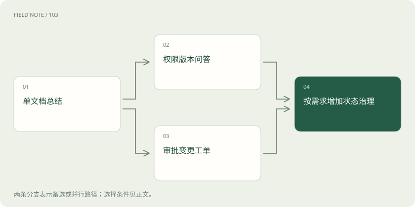

# 把企业 AI 栈放回职责地图：从 Java 应用到模型运行时

> 根据场景组合 SDK、工作流、数据服务、网关与推理设施，避免把不同层的工具当成替代品。

专题：行业技术栈 · 整理于 2026-11-04

## 前置阅读

- [AI 技术栈全景：市场上这些工具分别卖什么？](industry-stack.md)
- [vLLM、批处理、并行与 Kubernetes 各管什么？](serving-stack.md)
- [推理网关：为什么企业不直接调用模型？](gateway.md)

## 先用一个类比理解

像建设一家医院：挂号、诊疗流程、病历库、药房与设备各有职责，统一品牌不能消除交接契约。

类比只帮助建立直觉，不等同于完整机制。

## 一图看懂

## 从业务边界开始画图

企业 AI 系统首先仍是业务系统：用户身份、订单权限、审批和事实记录有自己的权威来源。模型可以组织语言或提出动作，但不能因为生成了一段“已审批”就更新审批事实。架构图应先标出用户入口、业务服务和外部副作用，再把检索与模型放入其中，避免把所有流程都塞进一个聊天组件而失去责任边界。

## 用 Java 类比理解 SDK

模型 SDK 类似访问远程服务的客户端库，负责请求对象、认证、连接、流式事件和错误映射；它不等于整个应用框架。Java 服务可以通过 HTTP 或相应客户端调用模型，也可以独立完成提示词组装与工具控制。只有一次受控生成的任务，直接 SDK 加业务服务通常已经清楚，不必为了“AI 架构完整”再叠加复杂编排。

## LangChain 负责组合抽象

LangChain 提供模型、工具、中间件和智能体等组合能力，可类比应用中的适配层与流程辅助库，但类比不是一一对应。它帮助统一调用和减少重复装配，却不替你定义订单权限、数据新鲜度或正确答案。框架版本也会变化，应按当前接口和真实任务决定采用范围，不能把一个旧教程中的模块清单当成永久架构标准。

## LangGraph 负责状态流程

LangGraph 更接近有共享状态、节点和边的编排运行时，支持长任务、检查点和人工中断等需求。它与 LangChain 可以组合，但不是数据库、消息队列或模型引擎的替代品。若 Java 团队已有可靠工作流引擎，也可让业务编排留在现有系统，只把需要模型决策的步骤封装成受控服务，减少跨语言状态和运维边界。

## Dify 是应用搭建与运营平台

Dify 提供可视化工作流、模型接入、知识与应用发布等能力，适合让配置与迭代进入统一界面。它可以作为某些应用的交付平台，但平台内置能力不意味着企业的权限、审计和业务接口已经自动接好。选型需核对版本、部署方式、扩展点与数据边界；将它与一个客户端 SDK 比较“谁更强”会遗漏两者覆盖范围不同。

## 数据服务按访问模式分工

向量数据库面向嵌入相似度及相关元数据检索；Elasticsearch 可承担词项搜索、过滤和向量检索等职责；Redis 常用于低延迟缓存、计数和临时状态；Kafka 用于持久事件流和异步处理。它们存在功能交集，却不能仅因“都存数据”互相替代。事实主库、索引和缓存还应明确谁是权威，索引延迟与缓存过期不能悄悄改变业务事实。

## 引擎与网关在不同位置

模型引擎负责把权重运行在硬件上，处理批次、显存、KV 和生成调度；网关负责应用到模型服务之间的认证、配额、预算、路由及用量治理。一个网关可以路由到托管 API 或自建引擎，自建引擎也可以由多个应用共享。网关不会凭空增加模型能力，引擎吞吐优化也不会自动满足租户权限和财务对账。

## 场景一：固定文档总结

若用户上传一份可访问文档并要求摘要，可组合 Java 业务服务、文档解析、模型 SDK 和必要网关，文件与任务状态落在已有存储。没有跨文档检索需求时，不必先建设向量库；没有长任务恢复需求时，不必先引入智能体图。验收重点是解析完整性、摘要忠实度、权限、长度限制和失败处理，简单组合更容易定位责任。

## 场景二：企业政策问答

知识跨文件、需要版本和权限时，增加受治理的入库链路与检索索引，可能用 Kafka 解耦解析任务，用 ES 或向量库检索，用 Redis 缓存经过权限约束的结果。编排层组织召回、重排和证据回答，网关统一模型调用。是否同时部署 ES 和独立向量库取决于检索能力、规模与运维成本，不是 RAG 的必选仪式。

## 场景三：可执行运维工单

需要监控查询、诊断、审批和变更恢复时，状态工作流与幂等业务接口成为关键，可采用 LangGraph、Dify 工作流或已有企业编排系统。模型仅在需要解释或选择时参与，确定规则留给执行层。Kafka 适合传递事件，不自动提供整个业务事务；Redis 中一段聊天历史也不能替代有动作意图、回执与审批绑定的持久执行记录。

## 评测与观测横跨所有层

评测定义任务成功与关键错误，观测记录一次请求在解析、检索、模型和工具各段发生什么。它们应关联组件版本、数据快照、资源成本与业务结果。复杂组件会增加升级、监控、容量和故障协调成本，因此选型最后要回答：新增组件解决哪项已测到的限制，替代什么现有责任，故障时由谁接管，以及删除它后系统会失去哪项能力。

## 图解：Java 责任映射

这是职责类比，不表示API、语言或产品完全等价。

## 图解：三场景递增

不是每个场景都要部署全部组件。

## 放在一起对比

| 组件或环节 | 负责什么 | 不能替代什么 |
| --- | --- | --- |
| SDK | 远端调用与事件处理 | 业务流程与权限 |
| LangGraph | 有状态流程和恢复 | 数据库及业务事务 |
| Dify | 应用搭建和运营 | 所有企业治理职责 |
| ES或向量库 | 相关材料检索 | 权威业务主库 |
| 网关与引擎 | 接入治理与实际计算 | 彼此不同职责 |

## 真实场景

一个 Java 团队已有 ES、Kafka 和审批系统，要新增政策问答与只读故障诊断。可以先复用 ES 的检索能力与已有授权服务，通过 SDK 调用模型；只有在验证需要长任务恢复和人工中断后再引入状态编排。组件复用也要重新验收权限和索引新鲜度，不能把“已经部署”当作“已经适用”。

## 常见误区

产品名称多不等于架构成熟。把 SDK、工作流平台、向量库和推理引擎画成同一排候选，会诱导跨职责替换，最终把缺失责任藏进模型提示词。

## 想一想

有了 Dify 是否就不需要网关与模型引擎？

查看解释

取决于采用的平台能力和部署边界。应用平台可集成部分接入治理；自建模型仍需运行时，企业统一预算与授权也可能需要独立网关。

## 关联阅读

- [让每个结论都有边界：RAG 的证据责任](deep-rag-evidence.md)
- [智能体不是连续聊天：一张服务工单的状态旅程](deep-agent-state.md)
- [一份能够指导决策的评测集怎样建立](deep-eval-design.md)

## 原始资料

- [LangChain overview](https://docs.langchain.com/oss/python/langchain/overview)
- [LangGraph overview](https://docs.langchain.com/oss/python/langgraph/overview)
- [Dify official repository](https://github.com/langgenius/dify)
- [Apache Kafka introduction](https://kafka.apache.org/intro)
- [vLLM official documentation](https://docs.vllm.ai/en/latest/)

原创讲解；图示和类比经过简化，数字示例不代表实测。工具功能以对应版本官方资料为准。
