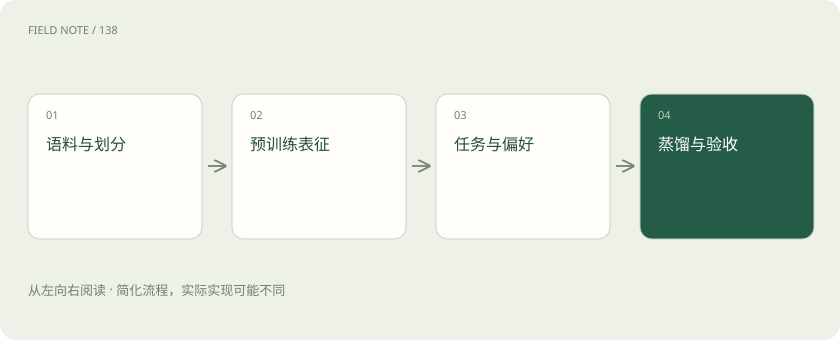
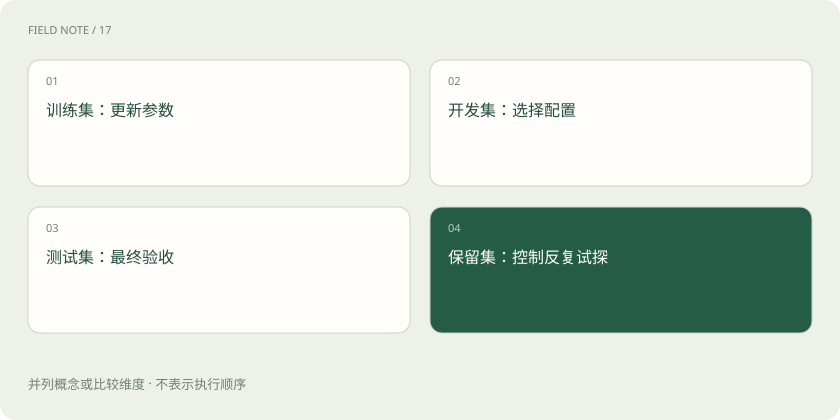
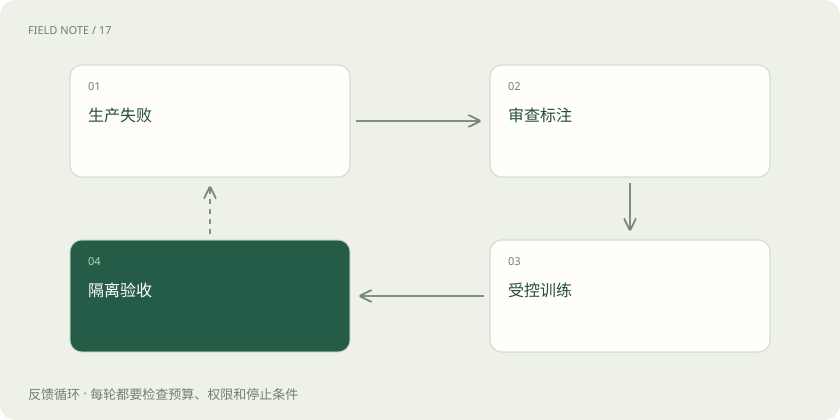

# 从原始语料到可发布模型：训练是一条受约束的生产线

> 把数据、目标函数、适配方式与发布判断连接起来。

专题：训练与对齐 · 整理于 2026-11-04

## 前置阅读

- [训练、微调与推理：学习和使用是两回事](training-inference.md)
- [训练数据质量：先修教材再加课时](data-quality.md)
- [LoRA 与 QLoRA：少改参数也能学习](lora-qlora.md)

## 先用一个类比理解

训练像编写并校验一本参考书：材料选择、练习设计和验收规则共同决定成品。

类比只帮助建立直觉，不等同于完整机制。

## 一图看懂

## 先确定要改变什么

如果问题是公司政策昨天更新，训练参数通常不是最快的事实更新通道；如果问题是模型长期不按固定字段回答，监督微调可能更直接。项目开始应写出目标行为、允许误差、数据权限与推理预算。没有这份约束，训练损失下降也无法证明业务问题被解决。

## 语料不是越多越好

原始网页、对话和文档要经过授权核对、去重、质量筛选及敏感信息处理。重复内容会改变样本权重，少数重复模板可能压过真正需要的长尾场景。清洗同时有代价：过强过滤会移除方言、少数群体表达或难题，因此应保留过滤前后分布报告，抽查被删样本，而不是只统计剩余字数。

## 先分组再划分

同一文档的不同段落、同一用户的近似问题、同一事件的多篇报道，都可能彼此泄漏。先按来源、事件或时间建立组，再分训练、验证和测试集合。验证集服务于反复选配置，测试集用于最终判断；如果根据测试失败逐次修改训练数据，这个测试集已经开始承担开发集角色，需要另设保留集。

## 预训练为什么能迁移

自回归预训练常以预测后续 Token 为目标，通过误差反向传播更新参数。为了在多种语境预测，模型可能学到语言结构、事实关联与任务模式，但目标仍不是直接优化每项业务正确率。训练损失是多个位置的平均数，高频普通文本改善可以掩盖稀有关键任务退化，因此要同时观察分领域验证结果。

## SFT 改变任务条件

监督微调使用输入与理想输出示例，让模型学习在特定指令下应该怎样回应。答案质量比统一格式更重要：把错误答案整理得很漂亮仍会训练错误行为。对于客服，应覆盖证据不足时澄清、无法处理时转人工等分支；只给成功案例，会让模型误以为每次都必须直接给出肯定结论。

## LoRA 是更新方式

全参数微调更新大量权重；LoRA 对选定权重引入低秩增量，降低需要训练和保存的适配参数量。它并非一种独立任务目标，可以用于 SFT 等流程。量化基础权重配合适配器训练还有额外数值与资源权衡。低秩限制可能不适合某些复杂变化，所以应与全参数或更高秩方案进行受控比较。

## 偏好训练如何补足示范

同一个问题可以有多个看似合理的答案，偏好数据记录哪一个更符合要求。RLHF 可以借助奖励模型和强化学习优化，DPO 则通过偏好对直接构造优化目标。偏好标注必须拆清正确性、清晰度与拒答边界；若标注员总喜欢较长答案，模型可能学到冗长，不能把这种偏好提升等同于推理能力提升。

## 蒸馏转移的是可观察行为

较强教师可以产生答案、解释或概率信息供学生学习，但学生受容量、训练覆盖和推理预算限制。教师也会犯错，合成数据应经过独立校验并保留来源。若教师参与生成测试答案，评测又由同一教师偏好决定，闭环容易奖励模仿风格，而非验证真实任务成功。

## 训练后还要算推理账

一个模型通过离线质量门槛之后，还需测量目标硬件上的延迟、内存、并发和总成本。适配器装载方式、量化和上下文长度都可能改变运行表现。假设方案甲每题正确率更高但超出业务超时约束，它不能直接替代方案乙；应比较在相同服务约束下能完成的合格任务，而非单项分数。

## 建立可回溯的模型档案

发布包应关联数据快照、过滤规则、基座版本、训练目标、适配器、评测样本与已知失败。回滚必须能恢复对应提示词和检索配置，否则恢复权重仍可能保留新问题。生命周期的终点不是训练结束，而是上线后发现分布变化、形成新数据，再经过隔离评测进入下一轮。

## 变化应该沿哪条通道进入

事实更新、风格变化与能力迁移对应不同成本。频繁政策更新可走知识库；少量固定格式要求可先用提示词和约束输出；稳定且重复的行为模式再考虑微调。训练不是其他方案失败后的仪式，而是对预期收益、数据和维护成本的选择。

假设每周修改十条制度，而每月只有一次训练窗口，把知识全部写进参数会制造新鲜度缺口；即便模型记住了旧制度，也难以准确指出适用版本。保留检索作为事实通道、让训练改善证据使用行为，通常更容易分别验收两种责任，但具体取舍仍要以任务评测验证。

## 图解：数据隔离

四类数据承担不同角色；按来源或事件分组隔离，任何集合都不应流入保留集。

## 图解：迭代闭环

不是把所有日志自动回灌。

## 放在一起对比

| 方法 | 主要改变 | 核心风险 |
| --- | --- | --- |
| 预训练 | 广泛分布上的参数 | 语料偏差 |
| SFT | 条件行为 | 示范错误 |
| 偏好优化 | 回答取舍 | 偏好捷径 |

## 真实场景

一个政策助手漏掉“试用期员工”例外：先确认政策是否可检索；若材料完整但模型总忽略例外，补充包含正反例与拒答分支的 SFT 数据。将同一政策所有改写放在同一划分组中，再用其他政策验证迁移能力，避免记住这一句就被算作提升。

## 常见误区

训练损失、偏好胜率和业务成功率是不同度量；其中任一个提高都不足以替代另外两个的独立检查。

## 想一想

LoRA 与 SFT 是互斥方案吗？

查看解释

不是。SFT 指数据与监督目标，LoRA 指参数更新的结构，可以组合使用。

## 关联阅读

- [把政策文件变成可追责的知识库](deep-rag-corpus.md)
- [一句话穿过 Transformer：从文字到下一个词](deep-transformer-journey.md)

## 原始资料

- [HF LLM course](https://huggingface.co/learn/llm-course/chapter7/6)
- [PEFT LoRA](https://huggingface.co/docs/peft/main/en/conceptual_guides/lora)
- [DPO paper](https://arxiv.org/abs/2305.18290)
- [Distillation](https://arxiv.org/abs/1503.02531)

原创讲解；图示和类比经过简化，数字示例不代表实测。工具功能以对应版本官方资料为准。
