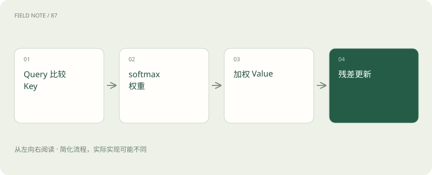
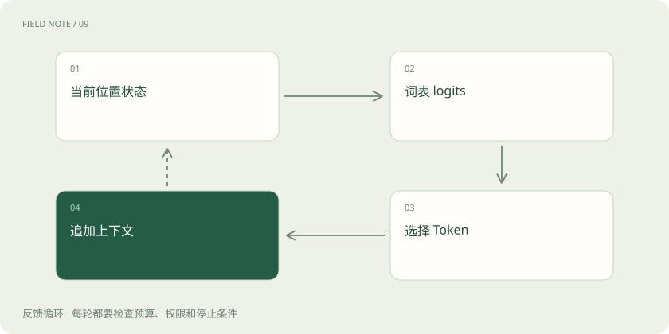

# 一句话穿过 Transformer：从文字到下一个词

> 沿一句话进入模型，看编号、向量、注意力和采样怎样接力产生后文。

专题：模型能力 · 整理于 2026-11-04

## 先说这篇在讲什么

你输入“设备温度过高，请……”，模型怎样继续写出回答？这篇把常见语言模型的一次生成拆开：文字先变成数值，多层计算联系上下文，最后选择下一步内容。我们逐段走过它，不把内部数值误当成存好的答案。

## 先看一个具体例子

如果模型错把旧政策当成新政策，先检查新政策是否真的进入输入。若根本没提供新材料，只把温度调低，可能让旧答案重复得更稳定。

## 遇到陌生概念，可以先读

展开前置阅读建议

- [Transformer、Attention 和 MoE：不看公式也能理解](transformer.md)
- [Q、K、V 与位置：注意力如何读上下文](attention-qkv.md)
- [概率、Logits 与 Softmax：模型“有把握”是什么意思？](probability-softmax.md)

## 先用一个类比理解

像一份笔记经过多轮加工：先把内容记成可计算的表示，再联系前后文，反复更新，最后决定下一步写什么；真实过程是数学计算。

类比只帮助建立直觉，不等同于完整机制。

## 一图看懂

## 先看这一次要生成什么

这里讨论常见的一类语言模型：根据已有内容，逐步生成后续 Token。它不代表所有 Transformer 的所有用途。输入“设备温度过高，请”后，模型先判断下一小段可能是什么；选出后，新内容又进入下一步计算。这样形成整段回答。因此前面一个错误，也可能影响后面的走向。页面一边出字，和服务器如何实际发送数据又是两回事，别把显示节奏当成内部全部步骤。

## 第一步：把文字变成编号和向量

分词器把文字切成 Token，再给出编号；Embedding，也叫嵌入，则让每个编号对应一组数，作为后面计算的起点。编号只是查找位置，100 和 101 不一定比 100 和 900 意思更近。假设这组数长 4096，就是 4096 维；这个数字只是例子。每个位置不是一条独立知识，许多数值共同参与表达内容，之后还会被上下文计算更新。

## 第二步：告诉模型谁在前、谁在后

“甲追乙”与“乙追甲”词一样，含义不同，所以模型需要位置信息。有的做法添加位置向量，有的让位置参与旋转等计算，先知道它们都在表达顺序即可。生成式训练还需要限制查看范围，不能让某个位置看见本该由自己预测的真实后文，这叫因果遮罩。训练时可以同时计算多个位置，但仍要遵守这个规则；所以并行训练不等于偷看答案。

## 第三步：用注意力联系有关内容

当前位置产生 Q，可以先类比“我想找什么”；可见位置提供 K 和 V，分别帮助匹配和提供信息。Q 与 K 比较后，通过 Softmax 换成一组关注比例，再按比例混合 V。若三处比例是 10%、70%、20%，第二处贡献较多，但不是简单把第二个词复制出来。它们混合的是数值信息，后面还要继续处理。Q、K、V 都由计算产生，不是人手写的三张卡片。

## 多个头和多层，为什么都要参与

一个注意力头是一套信息选择和混合的计算。多个头可以采用不同方式，结果组合后再向后传递；不能因此就把某个头永久解释成专管主语的部件。残差连接给原表示保留一条继续传递的路，归一化帮助数值保持适合计算的尺度。小白先把它们理解成防止逐层加工时信息与数值难以控制的设计，而不是把这些名字当成新的智能能力。

## 前馈网络和专家在做什么

注意力让不同位置交换信息，前馈网络则进一步加工每个位置的表示。FFN 就是前馈网络的英文缩写。某些模型使用 MoE，在这一类计算中按路由选择部分专家网络。专家不是独立聊天机器人，而是模型内部的计算模块。选择少数专家可以改变每次实际动用的参数和计算，但如果大家集中使用同一批专家，或者跨设备交换很慢，也会遇到瓶颈。

## 怎样得到候选的分数和比例

最后一层的表示会被换成词表上各候选的分数，叫 logits；词表就是模型可使用的 Token 清单。Softmax 再把分数换成比例。假设只有三个候选，分数为 2、1、0，比例约为 66.5%、24.5%、9.0%。真实计算有更多候选。这个比例说的是模型当前更倾向接哪段内容，不是已经核实某句话有几成正确，缺资料时仍会给出一组比例。

## 选出下一步后，怎样继续

可以直接选最高分，也可以在候选中抽样；温度和 Top-p 会影响抽样方式。选出的 Token 接到已有内容后，再开始下一步。KV 缓存保存部分前文计算结果，让下一步少重复一些工作；它需要显存，也不改变模型参数。参数、当前计算草稿、外部记忆，是三个不同东西。生成更稳定和记住某个用户偏好，都不能仅从 KV 缓存推断出来。

## 把这条链用到真实排错上

如果回答不对，先问关键资料是否进入了输入，再问模型有没有正确联系条件，最后看生成选择是否影响结果。例如把政策里的“仅总部适用”改成“仅分支适用”，其余不变，检查回答是否随之改变。这类成对问题可以观察系统是否利用了正确依据，但不能直接解释每个神经元在想什么。理解整条计算链的价值，是找到该补资料、改训练还是调整输出，而不是凭一个内部数值猜出全部原因。

## 图解：一个位置的计算

这里的流转是向量计算，不是文字片段搬运。

## 图解：生成反馈

新选择改变下一步的条件分布。

## 放在一起对比

| 环节 | 改变对象 | 不能单独保证 |
| --- | --- | --- |
| 检索 | 可见材料 | 正确使用证据 |
| 微调 | 参数与行为倾向 | 知识永不过时 |
| 采样 | 候选选择 | 事实正确 |

## 读完先记住这一句

模型通过多层数值计算逐步生成后文，不是先在参数里找到一段完整原文再抄出来。

## 常见误区

不要把某个向量维度当作固定的人类概念，也不要把注意力比例直接当成全部原因说明。

## 想一想

模型给某个词的比例最高，为什么不代表这句话最可信？

查看解释

这个比例来自训练所得规律与当前输入条件。材料可能缺失或错误，所以最可能接在后面的文字仍可能不符合事实。

## 关联阅读

- [从原始语料到可发布模型：训练是一条受约束的生产线](deep-training-lifecycle.md)
- [从离线分数到线上结果：一次可回滚的发布](deep-eval-production.md)

## 原始资料

- [Attention Is All You Need](https://arxiv.org/abs/1706.03762)
- [Transformers generation](https://huggingface.co/docs/transformers/generation_strategies)
- [Switch Transformers](https://arxiv.org/abs/2101.03961)

原创讲解；图示和类比经过简化，数字示例不代表实测。工具功能以对应版本官方资料为准。
