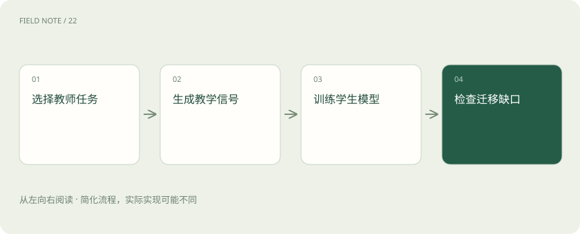

# 知识蒸馏：把老师能力迁移给学生

> 蒸馏让学生模型学习教师的输出或分布，有时也使用中间表示。

专题：训练与对齐 · 整理于 2026-11-04

## 前置阅读

- [文本、多模态、推理模型与开源权重，怎么区分？](model-choices.md)

## 先用一个类比理解

像老师把解题经验整理给学生，学生容量仍决定能学到多少。

类比只帮助建立直觉，不等同于完整机制。

## 一图看懂

## 概念边界

蒸馏让学生模型学习教师的输出或分布，有时也使用中间表示。教师生成的任务答案可以作为学生训练材料，但这只是蒸馏的一种形式，不能把所有合成数据训练都视为能力完整复制。

## 内部怎样运作

学生容量、训练任务覆盖与教师错误共同决定上限。应比较真实业务中的质量、延迟和资源消耗，同时核对教师服务与模型许可是否允许相应用途。某类任务迁移成功不代表其他任务同样成功。

## 把机制放进具体场景

教师擅长解释故障，但学生只见过简短分类标签，那么学生可能学会分类而不会生成完整解释。若部署目标还要求拒绝无依据诊断，教学材料就必须包含这种行为，而不能只保留老师答对的案例。

## 取舍与容易忽略的限制

蒸馏中的教师信号可以比单个正确标签更丰富，但丰富不等于无误。教师在不熟悉领域的自信错误也会被传递，学生还可能因为容量有限只保留容易模仿的表面模式。应明确希望保留的是分类边界、语言风格还是解释能力，再决定收集何种教学材料，而不是笼统追求“接近老师”。

## 真实场景

教师给产品问题附上可靠引用，学生却只学习结论文本，部署后便不能自然继承引用能力。需要在训练目标中保留来源与引用行为。

## 常见误区

小模型学会老师的表达风格，可能仍没有老师处理陌生问题的能力。

## 想一想

蒸馏后学生会获得老师的全部通用能力吗？

查看解释

不会，容量、教学信号和任务覆盖都会限制迁移范围。

## 关联阅读

- [SFT：用示范回答教会任务形式](sft-behavior.md)
- [文本、多模态、推理模型与开源权重，怎么区分？](model-choices.md)
- [评测集怎么分：避免把背过的题当能力](eval-splits.md)

## 原始资料

- [Hugging Face · distillation trainer](https://huggingface.co/docs/trl/en/distillation_trainer)

原创讲解；图示和类比经过简化，数字示例不代表实测。工具功能以对应版本官方资料为准。
