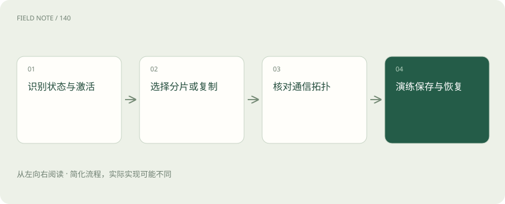
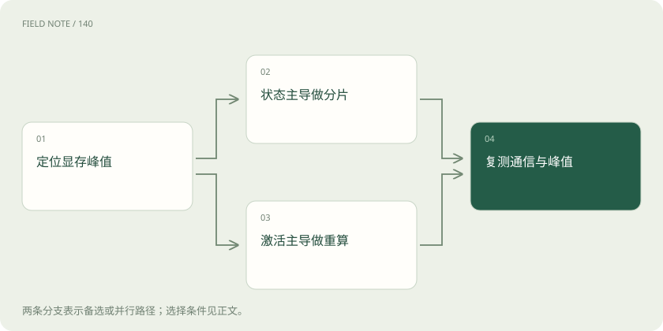

# 分布式训练：把显存、计算与通信拆开看

> 比较 DDP、FSDP、ZeRO 与模型并行，并区分激活重计算和持久化训练检查点。

专题：训练与对齐 · 整理于 2026-11-05

## 前置阅读

- [TP、PP、DP、EP：多张卡究竟分了什么](parallelism-types.md)

## 先用一个类比理解

像多人搬运大型设备：分件、分工与传递路线一起决定能否搬动以及速度。

类比只帮助建立直觉，不等同于完整机制。

## 一图看懂

## 先问单卡为什么放不下

本站教学例子是一支长文档助手团队，原本短问答训练正常，改成长维修手册后出现显存不足。训练显存包括参数、梯度、优化器状态、激活以及临时工作区。不同项目的主导项不同；如果增长主要来自序列变长，单纯增加参数分片不一定解决峰值。

团队应先区分加载阶段、前向、反向、优化器更新与保存阶段的失败位置。加载时失败可能是权重或临时复制，反向时失败可能与激活和通信缓冲有关，保存时失败可能是聚合完整状态。没有这份分类，多卡方案很容易只把同一个瓶颈移动到另一个阶段，并额外增加通信复杂度。

## DDP 复制模型并分配不同数据

分布式数据并行通常让每个参与进程拥有模型副本，处理不同数据，并通过梯度同步维持一致更新。它适合单份模型状态能够放进每张卡、希望增加总体吞吐的场景。多卡不是把每卡显存拼成一个自动扩大的空间，每个副本仍需容纳自己的必要状态。

在长手册案例中，如果单卡连前向都装不下，增加 DDP 副本通常不会直接解决。同步梯度需要网络带宽，较小模型或小批量时通信可能占比很高。还要区分每卡批量、卡数和梯度累积共同形成的有效批量，不能把卡数翻倍后的优化行为变化全部归因于硬件加速。

## FSDP 与 ZeRO 减少状态冗余

ZeRO 分阶段切分优化器状态、梯度和参数，常见阶段一、二、三逐步扩大分片范围。FSDP 也通过状态分片减少每个参与者常驻的完整状态，计算相关模块时需要组织参数与梯度通信。二者不是简单的同名换皮，具体调度、接口和支持组合应按所选版本核验。

它们节省的显存要以额外通信、元数据和临时聚合为代价。参数并非在所有时刻都保持每卡固定的几分之一，计算阶段可能出现局部完整参数和缓冲区。对长手册任务，状态分片提供的空间可能被更长激活用掉，因此需要同时考虑包装粒度、预取和激活策略，而不是只比较静态分片公式。

## TP 与 PP 切的是模型计算

张量并行 TP 把某些层内部的大矩阵计算切到多个设备，通常需要频繁的集体通信，因而依赖高带宽低延迟互联。流水线并行 PP 把不同层安排到不同阶段，通过微批在阶段间流动；它可能减少每卡层数，却引入流水线空泡、负载不均和调度复杂度。

两者可以与数据并行组合，但拓扑安排很关键。把需要频繁通信的 TP 跨越较慢节点，可能让算力空等；PP 阶段层数相同也不保证耗时相同，因为嵌入、注意力和输出层负载不同。长手册案例应观察实际阶段耗时与传输，而不能以卡数或理论总算力推导必然线性加速。

## EP 关注专家路由与负载

专家并行 EP 常用于混合专家模型，把不同专家分布在不同设备，词元按路由结果发送到对应专家。稀疏激活减少每个词元参与的专家计算，却不意味着全部专家权重消失，也不意味着通信免费。路由集中会让少数设备拥塞，其他设备等待，出现显存与耗时的不均衡。

维修文档如果大量集中在同一种结构，路由可能与一般文本不同。团队需要核查专家负载、跨设备词元传输与容量策略，有的设置还可能丢弃或重新分配超额词元。EP 不能直接应用于任何普通稠密模型并期待相同收益，它依赖模型结构及训练系统的联合支持。

## 激活检查点用重算换显存

激活检查点又称激活重计算，它不保存所有中间激活，而在反向需要时重新执行部分前向计算。这样降低保留激活的显存，代价是额外计算，并可能与随机性、数值行为和通信调度产生交互。它不减少模型参数数量，也不是把训练进度保存到磁盘。

长手册案例中，这一方法可能更直接地针对序列相关激活峰值。但重算范围过大可能显著拖慢吞吐，重算中再次触发参数通信还会改变整体成本。应在同样长度与批量条件下比较峰值显存和每步时间，而不是只记录“能够运行”。能放下只是约束满足，未必是预算下最优方案。

## 持久检查点是故障恢复资产

训练检查点通常保存模型状态，还可能包括优化器、调度器、随机状态和数据进度，使中断后继续训练。分布式检查点让各参与者协同保存分片，恢复时是否支持不同卡数或分片布局，取决于具体格式与工具能力。它解决持久化问题，与反向时的激活重计算属于不同层次。

完整恢复需要验证数据是否重复或跳过、学习率是否接续以及所有必要状态是否齐全。只导出推理权重可以用于部署，却往往不足以复原训练轨迹。保存也会占用时间、存储与临时内存，应估算保存频率和可容忍重做量；从未演练读取的检查点不能被当作已经验证的恢复能力。

## 选型依据是可测瓶颈与恢复要求

对模型状态主导的 OOM，可评估分片；对激活主导的峰值，可评估长度、批量与重计算；对算子临时工作区、碎片和保存峰值，应分别定位。若通信已经成为主导，进一步分片可能降低速度。CPU 或存储卸载能扩展可用空间，也可能把瓶颈转移到总线与输入输出。

最终方案要同时报告每步时间、有效吞吐、峰值显存、网络利用与恢复结果。教学例子不提供虚构跑分，也不要求读者执行训练。读者应能判断一份方案为什么适合当前模型和硬件，以及当序列、节点数量或网络改变时哪些结论需要重新验证，而不是记住“卡越多就越快”。

## 图解：两类检查点各管什么

四格分别呈现两类机制与代价，不表示先后关系。

## 图解：OOM 定位后的两条路线

两条路线可以组合，最终必须复测整体代价。

## 放在一起对比

| 选择 | 机制或收益 | 限制与核验 |
| --- | --- | --- |
| DDP | 复制模型并同步梯度 | 单卡仍要容纳副本 |
| FSDP与ZeRO | 切分训练状态 | 额外通信与瞬时聚合 |
| TP与PP | 切层内计算或层间阶段 | 互联与负载约束 |
| EP | 跨设备分配专家 | 路由负载与词元通信 |

## 真实场景

本站教学例子：长手册导致反向峰值上升，团队应先核查激活；DDP 增加副本不会自动合并各卡显存。

## 常见误区

把激活检查点与磁盘训练检查点混为一谈，会同时误判显存收益和故障恢复能力。

## 想一想

为什么参数已经分片，保存阶段仍可能发生 OOM？

查看解释

若保存路径聚合完整状态或创建额外副本，瞬时内存可能远高于常驻分片占用。

## 关联阅读

- [TP、PP、DP、EP：多张卡究竟分了什么](parallelism-types.md)

## 原始资料

- [PyTorch：FSDP2 入门与机制](https://docs.pytorch.org/tutorials/intermediate/FSDP_tutorial.html)
- [DeepSpeed ZeRO](https://www.deepspeed.ai/tutorials/zero/)
- [PyTorch 分布式检查点](https://docs.pytorch.org/docs/stable/distributed.checkpoint.html)
- [PyTorch 激活检查点](https://docs.pytorch.org/docs/stable/checkpoint.html)

原创讲解；图示和类比经过简化，数字示例不代表实测。工具功能以对应版本官方资料为准。
