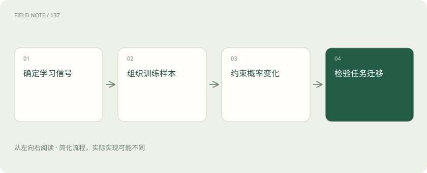
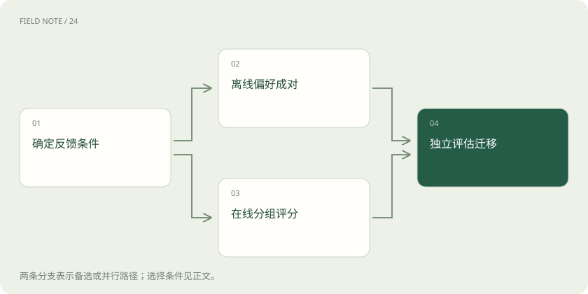
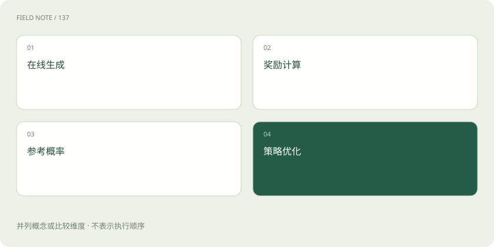

# DPO与GRPO：偏好对与在线分组的两条路线

> 理解直接偏好优化与分组相对策略优化的数据、信号和失效边界。

专题：训练与对齐 · 整理于 2026-11-05

## 前置阅读

- [强化学习基础：奖励如何改变策略](rl-reward-policy.md)
- [DPO、RLHF、GRPO：怎样学习回答偏好](preference-alignment.md)

## 先用一个类比理解

水箱比例题可预先标注正确与错误解答对，也可在线生成一组解答后按规则评分。

类比只帮助建立直觉，不等同于完整机制。

## 一图看懂

## 先问训练数据从哪里来

DPO与GRPO都能用于后训练，但它们组织经验的方式不同。标准离线DPO读取已经收集的提示、较优回答和较差回答；典型GRPO在训练中让当前策略对同一提示生成一组新回答，再得到奖励。离线指更新时使用既有数据，不表示数据最初不能由模型生成，也不表示数据永远不能重新收集。

本章用分数应用题贯穿比较：水箱原有一半水，再注入总容量的四分之一，最后应有四分之三。离线数据可以预先保存正确和错误解答；在线路线则让当前模型当场给出若干解法。两条路线首先面对的数据分布就不同，因此不能只比较损失函数名字而忽略候选是谁产生的。

## DPO直接学习成对偏好

DPO利用带KL正则的奖励最大化问题与最优策略之间的关系，把偏好学习转为策略概率比的分类目标。直观上，它提高较优回答相对较差回答的偏好程度，同时以参考模型的概率作为比较基准。训练标准DPO不需要先拟合一个单独奖励模型，也不需要在每次更新时从策略采样完整新回答。

水箱例子中，较优回答正确相加，较差回答把四分之一理解为剩余容量的四分之一。DPO从这对比较中调整整段回答的相对概率，但并没有自动获得每一步错误位置的标签。它也不是把较优文本原样记忆的监督微调：较差回答和参考模型都参与目标，决定成对差异应如何被改变。

## 参考约束与偏好强度要一起理解

DPO中的参考策略提供原有行为的坐标，超参数控制隐式奖励与策略偏移的关系。不能脱离目标定义，把某个超参数简单解释成“越大越强”或“越小越安全”。改变它会改变分类间隔对应的概率调整尺度，实际结果还受优化步数和数据分布影响。

如果水箱数据中的较优回答总是冗长、较差回答总是简短，模型可能把长度当成偏好线索。参考约束不会神奇地消除这种混杂。应加入长度相近但数学质量不同的回答对，并检查模型在不同措辞、不同分母和反向求容量的问题上是否改善。偏好对必须让真正希望学习的差异具有可辨识性。

## GRPO以同题分组形成相对信号

DeepSeekMath提出的GRPO属于PPO路线的变体。它对同一问题采样多条输出，为每条输出评分，并用组内奖励形成相对优势，避免依赖与策略规模相近的独立价值模型。原始结果监督形式可将奖励减去组均值，再按组标准差归一化；具体实现和后续变体会调整这些细节。

水箱题的一组答案可以是四分之三、八分之五、四分之一和四分之三。结果验证器给正确答案较高奖励，相对信号使正确样本比同组错误样本更受鼓励。这里的“相对”不是人类必须把所有回答逐一排序，而是从奖励数值构造训练基准；奖励既可以来自规则，也可以来自模型或组合评价。

## 在线更新依赖新旧策略概率比

GRPO并不是对高分样本简单复制。其优化沿用策略概率比与剪裁思想，结合相对优势对已采样输出进行更新，并可使用参考策略KL项约束漂移。采样策略与更新中的当前策略需要区分：对同一批数据做多次优化后，两者会逐渐偏离，不能把陈旧轨迹无限重复当作新鲜在线经验。

水箱题若采样时正确答案极少，一次更新可能增加这些路径的概率；下一轮重新采样才能观察新的错误分布。组规模增加会提高生成费用，也不保证奖励排序更准确。省去价值模型降低的是某部分资源开销，在线生成、奖励计算、参考概率和策略训练仍需资源，因此不能直接推断GRPO训练总成本必然更低。

## 分组没有差异时学习信号受限

若同组回答全对或全错，简单结果奖励可能完全相同，组内中心化优势缺少区分信息。全错组尤其常见于超出模型能力的题目。增加格式奖励可能让分数出现差异，但那是在奖励书写形式，未必帮助模型找到正确数学解法。训练应统计各难度题的组内奖励分布，而不只是平均奖励。

水箱题若所有输出都把比例基准理解错，验证器只给零分，组内比较无法指出哪个中间思路更接近答案。可以改善训练课程、题目覆盖或过程监督，但这些都改变了学习设置，必须明确记录。标准差很小时的数值处理也会影响更新尺度，不能把归一化当成无关紧要的实现细节。

## 两条路线会以不同方式利用漏洞

离线DPO的风险是训练对覆盖不足、偏好标签错误及数据与当前策略不匹配；GRPO的风险则突出表现为当前策略主动探索奖励漏洞。若水箱评分器只抽取回答末尾的分数，模型可能在错误推导后附上猜中的结果。结果得分提高不意味着推导已经可靠，格式通过也不意味着任务成功。

可以构造反例检查奖励：无推导的正确答案、正确推导但答案格式不同、明显矛盾却含有正确分数字符串。对DPO则要核对成对标签是否偏好事实正确而非语气坚定。两者都需要独立测试集，但针对的故障路径不同；用同一套笼统“对齐风险”描述会掩盖应该修复的数据环节。

## 选择方法需要对齐反馈条件

当已有可信的成对偏好数据，且在线生成与打分昂贵，离线DPO是合理的候选。当任务有可重复调用的奖励并希望策略持续探索新输出，GRPO提供另一条路线。这里是根据反馈条件选择方法，而不是给两种算法排普遍高低。开放写作的偏好与数学答案的规则奖励，监督性质明显不同。

最终比较应固定基础模型、训练题范围和评价预算，另外记录采样成本与标注成本。在水箱问题的未见变式上，检查单位、比例基准、无关信息与解释一致性，才能判断学习是否迁移。DPO是由偏好目标推导的直接优化方法，GRPO是在线分组相对策略优化；共享对齐目的不等于它们具有相同训练循环，更不意味着DPO就是PPO。

## 图解：两条后训练路线

依据反馈条件选择离线成对偏好或在线分组评分，分别训练后回到独立任务评估。

## 图解：GRPO的四个资源部分

省去独立价值模型不等于没有训练成本；在线生成、奖励、参考概率和优化仍需计量。

## 放在一起对比

| 机制 | 提供什么 | 不能保证什么 |
| --- | --- | --- |
| 离线DPO | 既有偏好对 | 自动覆盖新策略错误 |
| 在线GRPO | 当前策略分组采样与奖励 | 无差异组也有正确性信号 |
| 参考约束 | 约束相对行为漂移 | 消除奖励漏洞 |

## 真实场景

水箱比例题可预先标注正确与错误解答对，也可在线生成一组解答后按规则评分。

## 常见误区

把DPO说成省略名字的PPO，或认为GRPO无需奖励设计。

## 想一想

一组答案全部错误且奖励相同，组内比较能教会正确解吗？

查看解释

简单组内相对奖励没有区分信号，需要检查能力覆盖、题目课程或更有信息的监督。

## 关联阅读

- [强化学习基础：奖励如何改变策略](rl-reward-policy.md)
- [DPO、RLHF、GRPO：怎样学习回答偏好](preference-alignment.md)

## 原始资料

- [DPO原论文](https://arxiv.org/abs/2305.18290)
- [DeepSeekMath与GRPO](https://arxiv.org/abs/2402.03300)
- [TRL DPO](https://huggingface.co/docs/trl/dpo_trainer)
- [TRL GRPO](https://huggingface.co/docs/trl/grpo_trainer)

原创讲解；图示和类比经过简化，数字示例不代表实测。工具功能以对应版本官方资料为准。
