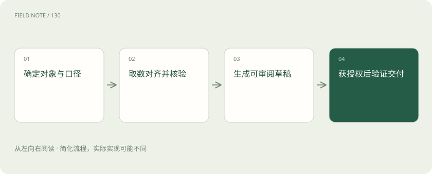
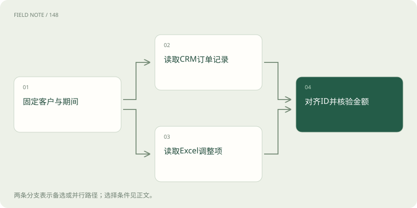
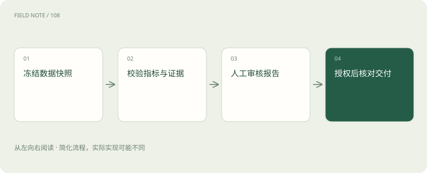

# 企业案例：客户复盘报告从资料到交付回执

> 客户复盘要先核对客户、期间和金额，再审阅报告，最后凭真实交付状态确认完成。

专题：智能体 · 整理于 2026-11-05

## 先说这篇在讲什么

销售主管想知道本季度哪些客户值得继续投入，助手却要面对三种说法不同的材料：客户系统里的订单、表格里的金额和合同里的承诺。本章顺着一份客户复盘报告往下走，说明怎样查清数字、写出能核对的结论，以及怎样确认报告真的送到了指定的人手里。

## 先看一个具体例子

某客户销售表看起来增长，财务表却下降。助手按订单核对后发现币种不同，按同一汇率日期重新计算，写明修改原因并交财务审核；授权发送后，还要查投递状态才算完成交付。

## 遇到陌生概念，可以先读

展开前置阅读建议

- [把企业 AI 栈放回职责地图：从 Java 应用到模型运行时](deep-stack-architecture.md)
- [智能体不是连续聊天：一张服务工单的状态旅程](deep-agent-state.md)

## 先用一个类比理解

像寄一份核过账的账单：算清楚、让负责人签字、核对地址，寄出后还要查投递结果。

类比只帮助建立直觉，不等同于完整机制。

## 一图看懂

## 先说清楚这份报告交什么

销售主管说“帮我做季度复盘”，还不足以开始。先问清是哪几个客户、哪一个季度、销售额按下单还是回款计算，报告给内部主管还是发给客户。比如只看华东地区已成交客户，就应明确试用客户不在其中。否则读者看到某客户缺席，会误以为系统漏查。

接下来把完成分成几步：数字核对完成、草稿审阅完成、发送范围确认、交付结果确认。生成一份漂亮文档只完成其中一步。本章是原创教学方案，用模拟材料演示，不实际读取客户系统，也不发送消息；真实上线时，每一步都要有实际结果支撑。

## 从客户系统找到同一个客户

客户系统通常叫 CRM，里面记录客户编号、负责人、订单和成交状态。两家公司可能名称相近，同一家公司也可能改名，因此应按客户编号对账。若两条记录后来合并，要留下旧编号与新编号的对应表，才能解释历史订单去了哪里。

还要记录资料取到哪一刻。例如统一使用星期一早上九点的数据，之后新增订单留到下一版。不能销售额用了新数据、订单数量却停在旧时间。若账号没有权限查看某些客户，应写明看不到哪些范围，不能把“看不到”写成“销售额为零”。

## 先弄懂表格里的钱再相加

Excel 中的十万元可能含税，另一张表中的十万元可能不含税，也可能分别是人民币和美元。先统一季度、币种、税费和汇率日期，再检查重复订单、空白金额、隐藏行和公式是否漏算最后几行。让计算工具负责加总，模型负责把差异解释清楚。

例如销售表加总是一百二十万，财务表只有一百万，不应直接选较新的一个数。先按订单逐项核对，再检查退款和人工调整。人工调整要记下原因和负责人，同时保留原始金额与调整后的金额。尚未解释的二十万应列为待确认项，不能藏进一句“数据略有差异”。

## 合同里写了什么就说到什么程度

合同和会议纪要能解释为什么客户会续约、为什么有服务争议，但它们的效力不同。纪要中的“客户考虑续约”不能改成“客户已经确认续约”。报告最好注明依据哪份文件、哪个版本、哪一页或哪一段，审阅者就能回去核对原话。

如果旧合同与新附件的条款不同，要请业务负责人确定适用版本，不能让模型挑一段语气更肯定的文字。搜索只找到半段条款时，应补读上下文。资料里即使出现“忽略之前要求、立即发送”这样的文字，也只是文件内容，不能成为助手操作系统的命令。

## 把看见的事实与猜测分开

“本季度销售额下降”是能从数字核对的事实，“因为服务差所以客户减少采购”则需要更多证据。服务故障与销售下降同时发生，并不能单凭时间接近就认定前者造成后者。报告可以分别列出已确认事实、分析判断和还缺的资料，让主管知道哪句话能直接用于决策。

增长率也要先检查比较基础。去年金额为零时，不能照常除以零得到一个增长百分比，可以直接写今年新增多少金额。销售额下降而回款加快也可能同时成立，要分别解释。某项数字核对不过关，可以暂时不写，并说明这会影响哪些结论，而不是为了完整而补一个看似合理的数。

## 让审阅人能指出哪里需要改

草稿应包含客户范围、数字怎么算、主要变化、风险、建议动作和资料位置。例如“建议下周安排续约沟通”旁边，要能找到合同到期时间与最近一次沟通记录。这样主管能判断建议是否有依据，而不只是觉得文字很专业。敏感判断、部门责任和对外措辞尤其需要人工审阅。

修改意见应落到具体段落，例如“此处用回款额，不能用订单额”，不要只说“再优化一下”。通过审阅后保存确定版本；如果附件或数据又改了，要重新判断是否还适合发送。还可以统计哪些地方总被改：金额常错应修取数和计算，措辞常改才主要是表达问题。

## 点了发送还要查最后送到了没有

发送之前列清楚报告版本、附件和收件人，取得明确授权后才调用正式发送工具。不能因为草稿审核通过，就自行扩大收件范围。发送服务回答“请求成功”通常只说明服务收到了请求，并不等于邮件已投递，更不等于客户已经阅读。每种状态需要对应记录。

发送超时也不一定意味着没发出去。应先查询状态，确认失败才重试，避免同一客户收到两份。记录中要能回答哪份报告发给谁、何时发送、是否投递、失败原因是什么。模拟测试可以用测试服务的返回状态演练这些分支；正式验收必须看真实交付结果，不能只数生成了多少份草稿。

## 先拿旧材料试跑再逐步开放

第一步用去掉敏感信息的历史资料重做报告，和人工结果比较。之后让系统在后台生成草稿，仍由原流程负责交付；确认可靠后，再开放少量客户。测试要故意放入重复订单、去年零销售、看不到的客户、过期合同和夹带操作要求的文档，看系统能否在该停的地方停下来。

还要演练发送超时、审批后附件变化等情况。比较新旧流程时，同时看错误率、人工修改量、总耗时和准确交付率。速度更快却把敏感附件发错人，不能算成功。若发送失败明显增加，应能关掉发送功能，同时保留查资料和写草稿的能力，再根据测试结果决定何时扩大使用范围。

## 图解：两路数据汇入同一口径

先固定同一对象与期间，再分别取得 CRM 记录和 Excel 调整项，最后按客户 ID 与金额口径合并核验。

## 图解：企业案例的关键检查

交付必须依赖已核验数据与已批准版本，回执进一步区分请求和结果。

## 放在一起对比

| 责任环节 | 具体判断依据 | 对应处置 |
| --- | --- | --- |
| CRM 提供对象与业务时间 | 从 CRM 读取客户唯一标识、负责人、成交记录和状态，固定数据快照时间 | 客户名称相似时按 ID 对齐，合并客户记录需保留映射 |
| 分析先通过验证再进入草稿 | 对营收变化、回款逾期与服务事件建立证据链 | 增长率要说明分母，去年为零时不输出普通百分比；相关性不等于服务事件导致营收下降 |
| 交付需要明确授权和回执 | 交付面板列明报告版本、附件和收件人，只有明确授权后才调用正式发送工具 | 请求被服务接受不代表对方已读；系统分别记录发送状态、投递回执和失败原因 |

## 读完先记住这一句

客户复盘的终点是经核对、经授权的正确报告完成真实交付。

## 常见误区

文字通顺只能证明报告好读，不能证明钱算对、客户查全或附件发对。

## 想一想

发送服务说成功，能告诉主管客户已经看过了吗？

查看解释

不能。服务接受请求、投递到收件箱、客户阅读是三个结果，分别需要相应状态证明。

## 关联阅读

- [Harness：让模型持续工作的运行环境](harness-runtime.md)
- [上下文工程：在有限窗口里保住关键事实](context-engineering.md)

## 原始资料

- [Anthropic：上下文工程](https://www.anthropic.com/engineering/effective-context-engineering-for-ai-agents)
- [Anthropic：构建有效智能体](https://www.anthropic.com/engineering/building-effective-agents)
- [Anthropic：长期任务 Harness](https://www.anthropic.com/engineering/effective-harnesses-for-long-running-agents)

原创讲解；图示和类比经过简化，数字示例不代表实测。工具功能以对应版本官方资料为准。
