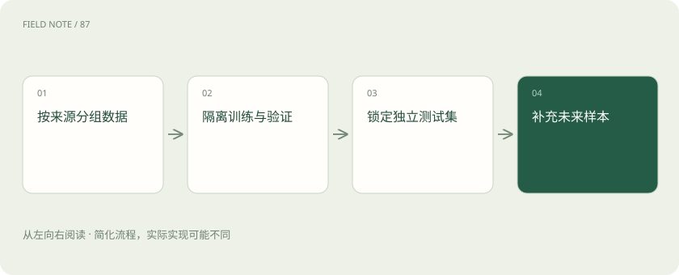

# 评测集怎么分：避免把背过的题当能力

> 学习用的题、挑方案用的题、最后考试用的题，要分开。

专题：评测运行 · 整理于 2026-11-04

## 先说这篇在讲什么

想判断一个学生会不会做陌生题，不能把刚练过的原题再拿来当考试。模型也一样。这篇用“练习、模拟考、最后考试”说明三类数据，帮助你分清分数代表学会了，还是只是熟悉这套题。

## 先看一个具体例子

同一客户连续追问的多个会话若分别落入开发集与测试集，关键背景可能相同。按客户或完整任务分组，比逐条随机切分更能减少这种重叠。

## 遇到陌生概念，可以先读

展开前置阅读建议

- [大模型评测：不要只问排行榜第一是谁](evaluation.md)

## 先用一个类比理解

像考试分开练习卷与保密卷，反复照答案改方案会污染考试。

类比只帮助建立直觉，不等同于完整机制。

## 一图看懂

## 训练集：真正拿来学习的材料

训练时用它比较预测和目标答案，并调整模型参数。这就像平时做练习题。已经用来学习的题，不能再拿它的高正确率证明模型会解决陌生问题。

## 验证集：帮助你挑选方案

训练轮次、提示词写法或处理流程可能有不同选择。验证集用来比较这些方案，像模拟考。你反复观察分数并调整做法，已经在利用这套材料作决定，它当然不能再算完全没见过。

## 测试集：选好方案后再检查一次

测试集用来观察最终方案在独立任务上的表现，像正式考试。如果看完错题又改系统，再重考同一张卷子，成绩改善不一定代表能做新的题。可以保留新的题，或明确说明已经使用过这套题调试。

## 题目不同，也可能偷偷重复

同一份手册的两段近似文字、同一个顾客的几条相似记录，可能看似是不同题，实际信息非常接近。可以按文档、顾客或时间分组，让分开的材料更接近真正的新情况。选择怎样分，要看以后是面对老顾客的新问题，还是完全新的顾客。

## 读完先记住这一句

反复根据最后考卷改系统，会让这张考卷失去独立检查的作用。

## 常见误区

评测集需要代表实际任务分布，同时单列关键困难场景，不能仅收集容易自动判分的题。

## 想一想

测试题没有直接用于训练，就一定独立吗？

查看解释

不一定，近似副本、共享实体及反复依据测试结果调参都会造成污染。

## 关联阅读

- [大模型评测：不要只问排行榜第一是谁](evaluation.md)
- [训练数据质量：先修教材再加课时](data-quality.md)
- [模型裁判：先校准评分，再相信排行榜](judge-calibration.md)

## 原始资料

- [dividing datasets](https://developers.google.com/machine-learning/crash-course/overfitting/dividing-datasets)

原创讲解；图示和类比经过简化，数字示例不代表实测。工具功能以对应版本官方资料为准。
