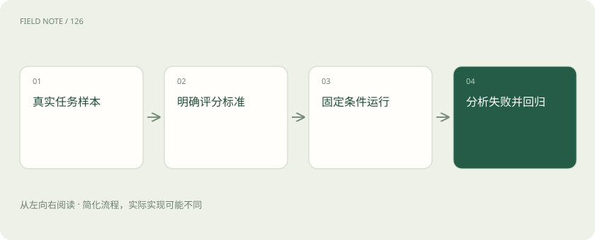

# 大模型评测：不要只问排行榜第一是谁

> 评测就是拿有代表性的任务，按照事先讲清楚的标准，检查模型有没有做好。

专题：评测运行 · 整理于 2026-11-04

## 先说这篇在讲什么

挑模型像挑一位助手：只听别人说“考试第一”还不够，还要看看他能否完成你的具体工作。比如你的需求是查公司政策，就应该拿真实政策问题来试，而不只看数学题成绩。

## 先看一个具体例子

纯教学数字：100 道题中 90 道过关，不足以说明可以上线；如果剩下 10 道全是高风险错误，就需要单独设门槛。

## 遇到陌生概念，可以先读

展开前置阅读建议

- [AI、机器学习、大模型，到底是什么关系？](ai-map.md)

## 先用一个类比理解

挑司机不能只考交规选择题，还要看你常走的路、雨天驾驶与服务要求。通用榜单像统一笔试，业务评测像真实路测。

类比只帮助建立直觉，不等同于完整机制。

## 一图看懂

## 先问：我到底要检查什么

模型考试可以检查语言、代码或数学能力；一个实际助手还要检查资料有没有找到、工具有没有做对事、结果是否及时。例如回答政策问题，需要日期正确、对象适用、引用有根据。这与一段话读起来顺不顺，是不同的检查项。

## 题目要像真实工作，也要包含难情况

可以准备常见问题、容易混淆的问题、资料里没有答案的问题，以及以前答错的问题。若只挑十道最容易成功的题，分数很高也没有多大帮助。不要一边反复改系统，一边把同一套题当作完全陌生的考试；专门留下没参与调试的题更有参考价值。

## 谁来判断答案对不对

明确的数字和格式可以用规则查；复杂解释可能需要人判断，也可以让另一个模型辅助评分。这个评分模型常叫“模型裁判”。它也可能偏爱长答案、被顺序影响或漏看错误，所以要抽一些结果和人工判断比较。真正重要的是评分理由是否符合任务，而不只是得到一个分数。

## 读完先记住这一句

先定义怎样算做好，再选题和评分。

## 常见误区

排行榜分数不是你业务的成功率；模型自己说“我很确定”也不是校准后的置信度。

## 想一想

知识库助手评测为什么要有“资料中没有答案”的题？

查看解释

检查能否拒绝编造，而不是强行给出答案。

## 关联阅读

- [评测集怎么分：避免把背过的题当能力](eval-splits.md)
- [模型裁判：先校准评分，再相信排行榜](judge-calibration.md)
- [线上 A/B：离线高分之后还要看什么](online-ab.md)
- [Recall、MRR 与 nDCG：检索到底好在哪](retrieval-metrics.md)

## 原始资料

- [OpenAI · 评测实践](https://developers.openai.com/api/docs/guides/evaluation-best-practices)
- [EleutherAI · LM Evaluation Harness](https://github.com/EleutherAI/lm-evaluation-harness)

原创讲解；图示和类比经过简化，数字示例不代表实测。工具功能以对应版本官方资料为准。
